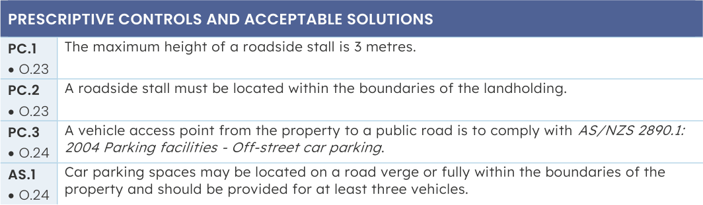

#### 9.2.8. Roadside Stalls

#### Objectives

O.23 To ensure roadside stalls are in keeping with the rural environment and do not distract road users from safe driving practices.

O.24 To ensure access to and from roadside stalls occurs in a safe manner.

> [Picture on page 11: a picture, saved as a picture (images/ch-09-00-rural-and-other-land-uses-page-11-6.gif, 150 dpi).]
> Words printed on the picture (title and legend, copied from the PDF):
> • O.23
> • O.23
> • O.24
> • O.24

#### PRESCRIPTIVE CONTROLS AND ACCEPTABLE SOLUTIONS

The maximum height of a roadside stall is 3 metres.

#### PC.1

A roadside stall must be located within the boundaries of the landholding.

#### PC.2

#### PC.3

A vehicle access point from the property to a public road is to comply with AS/NZS 2890.1: 2004 Parking facilities - Off-street car parking.

#### AS.1

Car parking spaces may be located on a road verge or fully within the boundaries of the property and should be provided for at least three vehicles.
