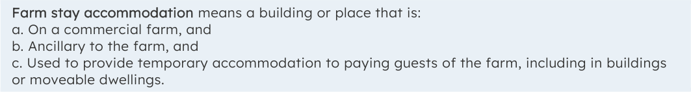
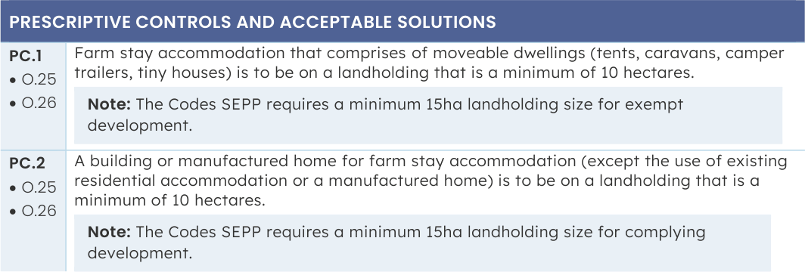
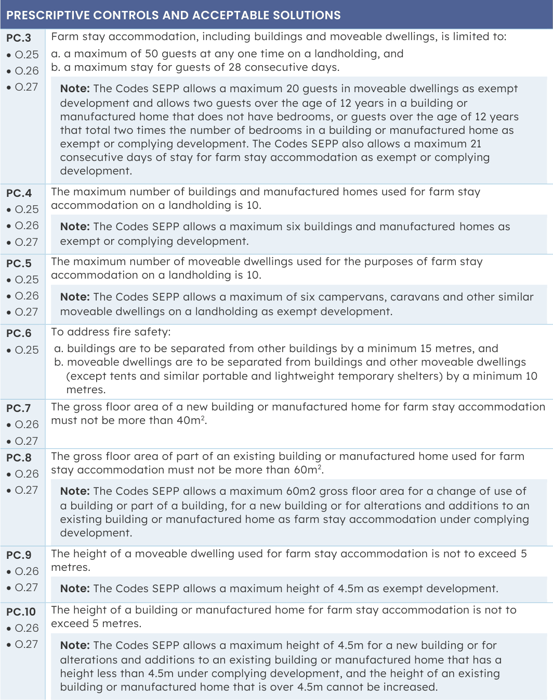
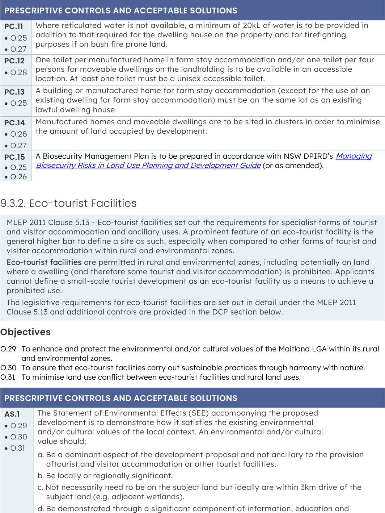

### 9.3. Agritourism

#### 9.3.1. Farm Stay Accommodation

> [Picture on page 11: a picture, saved as a picture (images/ch-09-00-rural-and-other-land-uses-page-11-20.gif, 150 dpi).]

Farm stay accommodation means a building or place that is:

a. On a commercial farm, and

b. Ancillary to the farm, and

c. Used to provide temporary accommodation to paying guests of the farm, including in buildings or moveable dwellings.

#### Objectives

O.25 To diversify the uses of agricultural land for tourist-style accommodation without adversely impacting the principal use of the land for primary production.

O.26 To ensure farm stay accommodation does not detract from existing environmental values, scenic landscape values, infrastructure and adjoining land uses.

O.27 To protect the amenity and privacy of adjoining properties, including visual and acoustic privacy, from farm stay accommodation.

O.28 To provide accessible farm stay accommodation suitable for people with disability or limited mobility.

> [Picture on page 11: a picture, saved as a picture (images/ch-09-00-rural-and-other-land-uses-page-11-35.gif, 150 dpi).]
> Words printed on the picture (title and legend, copied from the PDF):
> • O.25
> • O.26 Note: The Codes SEPP requires a minimum 15ha landholding size for exempt
> development.
> • O.25
> • O.26
> development.

#### PRESCRIPTIVE CONTROLS AND ACCEPTABLE SOLUTIONS

#### PC.1

Farm stay accommodation that comprises of moveable dwellings (tents, caravans, camper trailers, tiny houses) is to be on a landholding that is a minimum of 10 hectares.

#### PC.2

A building or manufactured home for farm stay accommodation (except the use of existing residential accommodation or a manufactured home) is to be on a landholding that is a minimum of 10 hectares. Note: The Codes SEPP requires a minimum 15ha landholding size for complying

> [Picture on page 12: a picture, saved as a picture (images/ch-09-00-rural-and-other-land-uses-page-12-1.gif, 150 dpi).]
> Words printed on the picture (title and legend, copied from the PDF):
> • O.25 a. a maximum of 50 guests at any one time on a landholding, and
> • O.26
> • O.27 Note: The Codes SEPP allows a maximum 20 guests in moveable dwellings as exempt
> • O.25
> • O.26 Note: The Codes SEPP allows a maximum six buildings and manufactured homes as
> exempt or complying development.
> • O.27
> • O.25
> • O.26 Note: The Codes SEPP allows a maximum of six campervans, caravans and other similar
> • O.27
> To address fire safety:
> • O.25 a. buildings are to be separated from other buildings by a minimum 15 metres, and

Farm stay accommodation, including buildings and moveable dwellings, is limited to:

#### PC.3

b. a maximum stay for guests of 28 consecutive days.

development and allows two guests over the age of 12 years in a building or manufactured home that does not have bedrooms, or guests over the age of 12 years that total two times the number of bedrooms in a building or manufactured home as exempt or complying development. The Codes SEPP also allows a maximum 21 consecutive days of stay for farm stay accommodation as exempt or complying development.

#### PC.4

The maximum number of buildings and manufactured homes used for farm stay accommodation on a landholding is 10.

#### PC.5

The maximum number of moveable dwellings used for the purposes of farm stay accommodation on a landholding is 10.

moveable dwellings on a landholding as exempt development.

#### PC.6

|  | b. moveable dwellings are to be separated from buildings and other moveable dwellings |
|---|---|
|  | (except tents and similar portable and lightweight temporary shelters) by a minimum 10 |
|  | metres. |
| PC.7 | The gross floor area of a new building or manufactured home for farm stay accommodation |
| • O.26 | must not be more than 40m2. |
| • O.27 |  |
| PC.8 | The gross floor area of part of an existing building or manufactured home used for farm |
| • O.26 | stay accommodation must not be more than 60m2. |
| • O.27 | Note: The Codes SEPP allows a maximum 60m2 gross floor area for a change of use of a building or part of a building, for a new building or for alterations and additions to an existing building or manufactured home as farm stay accommodation under complying development. |
| PC.9 | The height of a moveable dwelling used for farm stay accommodation is not to exceed 5 |
| • O.26 | metres. |
| • O.27 | Note: The Codes SEPP allows a maximum height of 4.5m as exempt development. |
| PC.10 | The height of a building or manufactured home for farm stay accommodation is not to |
| • O.26 | exceed 5 metres. |
| • O.27 | Note: The Codes SEPP allows a maximum height of 4.5m for a new building or for alterations and additions to an existing building or manufactured home that has a height less than 4.5m under complying development, and the height of an existing building or manufactured home that is over 4.5m cannot be increased. |

> [Picture on page 13: a picture, saved as a picture (images/ch-09-00-rural-and-other-land-uses-page-13-1.gif, 150 dpi).]
> Words printed on the picture (title and legend, copied from the PDF):
> • O.25
> • O.27
> • O.28
> • O.25
> • O.26
> • O.27
> • O.25
> • O.26

#### PC.11

Where reticulated water is not available, a minimum of 20kL of water is to be provided in addition to that required for the dwelling house on the property and for firefighting purposes if on bush fire prone land.

#### PC.12

One toilet per manufactured home in farm stay accommodation and/or one toilet per four persons for moveable dwellings on the landholding is to be available in an accessible location. At least one toilet must be a unisex accessible toilet.

#### PC.13

A building or manufactured home for farm stay accommodation (except for the use of an existing dwelling for farm stay accommodation) must be on the same lot as an existing lawful dwelling house.

#### PC.14

Manufactured homes and moveable dwellings are to be sited in clusters in order to minimise the amount of land occupied by development.

A Biosecurity Management Plan is to be prepared in accordance with NSW DPIRD’s Managing Biosecurity Risks in Land Use Planning and Development Guide (or as amended).

#### PC.15
