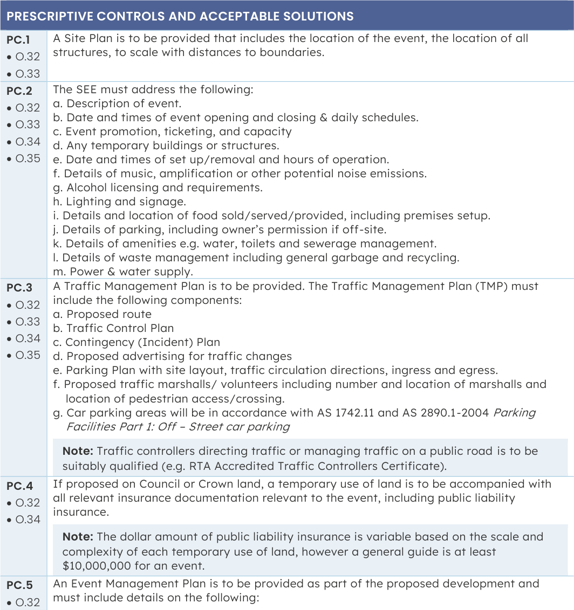
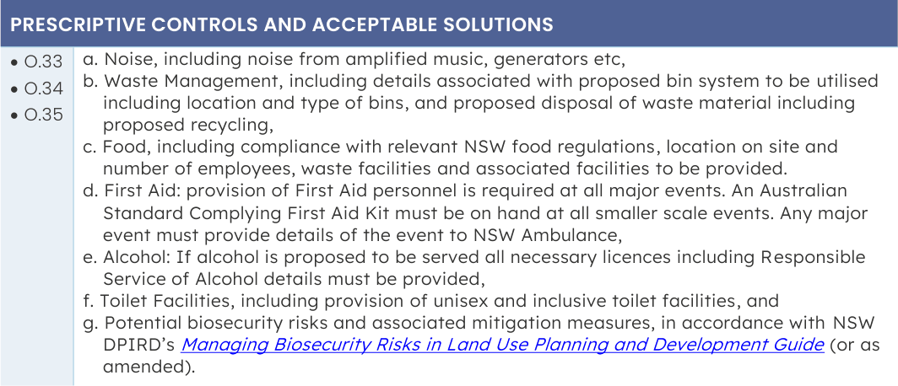

### 9.4. Other Land Uses

#### 9.4.1. Temporary Use of Land

#### Objectives

O.32 To ensure applicants provide adequate information to address a temporary use of land within a development application.

O.33 To provide guidelines for best practice for the appropriate location and management of events. O.34 To ensure public health and safety is maintained during temporary events. O.35 To limit the possibility that an unacceptable impact occurs to the community or local environment.

> [Picture on page 15: a map, saved as a picture (images/ch-09-00-rural-and-other-land-uses-page-15-9.gif, 150 dpi); the street names and other small labels are on the picture.]
> Words printed on the picture (title and legend, copied from the PDF):
> location of pedestrian access/crossing.

#### PRESCRIPTIVE CONTROLS AND ACCEPTABLE SOLUTIONS

#### PC.1

A Site Plan is to be provided that includes the location of the event, the location of all structures, to scale with distances to boundaries.

#### PC.2

The SEE must address the following:

a. Description of event.

b. Date and times of event opening and closing & daily schedules.

c. Event promotion, ticketing, and capacity

d. Any temporary buildings or structures.

e. Date and times of set up/removal and hours of operation.

f. Details of music, amplification or other potential noise emissions.

g. Alcohol licensing and requirements.

h. Lighting and signage.

i. Details and location of food sold/served/provided, including premises setup.

j. Details of parking, including owner’s permission if off-site.

k. Details of amenities e.g. water, toilets and sewerage management.

l. Details of waste management including general garbage and recycling.

m. Power & water supply.

#### PC.3

A Traffic Management Plan is to be provided. The Traffic Management Plan (TMP) must include the following components:

a. Proposed route

b. Traffic Control Plan

c. Contingency (Incident) Plan

d. Proposed advertising for traffic changes

e. Parking Plan with site layout, traffic circulation directions, ingress and egress.

f. Proposed traffic marshalls/ volunteers including number and location of marshalls and

g. Car parking areas will be in accordance with AS 1742.11 and AS 2890.1-2004 Parking Facilities Part 1: Off – Street car parking

Note: Traffic controllers directing traffic or managing traffic on a public road is to be suitably qualified (e.g. RTA Accredited Traffic Controllers Certificate).

#### PC.4

If proposed on Council or Crown land, a temporary use of land is to be accompanied with all relevant insurance documentation relevant to the event, including public liability insurance.

Note: The dollar amount of public liability insurance is variable based on the scale and complexity of each temporary use of land, however a general guide is at least $10,000,000 for an event.

#### PC.5

An Event Management Plan is to be provided as part of the proposed development and must include details on the following:

> [Picture on page 16: a picture, saved as a picture (images/ch-09-00-rural-and-other-land-uses-page-16-1.gif, 150 dpi).]
> Words printed on the picture (title and legend, copied from the PDF):
> • O.33
> • O.34
> • O.35

a. Noise, including noise from amplified music, generators etc,

b. Waste Management, including details associated with proposed bin system to be utilised including location and type of bins, and proposed disposal of waste material including proposed recycling,

c. Food, including compliance with relevant NSW food regulations, location on site and number of employees, waste facilities and associated facilities to be provided.

d. First Aid: provision of First Aid personnel is required at all major events. An Australian Standard Complying First Aid Kit must be on hand at all smaller scale events. Any major event must provide details of the event to NSW Ambulance,

e. Alcohol: If alcohol is proposed to be served all necessary licences including Responsible Service of Alcohol details must be provided,

f. Toilet Facilities, including provision of unisex and inclusive toilet facilities, and

g. Potential biosecurity risks and associated mitigation measures, in accordance with NSW DPIRD’s Managing Biosecurity Risks in Land Use Planning and Development Guide (or as amended).
