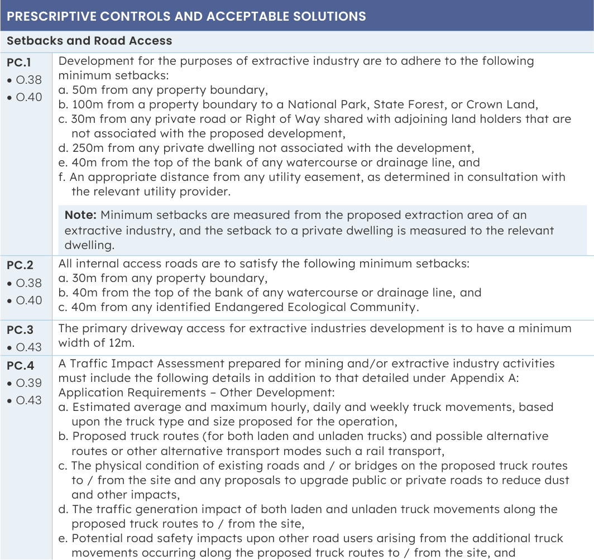
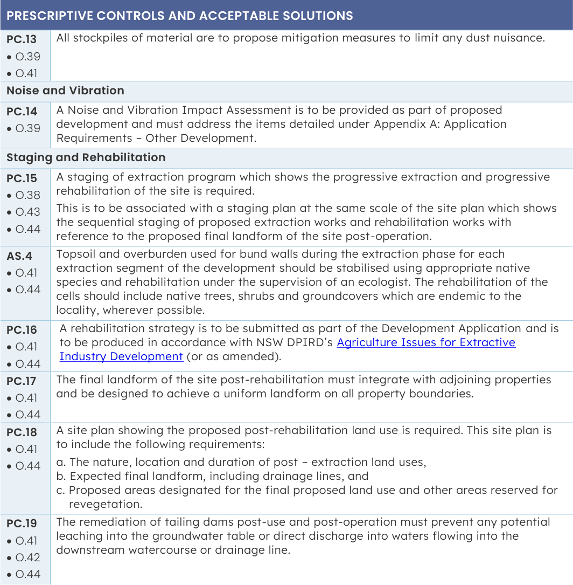

#### 9.4.3. Extractive Industries

#### Objectives

O.38 To ensure that development is designed to minimise risks associated with geotechnical hazards. O.39 To ensure that extractive industries adequately address relevant environmental constraints and hazards.

O.40 To provide an effective barrier between quarrying and mining operations and other sensitive land uses.

O.41 To maintain the character and amenity of existing rural land uses. O.42 To ensure that drainage is naturalised where appropriate and that water quality is maintained at pre-development levels when entering the wider water catchment.

O.43 To facilitate the orderly sequencing of extraction on sites. O.44 To ensure an appropriate rehabilitation program is implemented for extractive industries over the life of their operations.

> [Picture on page 17: a picture, saved as a picture (images/ch-09-00-rural-and-other-land-uses-page-17-14.gif, 150 dpi).]
> Words printed on the picture (title and legend, copied from the PDF):
> • O.38
> • O.40
> the relevant utility provider.
> • O.38
> • O.40
> • O.43
> • O.39
> • O.43

#### PRESCRIPTIVE CONTROLS AND ACCEPTABLE SOLUTIONS

#### Setbacks and Road Access PC.1

Development for the purposes of extractive industry are to adhere to the following minimum setbacks:

a. 50m from any property boundary,

b. 100m from a property boundary to a National Park, State Forest, or Crown Land,

c. 30m from any private road or Right of Way shared with adjoining land holders that are not associated with the proposed development,

d. 250m from any private dwelling not associated with the development,

e. 40m from the top of the bank of any watercourse or drainage line, and

f. An appropriate distance from any utility easement, as determined in consultation with

Note: Minimum setbacks are measured from the proposed extraction area of an extractive industry, and the setback to a private dwelling is measured to the relevant dwelling.

#### PC.2

All internal access roads are to satisfy the following minimum setbacks:

a. 30m from any property boundary,

b. 40m from the top of the bank of any watercourse or drainage line, and

c. 40m from any identified Endangered Ecological Community.

#### PC.3

The primary driveway access for extractive industries development is to have a minimum width of 12m.

#### PC.4

A Traffic Impact Assessment prepared for mining and/or extractive industry activities must include the following details in addition to that detailed under Appendix A: Application Requirements – Other Development:

a. Estimated average and maximum hourly, daily and weekly truck movements, based upon the truck type and size proposed for the operation,

b. Proposed truck routes (for both laden and unladen trucks) and possible alternative routes or other alternative transport modes such a rail transport,

c. The physical condition of existing roads and / or bridges on the proposed truck routes to / from the site and any proposals to upgrade public or private roads to reduce dust and other impacts,

d. The traffic generation impact of both laden and unladen truck movements along the proposed truck routes to / from the site,

e. Potential road safety impacts upon other road users arising from the additional truck movements occurring along the proposed truck routes to / from the site, and

| PRESCRIPTIVE CONTROLS AND ACCEPTABLE SOLUTIONS |  |
|---|---|
|  | f. Assessment of sight distances for trucks entering / exiting the site and at other key intersections along the proposed truck routes to / from the site. |
| Stormwater and Drainage |  |
| PC.5 • O.39 • O.42 | Drainage from sites is to be conducted in accordance with Managing Urban Stormwater: Soils and construction - Volume 1 (the Blue Book). Water discharge is to be directed towards an existing natural watercourse or drainage line on the site, or an off the line sediment basin, and not directly onto any adjoining downstream property (other than within the natural watercourse or drainage line). |
| PC.6 | Drainage measures are to be employed which direct upstream overland run-off to bypass the extraction site and are to be demonstrated as part of the development’s Soil and Water Management Plan (see Section 3.3.3. of Chapter 3: Site Requirements). |
| • O.39 |  |
| • O.42 |  |
| PC.7 | All drainage channels must be designed to convey run-off waters at velocities of less than 1m/second for vegetated channels or 0.4m/second for bare earth channels. |
| • O.39 |  |
| • O.42 |  |
| AS.1 | Topsoil stockpiles over 3m in height are encouraged to be benched to ensure stability and to include internal drains to minimise soil erosion problems. |
| • O.39 |  |
| • O.42 |  |
| AS.2 | Except for detention basins and sediment control dams proposed on site, batter slopes should be no steeper than 1:2 for stable soils or 1:4 for highly erodible soils or lands subject to instability. |
| • O.39 |  |
| • O.42 |  |
| PC.8 | Sediment basins are to be designed in accordance with Managing Urban Stormwater: Soils and construction - Volume 1 (the Blue Book). |
| • O.39 |  |
| • O.42 |  |
| PC.9 | All channels and detention ponds are to be designed to accommodate peak discharge for a minimum 1:20 year average recurrence interval storm event with a 0.5m flood freeboard margin. |
| • O.39 |  |
| • O.42 |  |
| Groundwater and Water Quality |  |
| AS.3 • O.39 • O.42 | The extraction depth should be to an absolute minimum freeboard level of 2m AHD above the wet weather high groundwater level, in order to help protect groundwater flow patterns and water quality on each extraction area. Extraction depths beyond this are to be supported by a Groundwater Assessment that considers any adverse impact, adjoining groundwater users, and incorporates mitigation measures to the satisfaction of Council. |
| PC.10 | A Groundwater Impact Assessment Report is to be provided as part of proposed development and must address the items detailed under Appendix A: Application Requirements – Other Development. |
| • O.39 |  |
| • O.42 |  |
| PC.11 | An Onsite Water Management Plan is to be provided as part of proposed development and must address the items detailed under Appendix A: Application Requirements – Other Development. |
| • O.39 |  |
| • O.42 |  |
| Air Quality |  |
| PC.12 • O.39 | An Air Quality Impact Assessment is to be provided as part of proposed development and must address the items detailed under Appendix A: Application Requirements – Other Development. |

> [Picture on page 19: a map, saved as a picture (images/ch-09-00-rural-and-other-land-uses-page-19-1.gif, 150 dpi); the street names and other small labels are on the picture.]

All stockpiles of material are to propose mitigation measures to limit any dust nuisance.

#### PC.13

#### Noise and Vibration PC.14

A Noise and Vibration Impact Assessment is to be provided as part of proposed development and must address the items detailed under Appendix A: Application Requirements – Other Development.

#### Staging and Rehabilitation PC.15

A staging of extraction program which shows the progressive extraction and progressive rehabilitation of the site is required. This is to be associated with a staging plan at the same scale of the site plan which shows the sequential staging of proposed extraction works and rehabilitation works with reference to the proposed final landform of the site post-operation.

#### AS.4

Topsoil and overburden used for bund walls during the extraction phase for each extraction segment of the development should be stabilised using appropriate native species and rehabilitation under the supervision of an ecologist. The rehabilitation of the cells should include native trees, shrubs and groundcovers which are endemic to the locality, wherever possible.

#### PC.16

A rehabilitation strategy is to be submitted as part of the Development Application and is to be produced in accordance with NSW DPIRD’s Agriculture Issues for Extractive Industry Development (or as amended).

#### PC.17

The final landform of the site post-rehabilitation must integrate with adjoining properties and be designed to achieve a uniform landform on all property boundaries.

#### PC.18

A site plan showing the proposed post-rehabilitation land use is required. This site plan is to include the following requirements:

a. The nature, location and duration of post – extraction land uses,

b. Expected final landform, including drainage lines, and

c. Proposed areas designated for the final proposed land use and other areas reserved for

#### PC.19

The remediation of tailing dams post-use and post-operation must prevent any potential leaching into the groundwater table or direct discharge into waters flowing into the downstream watercourse or drainage line.
