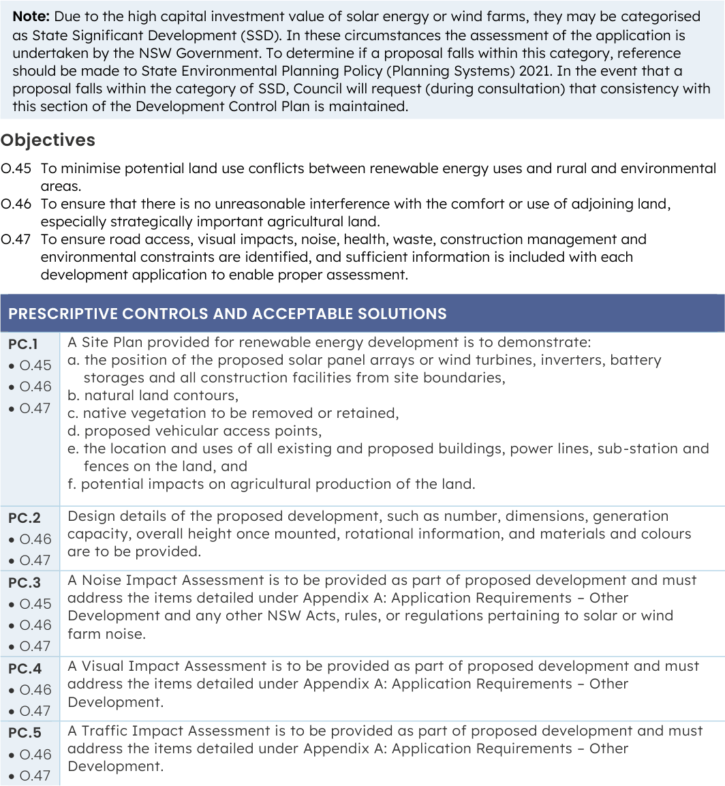

#### 9.4.4. Renewable Energy

> [Picture on page 20: a picture, saved as a picture (images/ch-09-00-rural-and-other-land-uses-page-20-2.gif, 150 dpi).]

Note: Due to the high capital investment value of solar energy or wind farms, they may be categorised as State Significant Development (SSD). In these circumstances the assessment of the application is undertaken by the NSW Government. To determine if a proposal falls within this category, reference should be made to State Environmental Planning Policy (Planning Systems) 2021. In the event that a proposal falls within the category of SSD, Council will request (during consultation) that consistency with this section of the Development Control Plan is maintained.

#### Objectives

O.45 To minimise potential land use conflicts between renewable energy uses and rural and environmental areas.

O.46 To ensure that there is no unreasonable interference with the comfort or use of adjoining land, especially strategically important agricultural land.

O.47 To ensure road access, visual impacts, noise, health, waste, construction management and environmental constraints are identified, and sufficient information is included with each development application to enable proper assessment.

#### PRESCRIPTIVE CONTROLS AND ACCEPTABLE SOLUTIONS

#### PC.1

A Site Plan provided for renewable energy development is to demonstrate:

a. the position of the proposed solar panel arrays or wind turbines, inverters, battery storages and all construction facilities from site boundaries,

b. natural land contours,

c. native vegetation to be removed or retained,

d. proposed vehicular access points,

e. the location and uses of all existing and proposed buildings, power lines, sub-station and fences on the land, and

f. potential impacts on agricultural production of the land.

#### PC.2

Design details of the proposed development, such as number, dimensions, generation capacity, overall height once mounted, rotational information, and materials and colours are to be provided.

#### PC.3

A Noise Impact Assessment is to be provided as part of proposed development and must address the items detailed under Appendix A: Application Requirements – Other Development and any other NSW Acts, rules, or regulations pertaining to solar or wind farm noise.

#### PC.4

A Visual Impact Assessment is to be provided as part of proposed development and must address the items detailed under Appendix A: Application Requirements – Other Development.

#### PC.5

A Traffic Impact Assessment is to be provided as part of proposed development and must address the items detailed under Appendix A: Application Requirements – Other Development.
