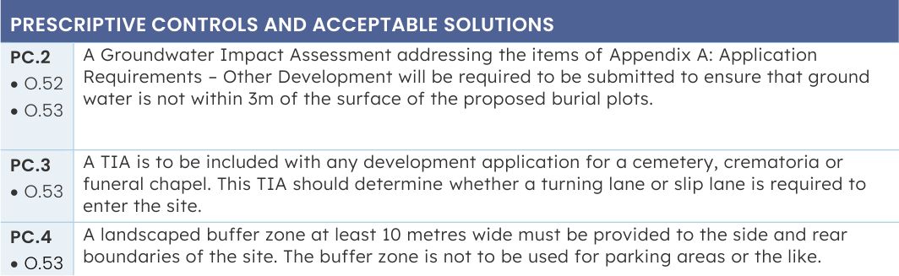

#### 9.4.6. Cemeteries and Crematoriums

#### Objectives

O.52 To ensure that the operation of cemeteries, crematoria and funeral chapels does not have an adverse impact on adjoining land uses and the surrounding area.

O.53 To ensure that uses locate on roads with the capacity to accommodate probable traffic generation.

#### PRESCRIPTIVE CONTROLS AND ACCEPTABLE SOLUTIONS

| PC.1 | Cemeteries and crematoria must be located on a site with a minimum of 10 ha available for |
|---|---|
| • O.52 | burial plots and memorial walls. Landscaped areas, setbacks, parking, driveways and turning areas, internal congregation areas and places of public worship will not be counted towards this minimum site area. |

> [Picture on page 22: a picture, saved as a picture (images/ch-09-00-rural-and-other-land-uses-page-22-1.gif, 150 dpi).]
> Words printed on the picture (title and legend, copied from the PDF):
> • O.52
> • O.53

#### PC.2

A Groundwater Impact Assessment addressing the items of Appendix A: Application Requirements – Other Development will be required to be submitted to ensure that ground water is not within 3m of the surface of the proposed burial plots.

| PC.3 | A TIA is to be included with any development application for a cemetery, crematoria or |
|---|---|
| • O.53 | funeral chapel. This TIA should determine whether a turning lane or slip lane is required to enter the site. |
| PC.4 | A landscaped buffer zone at least 10 metres wide must be provided to the side and rear |
| • O.53 | boundaries of the site. The buffer zone is not to be used for parking areas or the like. |
