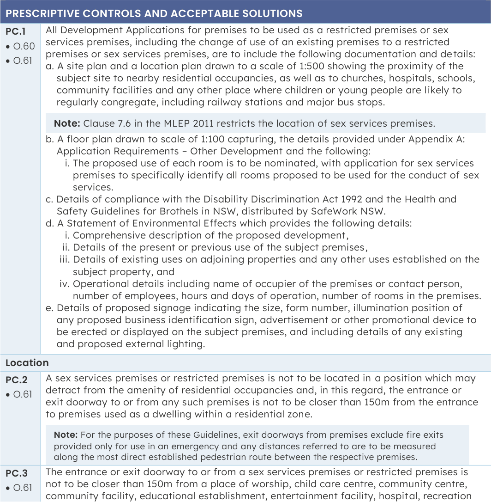

#### 9.4.8. Sex Services Premises and Restricted Premises

#### Objectives

O.60 To nominate location requirements and development standards for sex services premises and restricted premises which reflect broad community attitudes and expectations.

O.61 To provide appropriate guidelines for sex services premises and restricted premises which will ensure that such are at a reasonable distance from residential occupancies and other nominated sensitive land uses and will not cause disturbance or otherwise have a detrimental impact on the amenity of the surrounding neighbourhood.

O.62 To provide appropriate guidelines which will restrict the scale of sex services premises and restricted premises, as well as prevent their concentration in close proximity to one another.

> [Picture on page 24: a picture, saved as a picture (images/ch-09-00-rural-and-other-land-uses-page-24-11.gif, 150 dpi).]
> Words printed on the picture (title and legend, copied from the PDF):
> • O.60
> • O.61
> subject property, and
> • O.61
> Note: For the purposes of these Guidelines, exit doorways from premises exclude fire exits
> provided only for use in an emergency and any distances referred to are to be measured
> along the most direct established pedestrian route between the respective premises.
> • O.61

#### PRESCRIPTIVE CONTROLS AND ACCEPTABLE SOLUTIONS

#### PC.1

All Development Applications for premises to be used as a restricted premises or sex services premises, including the change of use of an existing premises to a restricted premises or sex services premises, are to include the following documentation and details:

a. A site plan and a location plan drawn to a scale of 1:500 showing the proximity of the subject site to nearby residential occupancies, as well as to churches, hospitals, schools, community facilities and any other place where children or young people are likely to regularly congregate, including railway stations and major bus stops.

Note: Clause 7.6 in the MLEP 2011 restricts the location of sex services premises.

b. A floor plan drawn to scale of 1:100 capturing, the details provided under Appendix A: Application Requirements – Other Development and the following:

i. The proposed use of each room is to be nominated, with application for sex services premises to specifically identify all rooms proposed to be used for the conduct of sex services.

c. Details of compliance with the Disability Discrimination Act 1992 and the Health and Safety Guidelines for Brothels in NSW, distributed by SafeWork NSW.

d. A Statement of Environmental Effects which provides the following details:

i. Comprehensive description of the proposed development,

ii. Details of the present or previous use of the subject premises,

iii. Details of existing uses on adjoining properties and any other uses established on the

iv. Operational details including name of occupier of the premises or contact person, number of employees, hours and days of operation, number of rooms in the premises.

e. Details of proposed signage indicating the size, form number, illumination position of any proposed business identification sign, advertisement or other promotional device to be erected or displayed on the subject premises, and including details of any existing and proposed external lighting.

#### Location PC.2

A sex services premises or restricted premises is not to be located in a position which may detract from the amenity of residential occupancies and, in this regard, the entrance or exit doorway to or from any such premises is not to be closer than 150m from the entrance to premises used as a dwelling within a residential zone.

#### PC.3

The entrance or exit doorway to or from a sex services premises or restricted premises is not to be closer than 150m from a place of worship, child care centre, community centre, community facility, educational establishment, entertainment facility, hospital, recreation

| PRESCRIPTIVE CONTROLS AND ACCEPTABLE SOLUTIONS |  |
|---|---|
|  | area or recreation facility or any place where children or young people are likely to regularly congregate, including railway stations or major bus stops. |
| PC.4 • O.62 | An entrance or exit doorway to or from a sex services premises or restricted premises is not to be closer than 150 metres from the entrance doorway to any other sex services premises, or restricted premises. |
| PC.5 | A sex services premises is not to be located within a remote area or an area in which public transport or emergency services are not conveniently to hand. |
| • O.61 |  |
| Scale and Character |  |
| PC.6 | A sex services premises is to be restricted in total floor space, such that no more than 5 rooms in which sex services are to take place can be provided. |
| • O.62 |  |
| PC.7 | The use of a premises as a sexual entertainment establishment is to be restricted in net floor area to an area no greater than 200m2. |
| • O.62 |  |
| PC.8 | Prostitution within an approved sex services premises is to be confined to rooms and areas so nominated on the submitted plans which are the subject of Council’s consent. |
| • O.62 |  |
| PC.9 • O.61 | Any new building or refurbishment of an existing building proposed to function as a restricted premises, or a sex services premises is to be designed to be compatible with the built form of adjoining premises and integrated into the streetscape. |
| PC.10 • O.61 | The entrance to a restricted premises or a sex services premises is to be discrete, safe and unobtrusive with any signage limited to a single business and/or property identification sign only, of modest dimensions, devoid of any sexually explicit or suggestive material, and any distinctive external lighting provided in respect of a brothel is to be limited to a single, low wattage globe. |
| PC.11 • O.61 | A sex services premises or sexual entertainment establishment is to be provided with adequate reception area/waiting room facilities sufficient to discourage clients or prospective clients from loitering outside the premises. |
| PC.12 | Sex industry establishments are not to display sex workers or sex related products from windows, the front door or outside of their premises. |
| • O.61 |  |
| PC.13 | Any proposed building is not to be of a colour or materiality that draws undue attention to the premises. |
| • O.61 |  |
| PC.14 | Sex services premises or restricted premises are not to be located in a building that contains a dwelling. |
| • O.61 |  |
| AS.1 | Sex services premises and restricted premises should generally be small scale and not clustered, so that they integrate with adjoining land uses. |
| • O.61 |  |
| • O.62 |  |
| Security |  |
| PC.15 | Sex services premises and restricted premises are to demonstrate implementation of a range of measures provided with Appendix F: CPTED Guidelines. |
| • O.60 |  |
| Building Standards |  |
| PC.16 | Sexual entertainment establishments involving live shows or the exhibition of films are to satisfy the constructional and fire safety standards for a place of public entertainment under the provisions of the National Construction Code. |
| • O.61 |  |
| PC.17 • O.61 | Access for people with a disability is to be provided in accordance with all relevant legislation, including AS 1428 – Design for Access and Mobility and the Disability Discrimination Act 1992. Major entrances to premises to which the public is entitled to enter need to be designed and constructed to provide equitable treatment of users and meet minimum standards of grade, doorway width and connectivity. |
