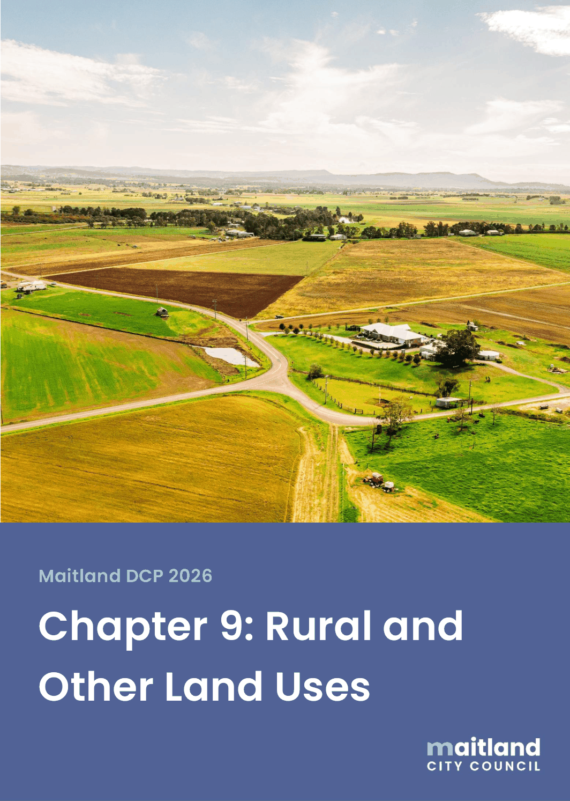

# Maitland Development Control Plan 2026 - Chapter 9 Rural and Other Land Uses

> This chapter is split into 22 section file(s), one per numbered heading, in the order they appear in the PDF.

Source PDF: [MDCP 2026 - Chapter 9 Rural and Other Land Uses.pdf](MDCP%202026%20-%20Chapter%209%20Rural%20and%20Other%20Land%20Uses.pdf)

> [Picture on page 1: a picture, saved as a picture (images/ch-09-00-rural-and-other-land-uses-page-1-1.gif, 150 dpi).]

### Maitland DCP 2026

## Chapter 9: Rural and Other Land Uses

### Table of Contents – Chapter 9: Rural and Other Land Uses

9.1. Introduction .................................................................................................................................................. 3 9.1.1. Application................................................................................................................................................................... 3 9.1.2. Relationship to other Chapters ............................................................................................................................ 3 9.1.3. How to use this Chapter ......................................................................................................................................... 3 9.1.4. Intent of this Chapter .............................................................................................................................................. 4 9.2. Rural Land Uses .......................................................................................................................................... 5 9.2.1. Intensive Agriculture (Livestock and Plants) ................................................................................................... 5 9.2.2. Rural Industries (Turf Farms) ............................................................................................................................... 6 9.2.3. Farm Buildings and Ancillary Structures ............................................................................................................7 9.2.4. Flood Mounds .............................................................................................................................................................7 9.2.5. Farm Dams ................................................................................................................................................................. 8 9.2.6. Garden Nurseries ...................................................................................................................................................... 9 9.2.7. Farm Gate Premises and Farm Experience Premises .................................................................................. 9 9.2.8. Roadside Stalls ......................................................................................................................................................... 11 9.3. Agritourism ................................................................................................................................................. 11 9.3.1. Farm Stay Accommodation .................................................................................................................................. 11 9.3.2. Eco-tourist Facilities ............................................................................................................................................... 13 9.4. Other Land Uses ....................................................................................................................................... 15 9.4.1. Temporary Use of Land ........................................................................................................................................ 15 9.4.2. Animal Boarding and Training Establishments ............................................................................................ 16 9.4.3. Extractive Industries .............................................................................................................................................. 17 9.4.4. Renewable Energy ................................................................................................................................................. 20 9.4.5. Places of Public Worship...................................................................................................................................... 21 9.4.6. Cemeteries and Crematoriums .......................................................................................................................... 21 9.4.7. Exhibition Homes and Villages .......................................................................................................................... 22 9.4.8. Sex Services Premises and Restricted Premises .......................................................................................... 24

<!-- sections -->
## Sections

1. [9.1.1 Application](01-9-1-1-application.md)
2. [9.1.2 Relationship to other Chapters](02-9-1-2-relationship-to-other-chapters.md)
3. [9.1.3 How to use this Chapter](03-9-1-3-how-to-use-this-chapter.md)
4. [9.1.4 Intent of this Chapter](04-9-1-4-intent-of-this-chapter.md)
5. [9.2.1 Intensive Agriculture (Livestock and Plants)](05-9-2-1-intensive-agriculture-livestock-and.md)
6. [9.2.2 Rural Industries (Turf Farms)](06-9-2-2-rural-industries-turf-farms.md)
7. [9.2.3 Farm Buildings and Ancillary Structures](07-9-2-3-farm-buildings-and-ancillary-structures.md)
8. [9.2.4 Flood Mounds](08-9-2-4-flood-mounds.md)
9. [9.2.5 Farm Dams](09-9-2-5-farm-dams.md)
10. [9.2.6 Garden Nurseries](10-9-2-6-garden-nurseries.md)
11. [9.2.7 Farm Gate Premises and Farm Experience Premises](11-9-2-7-farm-gate-premises-and-farm-experience.md)
12. [9.2.8 Roadside Stalls](12-9-2-8-roadside-stalls.md)
13. [9.3.1 Farm Stay Accommodation](13-9-3-1-farm-stay-accommodation.md)
14. [9.3.2 Eco-tourist Facilities](14-9-3-2-eco-tourist-facilities.md)
15. [9.4.1 Temporary Use of Land](15-9-4-1-temporary-use-of-land.md)
16. [9.4.2 Animal Boarding and Training Establishments](16-9-4-2-animal-boarding-and-training.md)
17. [9.4.3 Extractive Industries](17-9-4-3-extractive-industries.md)
18. [9.4.4 Renewable Energy](18-9-4-4-renewable-energy.md)
19. [9.4.5 Places of Public Worship](19-9-4-5-places-of-public-worship.md)
20. [9.4.6 Cemeteries and Crematoriums](20-9-4-6-cemeteries-and-crematoriums.md)
21. [9.4.7 Exhibition Homes and Villages](21-9-4-7-exhibition-homes-and-villages.md)
22. [9.4.8 Sex Services Premises and Restricted Premises](22-9-4-8-sex-services-premises-and-restricted.md)
