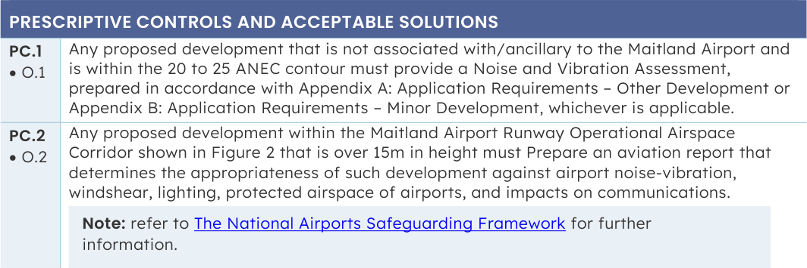
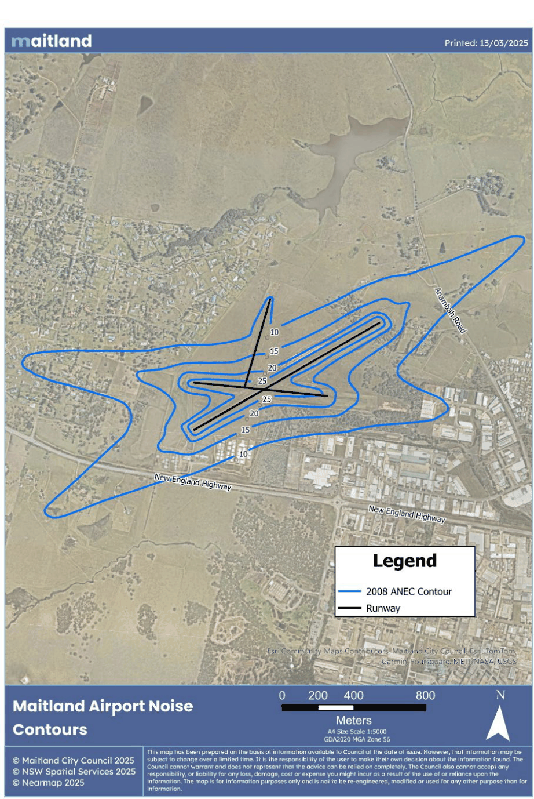
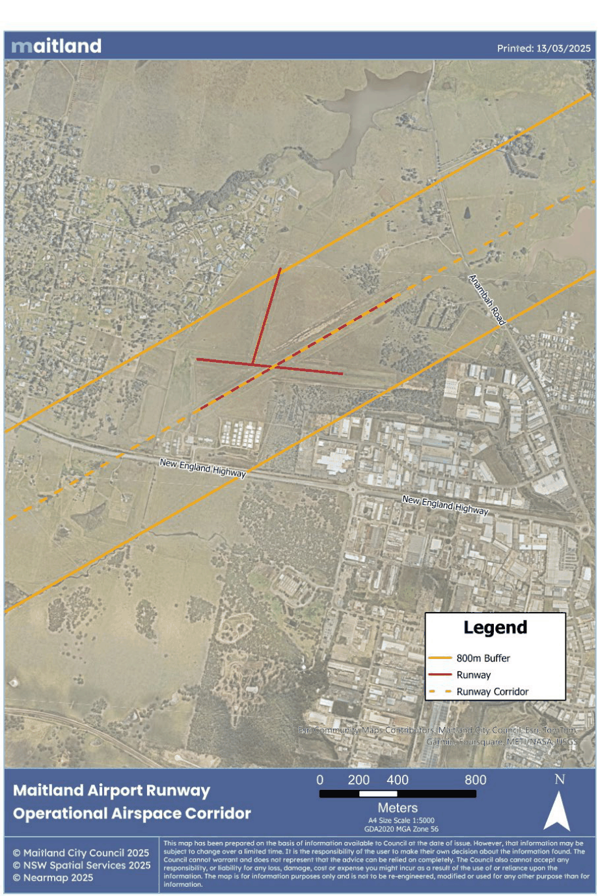

#### 10.2.1. Airports

#### 10.2.1.1. Maitland Airport

Maitland Airport, also known as the Royal Newcastle Aero Club, is a well-established general aviation airport that serves the broader community for origin-destination flights, flight training, recreational flying, aircraft maintenance and also supports a range of emergency services. Consequently, due to its existing approvals and operations, a few additional assessment considerations apply to the land surrounding the Maitland Airport.

#### Objectives

O.1 To ensure that properties exposed to high levels of aircraft noise appropriately assess its impacts

and provide appropriate mitigation measures.

O.2 To ensure that development within the airspace corridor does not limit the flight paths of the

Maitland Airport.

> [Picture on page 5: a picture, saved as a picture (images/ch-10-00-special-precincts-locality-plans-and-urban-release-page-5-19.gif, 150 dpi).]
> Words printed on the picture (title and legend, copied from the PDF):
> • O.1
> • O.2
> information.

#### PRESCRIPTIVE CONTROLS AND ACCEPTABLE SOLUTIONS

#### PC.1

Any proposed development that is not associated with/ancillary to the Maitland Airport and is within the 20 to 25 ANEC contour must provide a Noise and Vibration Assessment, prepared in accordance with Appendix A: Application Requirements – Other Development or Appendix B: Application Requirements – Minor Development, whichever is applicable.

#### PC.2

Any proposed development within the Maitland Airport Runway Operational Airspace Corridor shown in Figure 2 that is over 15m in height must Prepare an aviation report that determines the appropriateness of such development against airport noise-vibration, windshear, lighting, protected airspace of airports, and impacts on communications. Note: refer to The National Airports Safeguarding Framework for further

> [Picture on page 6: a picture, saved as a picture (images/ch-10-00-special-precincts-locality-plans-and-urban-release-page-6-1.gif, 150 dpi).]

#### Figure 10-1: Maitland Airport Noise Contours

> [Picture on page 7: a picture, saved as a picture (images/ch-10-00-special-precincts-locality-plans-and-urban-release-page-7-1.gif, 150 dpi).]

#### Figure 10-2: Maitland Airport Runway Operational Airspace Corridor
