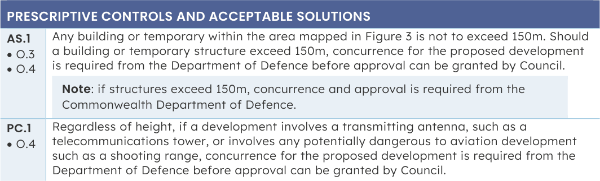
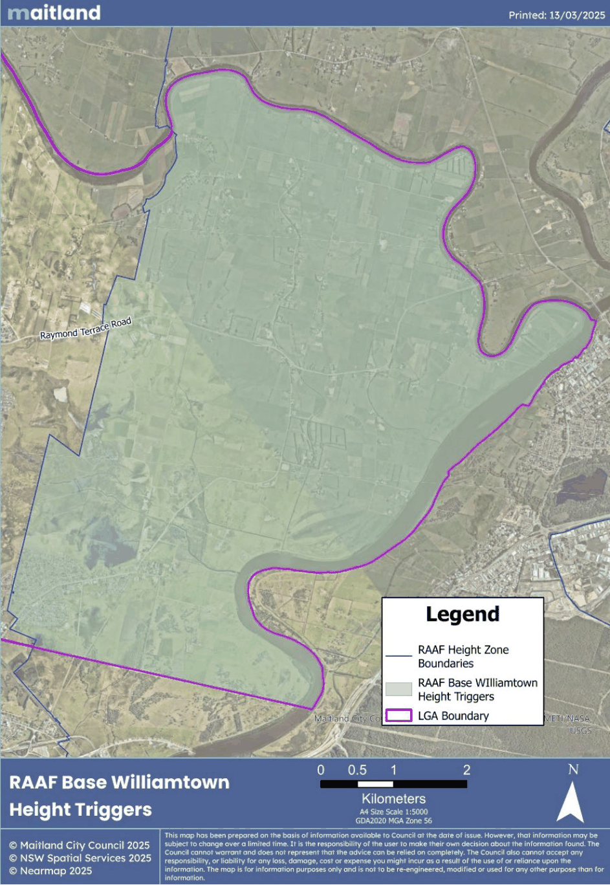

#### 10.2.1.2. Williamtown Airport

The area known as RAAF Base Williamtown is declared to be a Defence Aviation Area (DDA) under the Defence Act 1903 (Cwth). The RAAF Base Williamtown DDA covers a radius of 15 kilometres, which partially impacts upon the eastern reaches of the Maitland LGA. This DDA requires an application to be submitted to defence when certain parameters are met, including height and aviation-interfering development.

#### Objectives

O.3 To ensure that height of building restrictions are adhered to within the RAAF Base Williamtown

Defence Aviation Area for buildings, temporary structures (i.e. cranes) and/or natural features.

O.4 To ensure that consent is not granted until referrals and concurrence under the Defence Act 1903

(Cwth) have occurred.

> [Picture on page 8: a picture, saved as a picture (images/ch-10-00-special-precincts-locality-plans-and-urban-release-page-8-12.gif, 150 dpi).]
> Words printed on the picture (title and legend, copied from the PDF):
> • O.3
> • O.4
> Commonwealth Department of Defence.
> • O.4

#### PRESCRIPTIVE CONTROLS AND ACCEPTABLE SOLUTIONS

Any building or temporary within the area mapped in Figure 3 is not to exceed 150m. Should a building or temporary structure exceed 150m, concurrence for the proposed development is required from the Department of Defence before approval can be granted by Council.

#### AS.1

Note: if structures exceed 150m, concurrence and approval is required from the

#### PC.1

Regardless of height, if a development involves a transmitting antenna, such as a telecommunications tower, or involves any potentially dangerous to aviation development such as a shooting range, concurrence for the proposed development is required from the Department of Defence before approval can be granted by Council.

> [Picture on page 9: a picture, saved as a picture (images/ch-10-00-special-precincts-locality-plans-and-urban-release-page-9-1.gif, 150 dpi).]

#### Figure 10-3: RAAF Base Williamtown Defence Aviation Area
