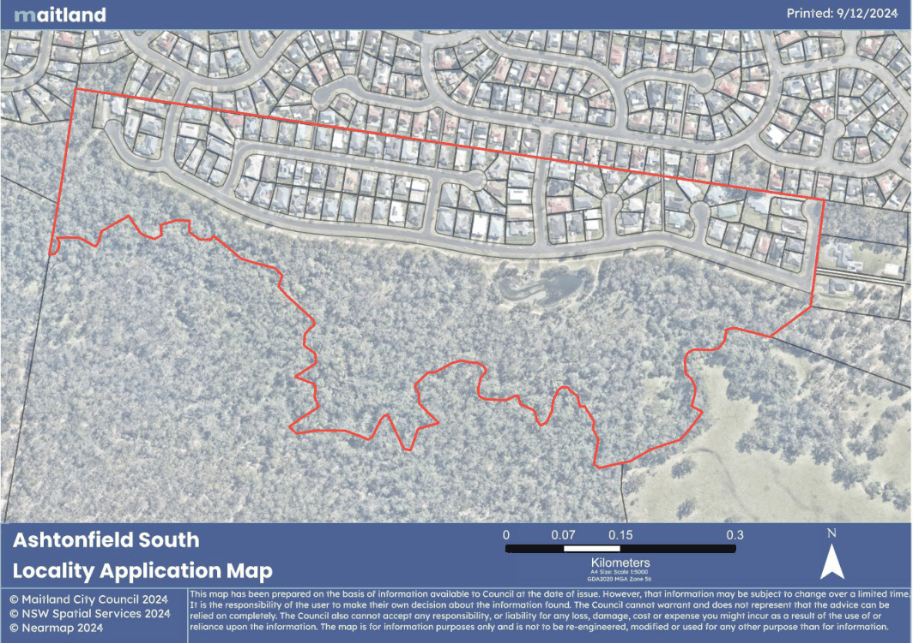
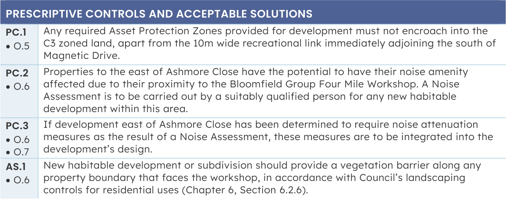

#### 10.3.1. Ashtonfield South

> [Picture on page 10: a picture, saved as a picture (images/ch-10-00-special-precincts-locality-plans-and-urban-release-page-10-17.gif, 150 dpi).]

#### Figure 10-4: Ashtonfield South Locality Map

#### Locality Statement

The Ashtonfield South Locality is comprised of an established residential estate and bushland, originally being an extension of the remainder of the Ashtonfield estate to the north. The bushland south of the residential area, which has remained in its natural state, is primarily made up of the Lower Hunter Spotted Gum Ironbark Forest and Alluvial Tall Moist Forest vegetation communities. The vegetation provides habitat for the Squirrel Glider and requires special considerations. The Ashtonfield South Locality is also in proximity of the Bloomfield Group Four Mile Workshop and abuts the mining lease land of the Bloomfield Colliery. This Locality Plan applies to all land detailed in Figure 10-4.

#### Objectives

O.5 To ensure that clear separations are maintained between the residential, recreational and

environmental sections of the locality.

O.6 To maximise tree retention in the wooded portions of the Locality and preserve the continuity and

connectivity of the bushland reserve south of Magnetic Drive.

O.7 To respect the proximity of the Four Mile Workshop by incorporating noise mitigation strategies for

potentially affected lots.

> [Picture on page 11: a picture, saved as a picture (images/ch-10-00-special-precincts-locality-plans-and-urban-release-page-11-17.gif, 150 dpi).]
> Words printed on the picture (title and legend, copied from the PDF):
> • O.5
> • O.6
> • O.6
> • O.7
> • O.6

#### PRESCRIPTIVE CONTROLS AND ACCEPTABLE SOLUTIONS

#### PC.1

Any required Asset Protection Zones provided for development must not encroach into the

C3 zoned land, apart from the 10m wide recreational link immediately adjoining the south of Magnetic Drive.

#### PC.2

Properties to the east of Ashmore Close have the potential to have their noise amenity affected due to their proximity to the Bloomfield Group Four Mile Workshop. A Noise Assessment is to be carried out by a suitably qualified person for any new habitable development within this area. If development east of Ashmore Close has been determined to require noise attenuation measures as the result of a Noise Assessment, these measures are to be integrated into the development’s design.

#### PC.3

#### AS.1

New habitable development or subdivision should provide a vegetation barrier along any property boundary that faces the workshop, in accordance with Council’s landscaping controls for residential uses (Chapter 6, Section 6.2.6).
