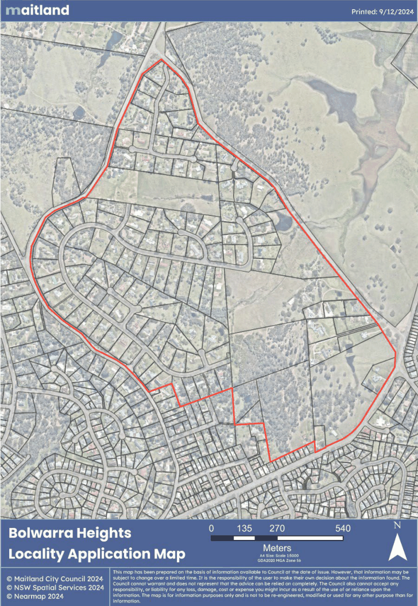

#### 10.3.2. Bolwarra Heights

> [Picture on page 12: a picture, saved as a picture (images/ch-10-00-special-precincts-locality-plans-and-urban-release-page-12-2.gif, 150 dpi).]

#### Figure 10-5: Bolwarra Heights Locality Map

#### Locality Statement

The land subject of this locality plan is located in the suburb of Bolwarra Heights and is bounded by Tocal Road, Lang Drive and Paterson Road. The area sits to the north and west of the more suburban style residential areas of Bolwarra, Largs, and Bolwarra Heights, and is characterised by large residential lots generally accommodating sizeable single or two storey residences. Large pockets of vegetation are located in the undeveloped areas of the site and are predominately identified as Lower Hunter Spotted Gum Ironbark Forest, which is an Endangered Ecological Community (EEC). A number of natural drainage paths and waterbodies also run through the site

connecting to the flood plain in the east. The core goal of this locality plan is to preserve the established local character through the additional controls outlined within this section. This Locality Plan applies to all land detailed in Figure 10-5.

#### Objectives

O.8 To preserve the established local character, being that of well-vegetated large lots with large

residences.

O.9 To ensure that native vegetation on lots is considered and impacts on the Lower Hunter Spotted

Gum Ironbark Forest is minimised.

O.10 To promote further revegetation and landscaping within the locality.

O.11 To facilitate limited densification that is commensurate with the established local character.

| PRESCRIPTIVE CONTROLS AND ACCEPTABLE SOLUTIONS |  |
|---|---|
| PC.1 | Any Development Application within the subject land must have a landscape plan prepared and provided to Council as part of submission, to the satisfaction of Council. |
| • O.10 |  |
| AS.1 • O.8 | The minimum front building setback for the subject land is to be 20m. A lesser setback may be permitted only if it can be shown that no other suitable building site is available on the allotment, and that a lesser setback would not detrimentally affect the streetscape. Setbacks may also be required from drainage channels and area subject to flooding. |
| AS.2 • O.8 | All structures erected on the subject land should be designed so as to be compatible with the rural character and landscape of the locality. In this regard, particular attention is to be given to the shape, colour and materials of the external surfaces of the structure. |
| AS.3 | Future development should have regard to the retention of natural vegetation and with respect to the natural topography of the land. |
| • O.9 |  |
| AS.4 | Additional landscaping and revegetation is encouraged in order to maintain the rural character of the area. |
| • O.10 |  |
| AS.5 | Any dual occupancy development should appear as a single residential building or cluster/complex of buildings. |
| • O.11 |  |
