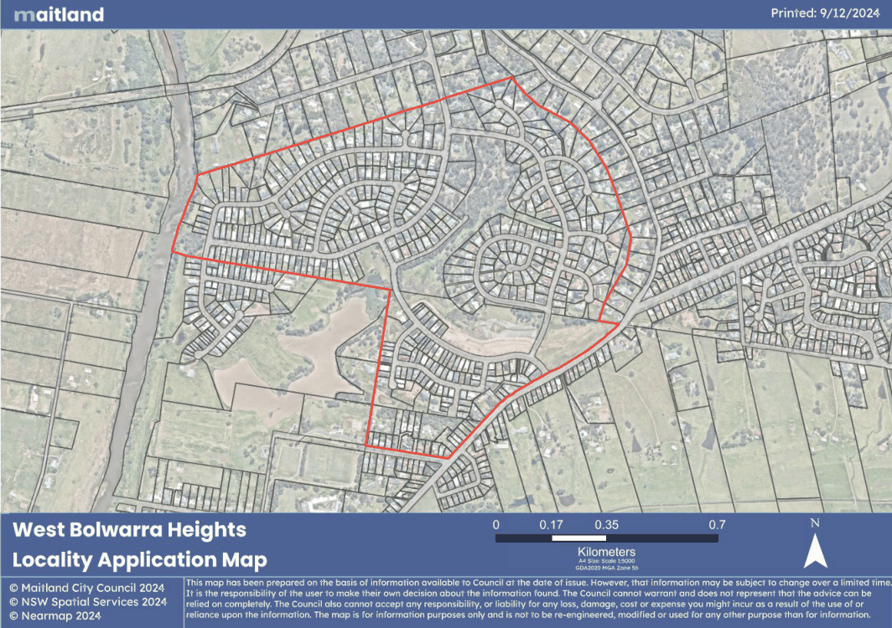

#### 10.3.3. West Bolwarra Heights

> [Picture on page 14: a picture, saved as a picture (images/ch-10-00-special-precincts-locality-plans-and-urban-release-page-14-2.gif, 150 dpi).]

#### Figure 10-6: West Bolwarra Heights Locality Map

#### Locality Statement

The locality of West Bolwarra Heights is located north of the historical suburb of Bolwarra and dominates the western section of Bolwarra Heights. The locality is characterised by undulating slopes, creek lines, and a now mostly established residential estate. The central part of the locality has been preserved as a key riparian corridor that provides local flora and fauna connectivity to the northern reaches of the Maitland LGA. West Bolwarra Heights has achieved its original envisioned character by providing a range of lot sizes in a residential, peri-urban setting. A transition zone has been maintained between the older rural-residential development and the newer development along the northern and eastern boundaries of the locality, with larger lot sizes provided. This Locality Plan applies to the land indicated as the Subject Area in Figure 10-6.

#### Objectives

O.12 To preserve and enhance the amount of native vegetation within the locality.

O.13 To ensure ongoing local pedestrian connectivity in the locality over the long term.

O.14 To preserve visual amenity of prominent land features within the locality.

O.15 To ensure that dwelling typologies present as a single dwelling to the streetscape. To maintain

access to natural areas.

| PRESCRIPTIVE CONTROLS AND ACCEPTABLE SOLUTIONS Clearance of native vegetation should be kept to a minimum as part of new development. Evidence is to be provided as to how development has been sited to minimise overall and conflict with bushland present on a site. Existing Section 88B instruments are present in many areas of the locality to preservation of vegetation and to restrict the erection of structures within important and bush regeneration areas, including on private property. community facilities within the locality are to connect to pedestrian Oval. housing, attached dwellings, multi-dwelling housing, and the area are to provide a photomontage with 3D renders to development will appear in the streetscape. development with multiple habitable dwellings should present have only one dwelling visible from the street. |  |
|---|---|
| AS.1 • O.12 • O.15 impact Note: ensure the environmentally |  |
| PC.1. | Development of any pathways to the Bolwarra |
| • O.13 |  |
| PC.2 Development for semi-detached • O.14 residential flat buildings within demonstrate how the new |  |
| AS.2 Except for dual occupancies, • O.15 either as one consolidated structure or |  |
