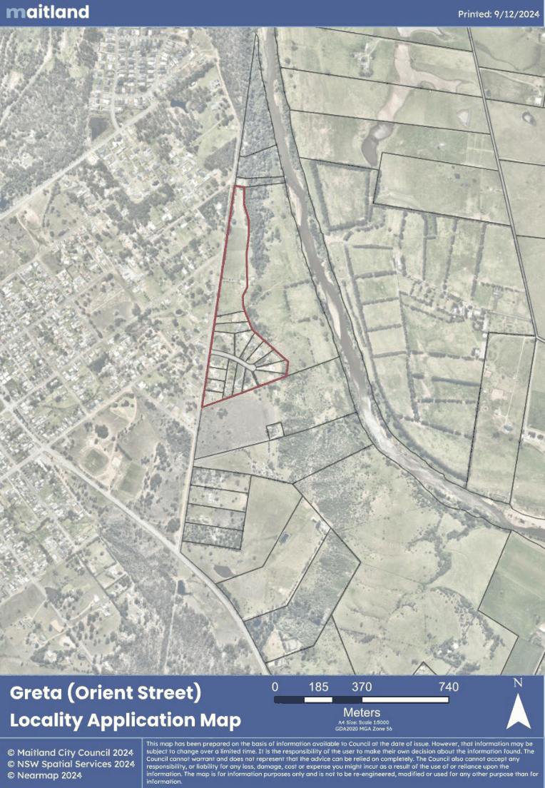

#### 10.3.4. Greta (Orient Street)

> [Picture on page 16: a picture, saved as a picture (images/ch-10-00-special-precincts-locality-plans-and-urban-release-page-16-2.gif, 150 dpi).]

#### Figure 10-7: Greta (Orient Street) Locality Map

#### Locality Statement

Greta (Orient Street) is located on the western boundary of the Maitland LGA primarily accessible from the New England Highway through Orient Street, Greta within the Cessnock LGA. The land sits on the edge of the escarpment overlooking the part of the Hunter River that crosses the suburbs of Lochinvar and Luskintyre. The area is characterised by large lot residential and limited small scale rural and agricultural activities. This Locality Plan applies to all land indicated within Figure 10-7.

O.16 To ensure that development respects the visual amenity of the locality, especially around the

significant escarpment along the eastern boundary.

O.17 To ensure landscaping creates, enhances, and complements a visual environment consistent with the

rural character of the area.

O.18 To protect natural drainage swales through sensitive subdivision design.

O.19 To ensure that adequate consideration is given to the historic and existing agricultural activities

within and surrounding the locality.

O.20 To ensure that the escarpment within the locality is bolstered and enhanced through native plantings

that reinforce and stabilise the slope.

O.21 To provide for the safe movement of traffic through appropriate intersection upgrades to the New

England Highway.

| PRESCRIPTIVE CONTROLS AND ACCEPTABLE SOLUTIONS |  |
|---|---|
| PC.1 • O.16 | The siting of buildings and building form, materials and colours are to be designed in a manner that ensures the visual impact of development is kept to a minimum in this visually sensitive escarpment area. |
| AS.1 • O.18 • O.19 • O.21 | Development is to adequately address the following matters: a. Potentially unstable land near the edge of the steep escarpment, b. The natural drainage swale through the centre and eastern part of the locality. Disturbance of this drain may present problems and inappropriately located buildings may suffer local flooding and/or drainage problems, c. The potential for high visual impact of development along the escarpment and on rural vistas and scenic quality generally. d. The proximity of a poultry farm to the north-west of the site, e. The proximity to an old disused piggery to the west of the site, f. The proximity of the cattle yards to the south of the site, g. The layout of the existing local road network, and h. Traffic studies to determine the level of upgrade to the intersection with the New England Highway to provide for the safe movement of vehicles to and from the Orient Street. |
| PC.2 • O.16 • O.19 | Building envelopes within the locality are to adhere to the following criteria: a. be no closer than 10m from the centreline of natural drainage swales, b. have a minimum setback of 10m from all lot boundaries, c. be no closer than 20m from the edge of the escarpment, and d. be accessible to a public road. |
| PC.5 | The planting of pine trees of similar genus to those already present is to occur along Orient Street for residential development. |
| • O.17 |  |
| PC.6 | Shrubs, ground covers and scattered trees are to be planted 10m either side of the edge of the escarpment to reduce erosion and maintenance problems and to re-establish a vegetated aspect along the escarpment. |
| • O.17 |  |
| • O.20 |  |
| AS.2 | Existing drainage lines in the locality should be revegetated where possible to minimise any future erosion and salinity problems. |
| • O.17 |  |
| • O.18 |  |
| PC.7 | Where buildings are proposed within 50m of the escarpment, the planting of a backdrop of trees is required to soften the skyline along the escarpment. Plantings should include locally indigenous species with mature height in excess of 10m. |
| • O.16 |  |
| • O.17 |  |
| • O.20 |  |
