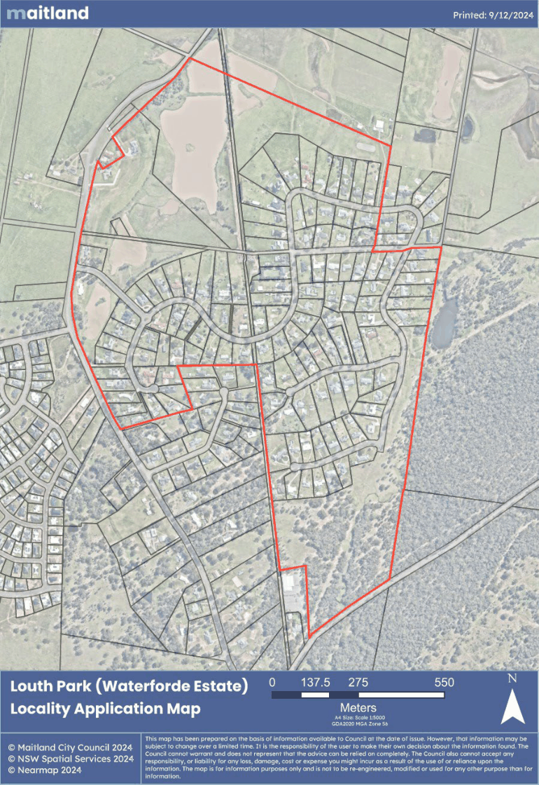

#### 10.3.5. Louth Park (Waterforde Estate)

> [Picture on page 18: a picture, saved as a picture (images/ch-10-00-special-precincts-locality-plans-and-urban-release-page-18-2.gif, 150 dpi).]

#### Figure 10-8: Louth Park (Waterforde Estate) Locality Map

#### Locality Statement

Waterforde Estate, located within Louth Park, lies to the south of Maitland CBD, along the southern boundary of the Maitland LGA adjoining Cessnock LGA. The locality fronts Louth Park Road and Mount Vincent Road. The area is relatively flat and characterised by its large lot residential character and scattered vegetation. It is surrounded by the Wallis Creek floodplain in the east, the Mt Vincent Waste Disposal Depot in the west, and the Bloomfield Colliery to the southwest. Several constraints affect the

land including flooding, mine subsidence, buffer to the waste disposal facility, and coal mining buffer to Bloomfield Collieries. This Locality Plan applies to the land defined as the Subject Area in Figure 10-8.

#### Objectives

O.22 To ensure landscaping forms a locality that creates an ordered, open rolling landscape that

preserves views from surrounding properties and provides an attractive outlook from the rural-residential areas.

O.23 The ensure the perimeter of the locality provides adequate and appropriate plantings to buffer

westerly winds and provide a living hedge to the development.

O.24 To preserve strategic open view sections to give selective views to observers of wetlands and distant

views of rolling rural-residential development.

O.25 To ensure that the unique constraints of the locality are considered for all development.

O.26 To ensure subdivision and building design and siting reflects the large lot residential amenity of the

locality and rural character of the surrounding area.

O.27 To embellish the north-western part of the locality as a wetland area that improves biodiversity and

habitat opportunities for local wildlife.

O.28 To ensure development is provided above known flood levels.

| PRESCRIPTIVE CONTROLS AND ACCEPTABLE SOLUTIONS |  |
|---|---|
| AS.1 | Development and its associated Development Application is to give clear and adequate consideration to flooding and mine subsidence. |
| • O.25 |  |
| • O.28 |  |
| PC.1 | Each lot is to include a building envelope of a minimum of 700m2 above the appropriate flood level adopted by Council at the time of application. |
| • O.26 |  |
| PC.2 • O.25 | The southern part of the locality is partly affected by shallow mine workings. Detailed geotechnical investigations will be required to inform the future subdivision layout, allotment sizes, building design controls and any designated building envelopes. Any development application in the affected areas will require the approval of Subsidence Advisory NSW. |
| PC.3 • O.25 | Geotechnical investigations are to include details of the depth of coal seam, height of workings, floor conditions and thickness of competent rock over mine workings to the satisfaction of Subsidence Advisory NSW. At the completion of any geotechnical remediation works, a qualified geotechnical engineer is to certify that the remediation of the mine workings has been achieved. |
| PC.4 • O.22 • O.23 • O.24 | Development is to provide plantings along adjoining lot boundaries to form a buffer, and is to adhere to the following criteria: a. Be at least 10m wide (mature canopy width), inclusive of any existing plantings on the adjoining property, b. Primarily consist of low-lying shrubs or hedging, and c. If utilising tree plantings, space them at least 5m apart to maintain a balance of views and privacy. |
| PC.5 • O.26 | All structures erected on large lot residential zoned land are to be designed so as to be compatible with the rural character and landscape of the locality. In this regard, particular attention is to be given to the style, colour and materials of the external surfaces of the structure. |
| AS.2 • O.27 | Development on the land associated with the Environmentally Sensitive Area should make efforts to enhance the biodiversity and habitat of the area through appropriate native plantings and separation. Any enhancement is to be proportional to the extent of development, as determined by Council. |
