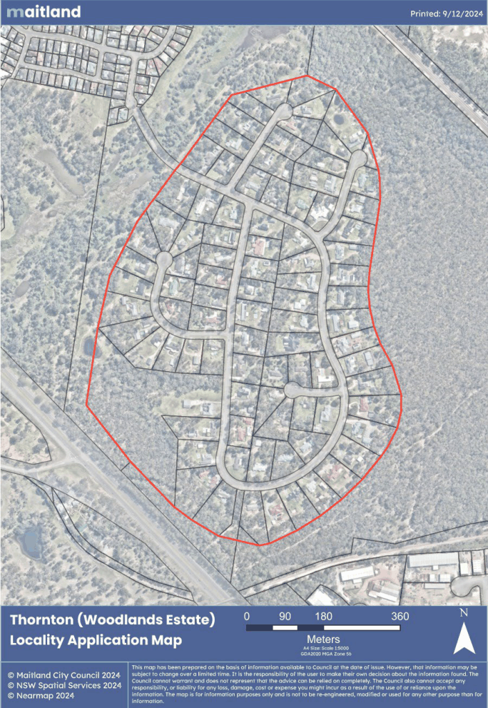
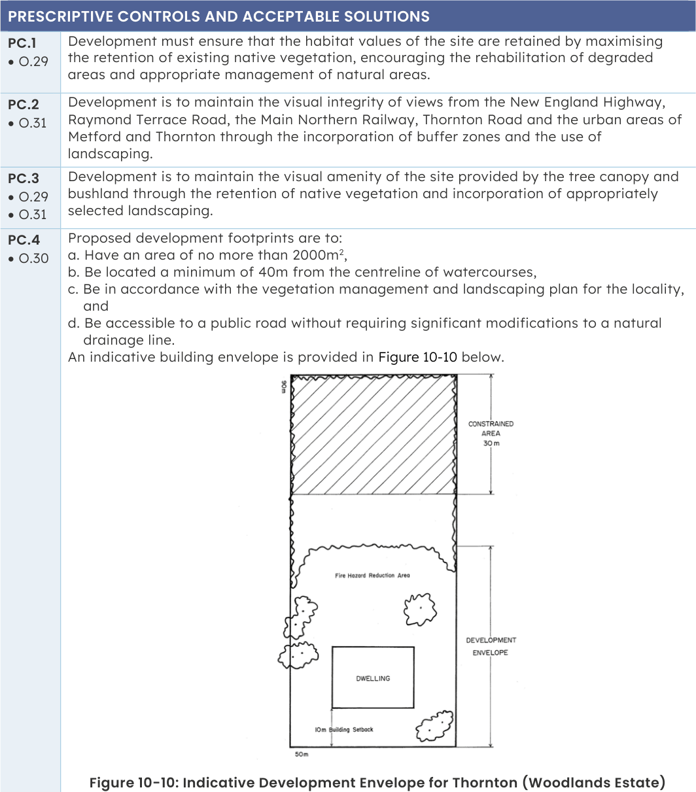

#### 10.3.6. Thornton (Woodlands Estate)

> [Picture on page 20: a picture, saved as a picture (images/ch-10-00-special-precincts-locality-plans-and-urban-release-page-20-2.gif, 150 dpi).]

#### Figure 10-9: Thornton (Woodlands Estate) Locality Map

#### Locality Statement

The Woodlands Estate Locality lies between the established urban areas of Metford and Thornton, the New England Highway and the North Coast Railway. The native vegetation within the Locality provides habitat for several vulnerable species under the Biodiversity Conservation Act 2016, as well as assisting with the stabilisation of soils, reducing sediment runoff into the nearby Four Mile Creek. Accordingly, the retention of native vegetation has been an integral design principle over the course of the locality’s existence, and this has been reflected in the use of the C4 Environmental Living zone for the existing residential development. This Locality Plan applies to the land indicated as the Subject Area on Figure 10-9.

O.29 To assist in the retention of a high proportion of existing habitat in the locality.

O.30 To ensure that development is sited and designed in a manner that limits its potential impact on the

surrounding natural environment.

O.31 To protect established long term natural buffers to nearby land uses and noise generating sources.

O.32 To ensure that the contaminant producing historical activities within and surrounding the locality are

adequately addressed.

> [Picture on page 21: a picture, saved as a picture (images/ch-10-00-special-precincts-locality-plans-and-urban-release-page-21-7.gif, 150 dpi).]
> Words printed on the picture (title and legend, copied from the PDF):
> • O.29
> • O.31
> • O.29
> • O.31
> • O.30
> and
> drainage line.

Figure 10-10: Indicative Development Envelope for Thornton (Woodlands Estate)

#### PRESCRIPTIVE CONTROLS AND ACCEPTABLE SOLUTIONS

#### PC.1

Development must ensure that the habitat values of the site are retained by maximising the retention of existing native vegetation, encouraging the rehabilitation of degraded areas and appropriate management of natural areas.

#### PC.2

Development is to maintain the visual integrity of views from the New England Highway, Raymond Terrace Road, the Main Northern Railway, Thornton Road and the urban areas of Metford and Thornton through the incorporation of buffer zones and the use of landscaping. Development is to maintain the visual amenity of the site provided by the tree canopy and bushland through the retention of native vegetation and incorporation of appropriately selected landscaping.

#### PC.3

#### PC.4

Proposed development footprints are to:

a. Have an area of no more than 2000m2,

b. Be located a minimum of 40m from the centreline of watercourses,

c. Be in accordance with the vegetation management and landscaping plan for the locality,

d. Be accessible to a public road without requiring significant modifications to a natural

An indicative building envelope is provided in Figure 10-10 below.

| PRESCRIPTIVE CONTROLS AND ACCEPTABLE SOLUTIONS |  |
|---|---|
| PC.5 • O.29 • O.30 | All buildings within the development envelope are to be sited in a manner which allows all necessary bushfire fuel reduction measures to occur within the development envelope. Buildings shall have a minimum setback of 6m from side boundaries and 10m from the front boundary. |
| AS.1 | Development seeking to clear land lying outside an established development envelope or alter the configuration of the envelope are required to provide evidence that such work will not significantly impact upon the habitat of endangered or vulnerable flora/fauna and is consistent with the vegetation management and landscaping plan of the locality. |
| • O.29 |  |
| • O.30 |  |
| • O.31 |  |
| AS.2 • O.30 | All structures, i.e. dwelling-houses, garages, sheds, fencing, are to be designed with consideration to the bushland character of the area, the topography, and the landscape features of the site. Particular consideration is to be given to building location, solar access, form, colour and construction materials. |
| PC.6 | A minimum 50m setback is required between dwellings and the boundary of the New England Highway or the Main Northern Railway. |
| • O.31 |  |
| AS.3 • O.30 | The use of solid panel fencing, except for the screening of areas around swimming pools and entertainment areas and acoustic fencing adjoining a dwelling, is not supported in a bushland environment. The use of open mesh or rural type (post & wire) fencing is acceptable. |
| C3 Environmental Management Zone |  |
| PC.7 • O.29 • O.30 | If development is proposed on the part of the land zoned C3 Environmental Management, a Vegetation Management Plan for is to be prepared and submitted to Council for approval prior to the release of a construction certificate. The management plan shall indicate details of access, fencing, bushfire hazard reduction measures, weed control, location of buildings, extent of vegetation removal and rehabilitation. |
| AS.4 • O.30 | Buildings and related works should generally be located in areas which contain poor habitat for native fauna due to vegetation removal undertaken in the past. The design of these works is to reflect the environmental sensitivity of the site. |
| AS.5 | The removal of native trees and understorey is discouraged outside those areas not forming part of the Development Envelope. An exception applies for works associated with bushfire hazard reduction undertaken by authorised persons. |
| • O.29 |  |
| • O.30 |  |
| PC.8 | Detailed investigations are to be undertaken to determine the presence or level of any shallow mine workings, with the results to be submitted with any subdivision application. |
| • O.32 |  |
