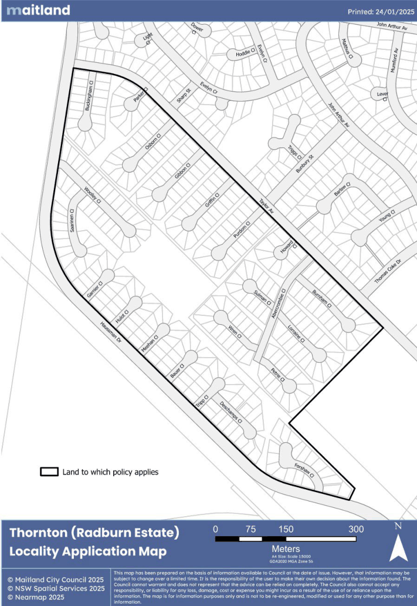
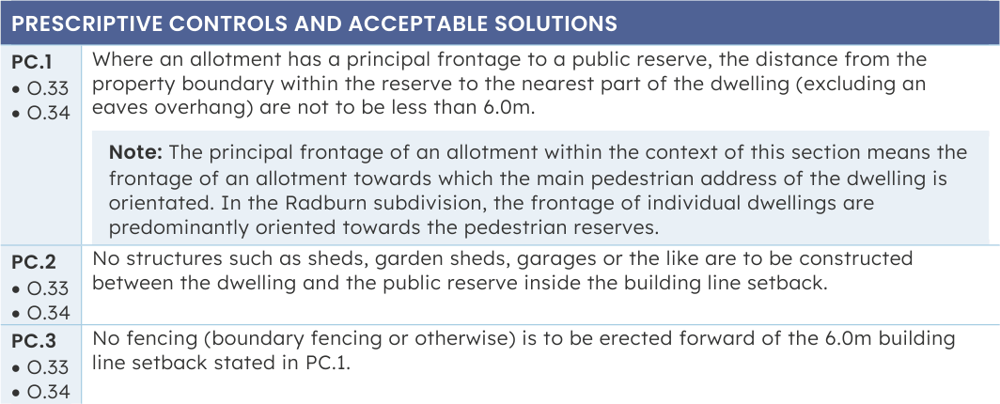

#### 10.3.7. Thornton (Radburn Estate)

> [Picture on page 23: a picture, saved as a picture (images/ch-10-00-special-precincts-locality-plans-and-urban-release-page-23-2.gif, 150 dpi).]

#### Figure 10-11: Thornton (Radburn Estate) Locality Map

#### Locality Statement

This Locality Plan applies to:

• Lots within the Radburn Estate at Thornton which have a property frontage to a public reserve, and

• Lots within the Radburn Estate at Thornton as shown on Figure 10-11 which have a principal frontage

to a public reserve.

O.33 To establish an appropriate building line for lots within the Radburn Estate at Thornton which have a

property frontage to a public reserve.

O.34 To ensure the integrity of the streetscape and character of public spaces through the provision of

appropriate building setbacks and the establishment of fencing guidance appropriate for the locality.

> [Picture on page 24: a picture, saved as a picture (images/ch-10-00-special-precincts-locality-plans-and-urban-release-page-24-6.gif, 150 dpi).]
> Words printed on the picture (title and legend, copied from the PDF):
> • O.33
> • O.34
> • O.33
> • O.34
> • O.33
> • O.34

#### PRESCRIPTIVE CONTROLS AND ACCEPTABLE SOLUTIONS

Where an allotment has a principal frontage to a public reserve, the distance from the property boundary within the reserve to the nearest part of the dwelling (excluding an eaves overhang) are not to be less than 6.0m.

#### PC.1

Note: The principal frontage of an allotment within the context of this section means the

frontage of an allotment towards which the main pedestrian address of the dwelling is orientated. In the Radburn subdivision, the frontage of individual dwellings are predominantly oriented towards the pedestrian reserves. No structures such as sheds, garden sheds, garages or the like are to be constructed between the dwelling and the public reserve inside the building line setback.

#### PC.2

No fencing (boundary fencing or otherwise) is to be erected forward of the 6.0m building line setback stated in PC.1.

#### PC.3
