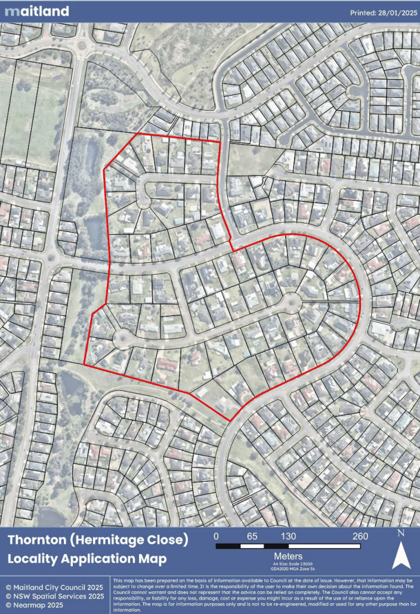

#### 10.3.8. Thornton (Hermitage Close)

> [Picture on page 25: a picture, saved as a picture (images/ch-10-00-special-precincts-locality-plans-and-urban-release-page-25-2.gif, 150 dpi).]

#### Figure 10-12: Thornton (Hermitage Close) Locality Map

#### Locality Statement

The Hermitage Close precinct comprises an established large-lot residential estate within the Thornton estate. The precinct is low density in nature, being characterised by single- and two-storey dwelling houses on large lots, with generous setbacks and open-style front fencing. The re-subdivision of existing residential lots, or the intensification of development beyond dwelling houses, is discouraged. Where re-subdivision is proposed, development must ensure that the resulting lots are consistent with the predominant lot sizes of the immediate precinct.

Proposals for medium-density or dual occupancy development must take into account potential impacts on privacy, solar access, streetscape, visual amenity, traffic management, and compatibility with the surrounding built form. This Locality Plan applies to all land detailed in Figure 10-12.

#### Objectives

O.35 To maintain the established streetscape character of Hermitage Close, ensuring generous front

setbacks and cohesive visual amenity.

O.36 To maintain the large-lot, low-density character of Hermitage Close by ensuring that new

development respects the precinct’s established character.

O.37 To ensure that any proposed re-subdivision or higher-density development is consistent with the

prevailing lot sizes and large-lot residential character of the area.

| PRESCRIPTIVE CONTROLS AND ACCEPTABLE SOLUTIONS |  |
|---|---|
| PC.1 • O.35 | Setbacks for a development are to be provided in accordance with Table 10-1. Table 10-1: Minimum Setbacks DWELLING TYPE FRONT SECONDARY SETBACK SIDE REAR SETBACK (CORNER LOTS) SETBACK SETBACK All Dwelling Types 12m 5m 4m 4m |
| PC.2 • O.35 | Development must reinforce the established streetscape character, providing generous front setbacks and open-style front fencing. |
| PC.3 | Any re-subdivision must maintain the large-lot, low-density character, preserving the predominant lot sizes in the immediate precinct. |
| • O.36 |  |
| PC.4 • O.37 | Development containing multiple habitable dwellings (e.g. dual occupancy or medium- density housing) must be designed, when viewed from public spaces, to resemble a single dwelling in scale, massing, and overall appearance. |
| PC.5 • O.35 | New developments are to be designed and sited so that its external building materials, colours, and landscaping treatments are sympathetic to the existing natural and built context of Hermitage Close. |
| AS.1 | Re-subdivision of existing residential lots should only be undertaken where the resultant lots are consistent with the typical sizes in the surrounding streetscape. |
| • O.37 |  |
| AS.2 • O.35 | Where multiple habitable dwellings are proposed, building form and layout should blend with the established local character, ensuring continuity of roof forms, façade treatments, and landscaping that complements the existing streetscape. |
