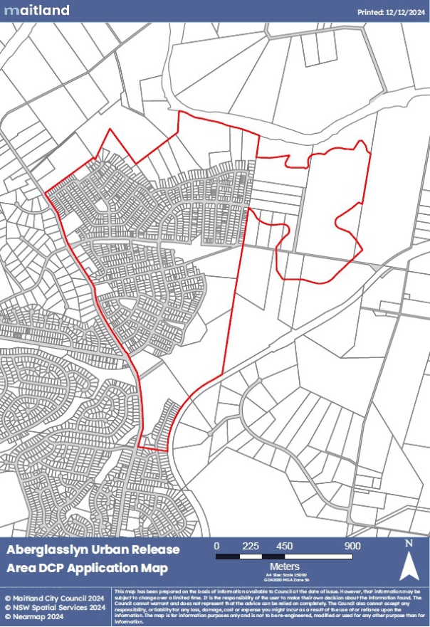
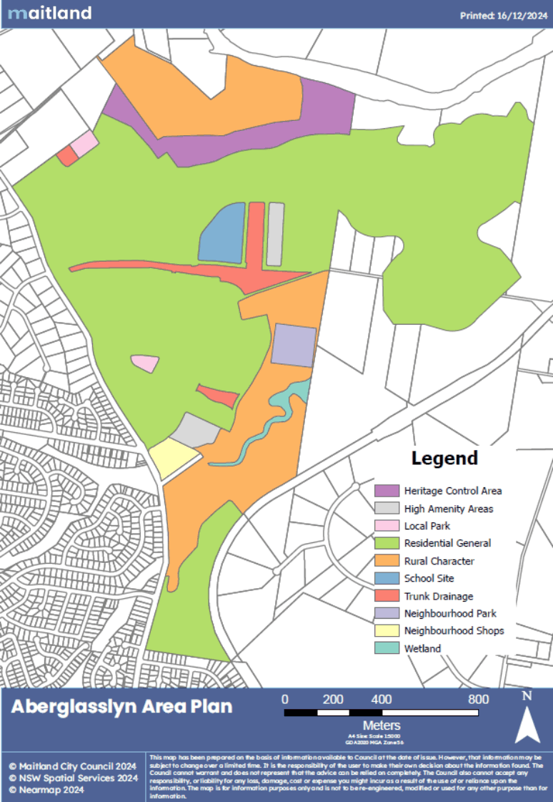
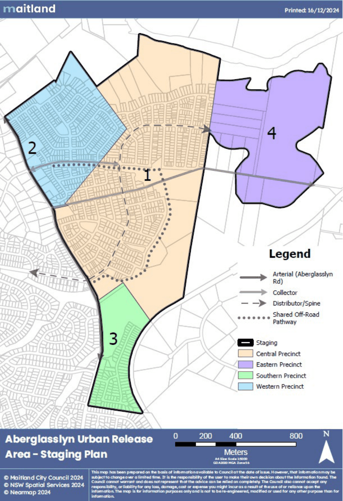
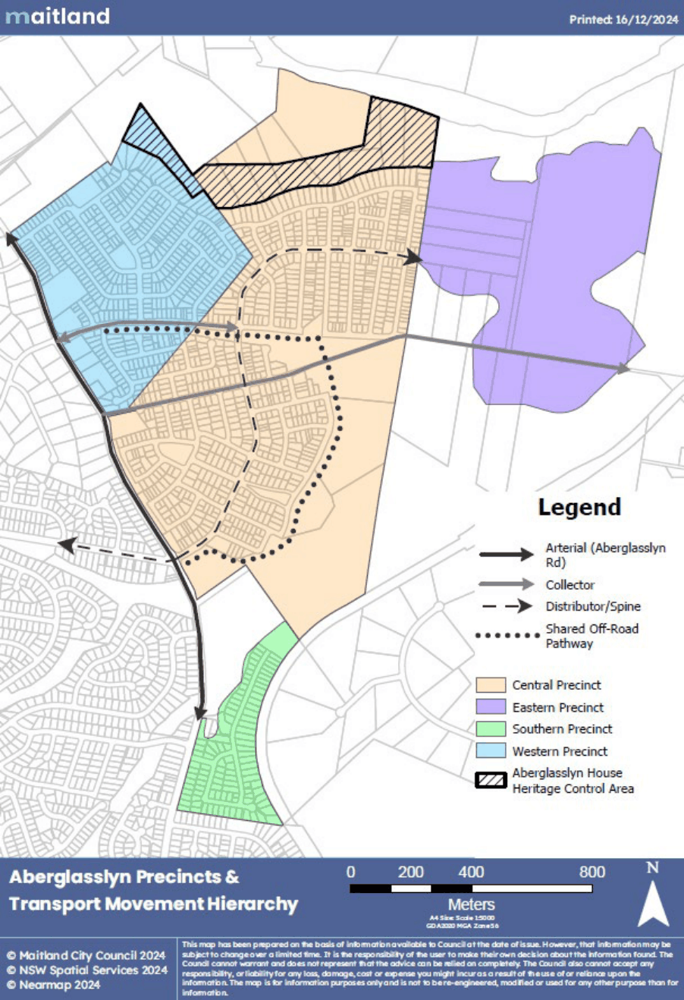

#### 10.4.2. Aberglasslyn Urban Release Area

> [Picture on page 29: a picture, saved as a picture (images/ch-10-00-special-precincts-locality-plans-and-urban-release-page-29-2.gif, 150 dpi).]

#### Figure 10-13: Aberglasslyn Urban Release Area

The Aberglasslyn Urban Release Area identifies approximately 200 hectares of land to the north of the existing urban area of Rutherford. Access to the area is via Aberglasslyn and Oakhampton Roads from the New England Highway. The majority of the land has traditionally been used for grazing. The area adjoins a number of important sites and land uses that required consideration in the strategic planning for this area. In particular, the proximity to Aberglasslyn House, a heritage item of State significance; the adjoining rail corridor, and impacts associated with extractive industries along the Hunter River dictated specific design outcomes for these areas. Environmental issues associated with flooding and water quality from sub- catchments which flow directly into the Hunter River and the Oakhampton Wetlands required specific development controls. Infrastructure provision (particularly the extension and augmentation of reticulated water and sewer) influences the orderly staging and sequencing of land. The potential for impacts on the road network leading into Central Maitland also requires consideration in the staging of development. Development of the East Precinct may require upgrading and safety improvements to the Oakhampton Road railway level crossing.

Development of this Urban Release Area is well progressed. Precinct Plans and consequent development has already occurred for the East, Central and South Precincts as part of this DCP and land has been rezoned on the corner of Aberglasslyn Road and McKeachie Drive for a neighbourhood centre.

#### Aberglasslyn Area Plan

The Aberglasslyn Area Plan is comprised of precinct plans as shown in Figure 10-16. The provisions of

this section apply to the preparation of precincts plans for and staging of the Aberglasslyn Urban

> [Picture on page 30: a picture, saved as a picture (images/ch-10-00-special-precincts-locality-plans-and-urban-release-page-30-8.gif, 150 dpi).]

Release Area.

#### Figure 10-14: Aberglasslyn Area Plan

#### Staging Plan

> [Picture on page 31: a picture, saved as a picture (images/ch-10-00-special-precincts-locality-plans-and-urban-release-page-31-2.gif, 150 dpi).]

#### Figure 10-15: Aberglasslyn Staging Plan

#### Precinct Plan

> [Picture on page 32: a picture, saved as a picture (images/ch-10-00-special-precincts-locality-plans-and-urban-release-page-32-2.gif, 150 dpi).]

#### Figure 10-16: Aberglasslyn Precinct Plan & Transport Movement Hierarchy

### Development Requirements – General Provisions

No specific requirements have been made for the following matters within the General Provisions for the Aberglasslyn Urban Release Area as they are already adequately addressed by other relevant provisions within the Maitland Local Environmental Plan 2011 and the Maitland Development Control Plan 2026:

• Neighbourhood Commercial and Retail Uses

• Provision of Public Facilities and Services
