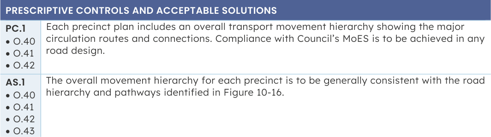
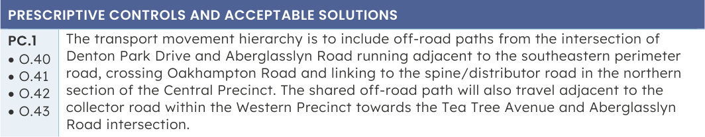

#### 10.4.2.3. Transport Movement Hierarchy

#### Objectives

O.40 To achieve a simple and safe movement system for private vehicles, public transport, pedestrians

and cyclists.

O.41 To provide walkable neighbourhoods with convenient access to neighbourhood shops, community

facilities and other services, with less dependence on cars for travel.

O.42 To provide for access generally by way of an interconnected network of streets and paths which

facilitate safe, efficient and pleasant walking, cycling and driving.

O.43 To facilitate new development which supports the efficiency of public transport systems, and

provides safe, direct access to the system for residents.

> [Picture on page 33: a picture, saved as a picture (images/ch-10-00-special-precincts-locality-plans-and-urban-release-page-33-35.gif, 150 dpi).]
> Words printed on the picture (title and legend, copied from the PDF):
> road design.
> • O.40
> • O.41
> • O.42
> • O.40
> • O.41
> • O.42
> • O.43

#### PRESCRIPTIVE CONTROLS AND ACCEPTABLE SOLUTIONS

Each precinct plan includes an overall transport movement hierarchy showing the major circulation routes and connections. Compliance with Council’s MoES is to be achieved in any

#### PC.1

The overall movement hierarchy for each precinct is to be generally consistent with the road hierarchy and pathways identified in Figure 10-16.

#### AS.1

> [Picture on page 34: a picture, saved as a picture (images/ch-10-00-special-precincts-locality-plans-and-urban-release-page-34-1.gif, 150 dpi).]
> Words printed on the picture (title and legend, copied from the PDF):
> • O.40
> • O.41
> • O.42
> • O.43
> Road intersection.

#### PRESCRIPTIVE CONTROLS AND ACCEPTABLE SOLUTIONS PC.1

The transport movement hierarchy is to include off-road paths from the intersection of Denton Park Drive and Aberglasslyn Road running adjacent to the southeastern perimeter road, crossing Oakhampton Road and linking to the spine/distributor road in the northern section of the Central Precinct. The shared off-road path will also travel adjacent to the collector road within the Western Precinct towards the Tea Tree Avenue and Aberglasslyn
