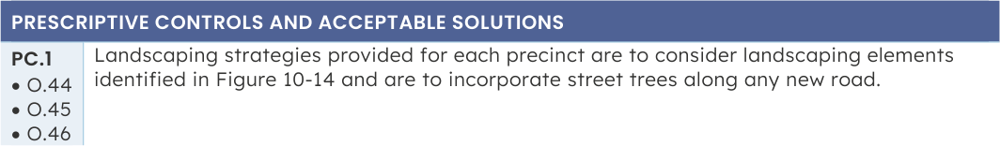

#### 10.4.2.4. Overall Landscaping Strategy

#### Objectives

O.44 To protect and enhance riparian areas and remnant vegetation, including visually prominent

locations.

O.45 To protect scenic values and significant vegetation, particularly within, and adjacent to, the

Aberglasslyn House Heritage Control Area, Aberglasslyn Road and Oakhampton Wetlands.

O.46 To provide detailed landscaping requirements for both the public and private domain.

> [Picture on page 34: a picture, saved as a picture (images/ch-10-00-special-precincts-locality-plans-and-urban-release-page-34-16.gif, 150 dpi).]
> Words printed on the picture (title and legend, copied from the PDF):
> • O.44
> • O.45
> • O.46

#### PRESCRIPTIVE CONTROLS AND ACCEPTABLE SOLUTIONS

Landscaping strategies provided for each precinct are to consider landscaping elements identified in Figure 10-14 and are to incorporate street trees along any new road.

#### PC.1
