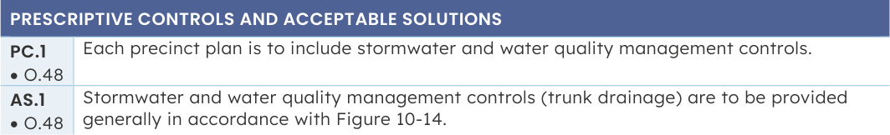

#### 10.4.2.6. Stormwater and Water Quality

#### Objectives

O.48 Stormwater and water quality management controls shall protect and enhance the water quality,

water quantity and habitat value of downstream waterways and environment, including Oakhampton wetlands and the Hunter River.

> [Picture on page 34: a picture, saved as a picture (images/ch-10-00-special-precincts-locality-plans-and-urban-release-page-34-35.gif, 150 dpi).]
> Words printed on the picture (title and legend, copied from the PDF):
> • O.48
> • O.48

#### PRESCRIPTIVE CONTROLS AND ACCEPTABLE SOLUTIONS

Each precinct plan is to include stormwater and water quality management controls.

#### PC.1 AS.1

Stormwater and water quality management controls (trunk drainage) are to be provided generally in accordance with Figure 10-14.
