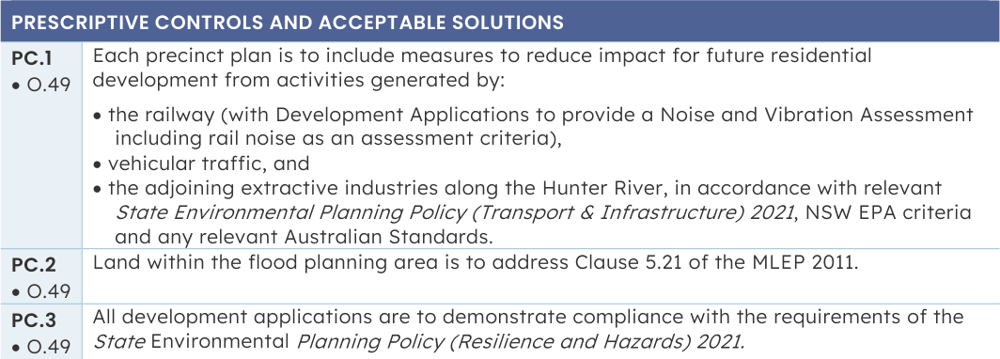

#### 10.4.2.7. Amelioration of Natural and Environmental Hazards

#### Objectives

O.49 Amelioration of natural and environmental hazards, including bushfire, flooding and site

contamination and, in relation to natural hazards, the safe occupation of, and the evacuation from, any land so affected is achieved.

> [Picture on page 35: a picture, saved as a picture (images/ch-10-00-special-precincts-locality-plans-and-urban-release-page-35-6.gif, 150 dpi).]
> Words printed on the picture (title and legend, copied from the PDF):
> • O.49
> • vehicular traffic, and
> • O.49
> • O.49

#### PRESCRIPTIVE CONTROLS AND ACCEPTABLE SOLUTIONS

Each precinct plan is to include measures to reduce impact for future residential development from activities generated by:

#### PC.1

Land within the flood planning area is to address Clause 5.21 of the MLEP 2011.

• the railway (with Development Applications to provide a Noise and Vibration Assessment

including rail noise as an assessment criteria),

• the adjoining extractive industries along the Hunter River, in accordance with relevant

State Environmental Planning Policy (Transport & Infrastructure) 2021, NSW EPA criteria and any relevant Australian Standards.

#### PC.2

All development applications are to demonstrate compliance with the requirements of the State Environmental Planning Policy (Resilience and Hazards) 2021.

#### PC.3
