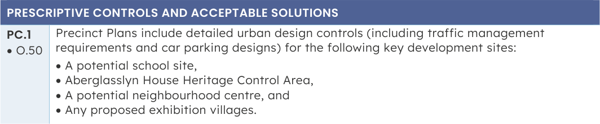

#### 10.4.2.8. Key Development Sites

#### Objectives

O.50 Detailed urban design controls are provided for significant development sites.

> [Picture on page 35: a picture, saved as a picture (images/ch-10-00-special-precincts-locality-plans-and-urban-release-page-35-24.gif, 150 dpi).]
> Words printed on the picture (title and legend, copied from the PDF):
> • O.50

#### PRESCRIPTIVE CONTROLS AND ACCEPTABLE SOLUTIONS

Precinct Plans include detailed urban design controls (including traffic management requirements and car parking designs) for the following key development sites:

#### PC.1

• A potential school site,

• Aberglasslyn House Heritage Control Area,

• A potential neighbourhood centre, and

• Any proposed exhibition villages.
