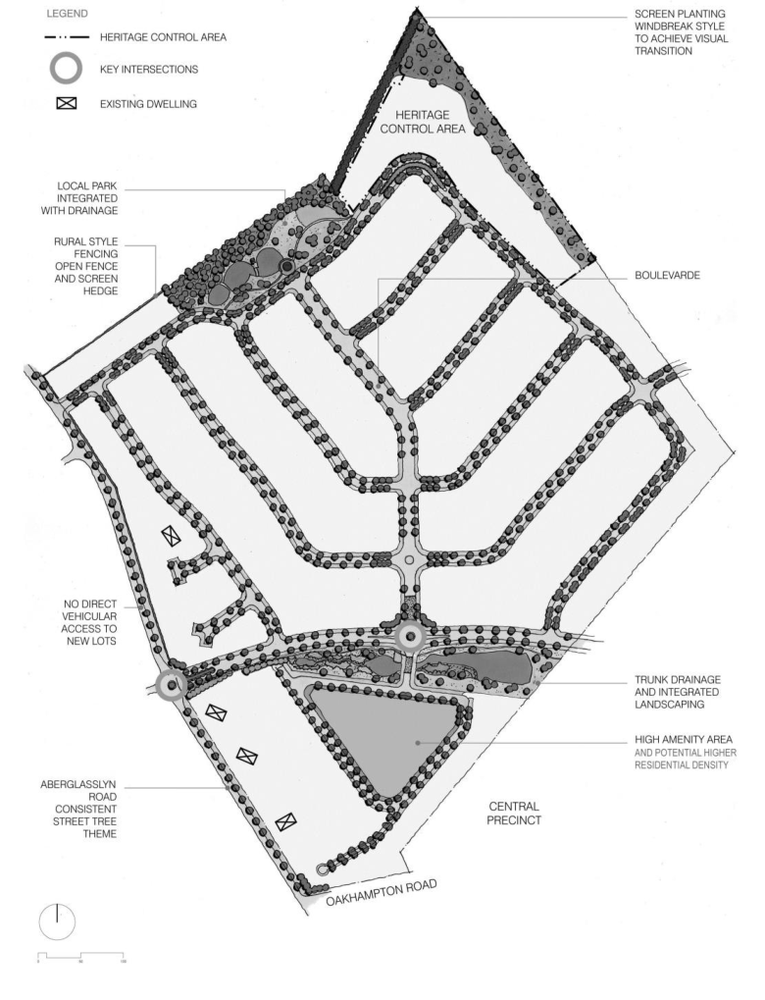

#### 10.4.2.9. Residential Densities

#### Objectives

O.51 To encourage higher density living around transport, open space and service nodes.

O.52 To ensure cost-effective and resource efficient development to promote affordable housing.

| PRESCRIPTIVE CONTROLS AND ACCEPTABLE SOLUTIONS |  |
|---|---|
| PC.1 • O.51 • O.52 | Precinct plans are to nominate areas where higher density living may be appropriate. Note: Residential densities are controlled by lot size in the Maitland Local Environmental Plan 2011. |

### Development Requirements – Aberglasslyn West Precinct

The following is the Precinct Plan provisions referred to in the general provisions above that applies to

> [Picture on page 36: a picture, saved as a picture (images/ch-10-00-special-precincts-locality-plans-and-urban-release-page-36-3.gif, 150 dpi).]

the West Precinct.

#### Figure 10-17: Aberglasslyn Urban Release Area - Western Precinct

No specific requirements have been made for the following matters within the West Precinct as they are already adequately addressed by other relevant provisions within the Maitland Local Environmental Plan 2011 and the Maitland Development Control Plan 2026:

• Neighbourhood Commercial and Retail Uses

• Provision of Public Facilities and Services
