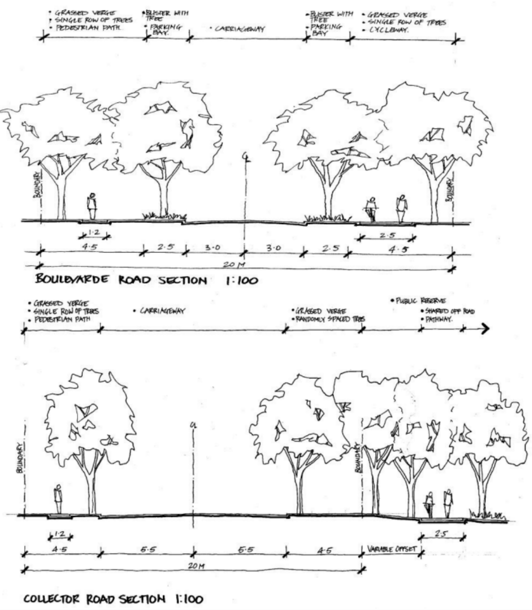

#### 10.4.2.10. Transport Movement Hierarchy

#### Objectives

O.53 To achieve a simple and safe movement system for private vehicles, public transport, pedestrians

and cyclists.

O.54 To provide walkable neighbourhoods with convenient access to neighbourhood shops, community

facilities and other services, with less dependence on cars for travel.

O.55 To provide for access generally by way of an interconnected network of streets and paths which

facilitate safe, efficient and pleasant walking, cycling and driving.

O.56 To facilitate new development which supports the efficiency of public transport systems, and

provides safe, direct access to the system for residents.

| PRESCRIPTIVE CONTROLS AND ACCEPTABLE SOLUTIONS |  |
|---|---|
| PC.1 | The principal access to the West Precinct will be via a roundabout controlled intersection on Aberglasslyn Road at the existing intersection of Tea Tree Avenue. This collector road will link to the main spine/distributor road through the Central Precinct and if required will accommodate a bus route. |
| • O.53 |  |
| • O.54 |  |
| • O.55 |  |
| • O.56 |  |
| PC.3 | No new future lot shall have direct vehicular access to Aberglasslyn Road, except where existing dwelling houses are to be redeveloped in a coordinated and orderly manner. |
| • O.54 |  |
| • O.56 |  |
| AS.1 | Residential development in the West Precinct is not to create new allotments with direct access to Aberglasslyn Road but may create shared access ways to service a small number of additional dwellings adjacent to existing dwellings. |
| • O.54 |  |
| • O.56 |  |
| PC.2 | Road layout and street design will be consistent with Figure 10-17 and following detailed survey and subdivision planning. Figure 10-19 shows typical cross sections for roads in this precinct. |
| • O.53 |  |
| • O.54 |  |
| • O.55 |  |
| • O.56 |  |

> [Picture on page 38: a picture, saved as a picture (images/ch-10-00-special-precincts-locality-plans-and-urban-release-page-38-1.gif, 150 dpi).]

#### Figure 10-18: Western Precinct Road Sections
