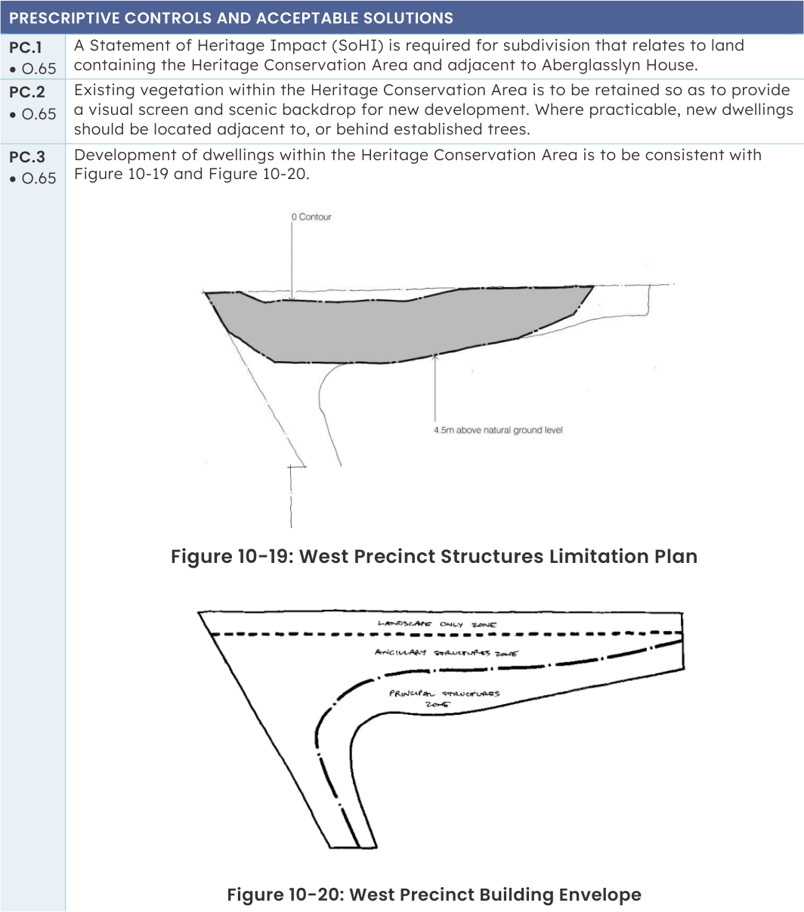

#### 10.4.2.15. Key Development Sites

#### Aberglasslyn Heritage Control Area Objectives

O.65 To ensure that development does not adversely impact upon the setting and context of Aberglasslyn

House.

> [Picture on page 41: a picture, saved as a picture (images/ch-10-00-special-precincts-locality-plans-and-urban-release-page-41-6.gif, 150 dpi).]
> Words printed on the picture (title and legend, copied from the PDF):
> • O.65
> • O.65
> • O.65

Figure 10-19 and Figure 10-20.

Figure 10-19: West Precinct Structures Limitation Plan

Figure 10-20: West Precinct Building Envelope

#### PRESCRIPTIVE CONTROLS AND ACCEPTABLE SOLUTIONS

A Statement of Heritage Impact (SoHI) is required for subdivision that relates to land containing the Heritage Conservation Area and adjacent to Aberglasslyn House.

#### PC.1 PC.2

Existing vegetation within the Heritage Conservation Area is to be retained so as to provide a visual screen and scenic backdrop for new development. Where practicable, new dwellings should be located adjacent to, or behind established trees. Development of dwellings within the Heritage Conservation Area is to be consistent with

#### PC.3

| PRESCRIPTIVE CONTROLS AND ACCEPTABLE SOLUTIONS |  |
|---|---|
| PC.4 • O.65 | Residential development in the Heritage Conservation Area must include specific design and construction measures to comply with the requirements for the minimisation and management of any heritage impacts to Aberglasslyn House. |
| PC.5 • O.65 | All development within the Heritage Conservation Area as shown in Figure 10-14 is to be limited in height to ensure that no structure or element thereof protrudes above the surface defined by the Structures Limitations Plan in Figure 10-19. |
| PC.6 • O.65 | Dwellings and ancillary buildings are to be a maximum of one storey (although they may include habitable rooms within a roof/attic space) and is to only be located within the Principal Structures Zone shown in Figure 10-20. |
| PC.7 • O.65 | Fencing within the Heritage Conservation Area and particularly the Landscape Only Zone shown in Figure 10-20 are to be limited to traditional timber post and wire rural style fencing. |
| AS.1 • O.65 | Ancillary residential buildings including single storey garages or carports (and single storey recreation/community buildings in the case of a specifically designed community title subdivision) may be considered within the Ancillary Structures Zone shown in Figure 10-20, subject to Council’s consent. |
| PC.8 • O.65 | A visual transition is to be created between the new Aberglasslyn urban development and the rural landscape setting of Aberglasslyn House by landscaping of the north- western boundary of the West Precinct to create a dense screen planting (windbreak) as a total visual screen for the length of the Heritage Conservation Area boundary. The screened plantings must be of a durable and suitable species to ensure sufficient height and spread is achieved. Such plantings shall be completed in the first stage of subdivision for the West Precinct, to ensure the plantings reach a satisfactory height and maturity prior to any new housing development being completed in that section of the Precinct. |
| PC.9 • O.65 | Landscaping within the Landscape Only Zone as indicated in Figure 10-20 is to be limited to scattered plantings of endemic eucalypts consistent with the historical use of the site for grazing. No other structures or plantings are to be located within the Landscape Only Zone. |
| PC.10 • O.65 | Any dwellings or outbuildings within the Heritage Conservation Area are to be constructed of external materials and finishes with darker colours and tones, so as to limit visibility, protecting the heritage qualities and rural setting of Aberglasslyn House. External building materials and finishes must also be non-reflective. |
| PC.11 • O.65 | A suitable “Schedule of external colours and building materials” must be submitted to Council for approval with a Statement of Heritage Impact and Development Application for subdivision of land within the Heritage Conservation Area. The relevant development consent will subsequently have a restriction as to user on the subdivision, to apply that Schedule on the land title. |
