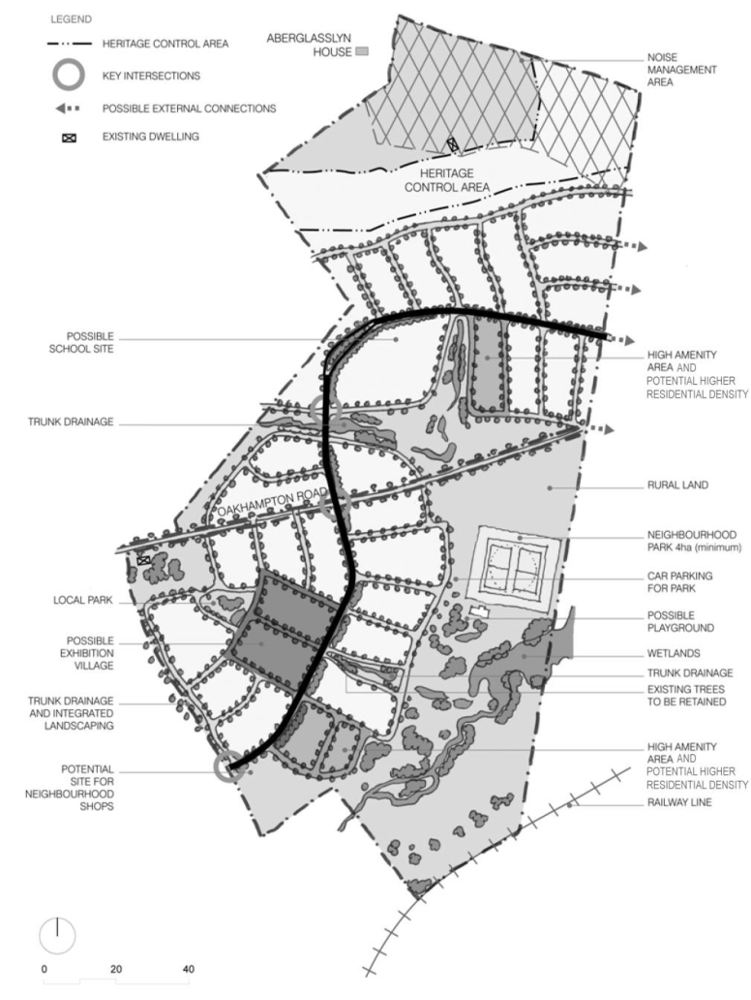
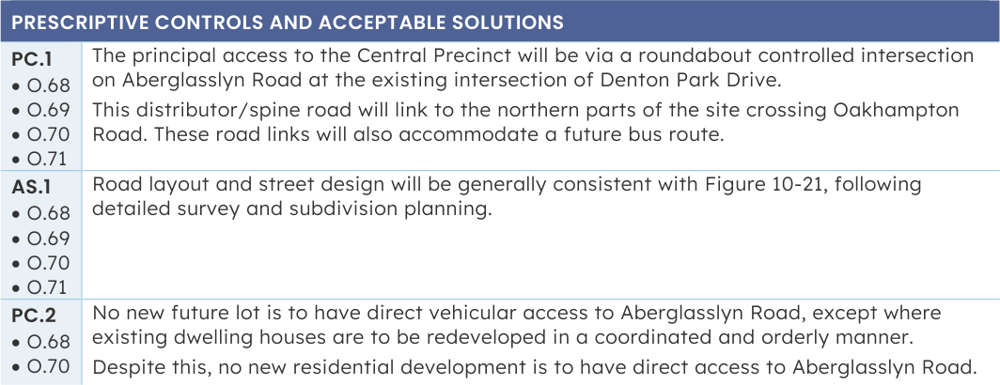

#### 10.4.2.16. Residential Densities

#### Objectives

O.66 To encourage higher density living around transport, open space and service nodes.

O.67 To ensure cost-effective and resource efficient development to promote affordable housing.

#### PRESCRIPTIVE CONTROLS AND ACCEPTABLE SOLUTIONS

Higher residential densities are encouraged in high amenity areas nominated in Figure 10- 17.

#### AS.1

• O.66

• O.67

### Development Requirements – Aberglasslyn Central Precinct

The following is the Precinct Plan provisions referred to in the general provisions above that applies to the Central Precinct.

> [Picture on page 43: a picture, saved as a picture (images/ch-10-00-special-precincts-locality-plans-and-urban-release-page-43-4.gif, 150 dpi).]

#### Figure 10-21: Aberglasslyn – Central Precinct and Road Hierarchy

No specific requirements have been made for the following matters within the Central Precinct as they are already adequately addressed by other relevant provisions within the Maitland Local Environmental Plan 2011 and the Maitland Development Control Plan 2026:

• Neighbourhood Commercial and Retail Uses

• Provision of Public Facilities and Services

#### Objectives

O.68 To achieve a simple and safe movement system for private vehicles, public transport, pedestrians

and cyclists.

O.69 To provide walkable neighbourhoods with convenient access to neighbourhood shops, community

facilities and other services, with less dependence on cars for travel.

O.70 To provide for access generally by way of an interconnected network of streets and paths which

facilitate safe, efficient and pleasant walking, cycling and driving.

O.71 To facilitate new development which supports the efficiency of public transport systems, and

provides safe, direct access to the system for residents.

> [Picture on page 44: a picture, saved as a picture (images/ch-10-00-special-precincts-locality-plans-and-urban-release-page-44-10.gif, 150 dpi).]
> Words printed on the picture (title and legend, copied from the PDF):
> • O.68
> • O.69
> • O.70
> • O.71
> • O.68
> • O.69
> • O.70
> • O.71
> • O.68
> • O.70

#### PRESCRIPTIVE CONTROLS AND ACCEPTABLE SOLUTIONS

The principal access to the Central Precinct will be via a roundabout controlled intersection on Aberglasslyn Road at the existing intersection of Denton Park Drive. This distributor/spine road will link to the northern parts of the site crossing Oakhampton Road. These road links will also accommodate a future bus route.

#### PC.1

Road layout and street design will be generally consistent with Figure 10-21, following detailed survey and subdivision planning.

#### AS.1

No new future lot is to have direct vehicular access to Aberglasslyn Road, except where existing dwelling houses are to be redeveloped in a coordinated and orderly manner. Despite this, no new residential development is to have direct access to Aberglasslyn Road.

#### PC.2
