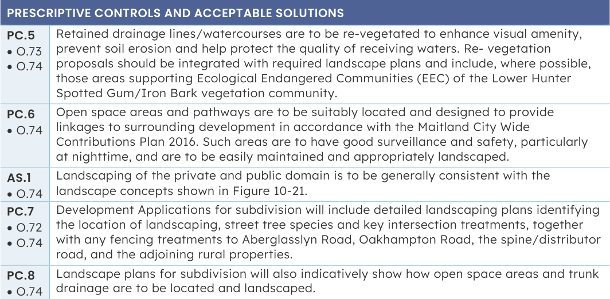

#### 10.4.2.18. Overall Landscaping Strategy

#### Objectives

O.72 To soften the visual impact of all built elements, creating attractive and consistent streetscapes

when viewed by passing traffic and pedestrians.

O.73 To ensure key environmental areas such as waterways, vegetation, land resources, and areas of

cultural significance and scenic value are protected.

O.74 To provide landscaping appropriate to the nature and scale of development that enhances the local

character and streetscape, supports retention and regeneration of ecological corridors and provides visual interest and a suitable backdrop to the built form.

| PRESCRIPTIVE CONTROLS AND ACCEPTABLE SOLUTIONS |  |
|---|---|
| PC.1 • O.73 | A visual and scenic impact assessment is to accompany development applications for Medium and Large Subdivisions and development that are likely to have a visual impact on the area. Such assessments are to address any development of land containing part of the Heritage Control Area and/or with views to Aberglasslyn House. |
| PC.2 | Landscaping will be required on land adjacent to Aberglasslyn Road. |
| • O.74 |  |
| PC.3 | Existing trees are to be retained wherever possible within riparian corridors, open space, within and adjacent to the Aberglasslyn Road reserve and along allotment boundaries. |
| • O.73 |  |
| PC.4 • O.74 | Street tree planting is to be carried out as part of the subdivision design and road construction. Street trees are to be planted to provide a physical barrier to traffic, to contribute to traffic calming, provide shade on footpaths and enhance the view of corridors in all subdivision designs and housing developments. |

> [Picture on page 45: a picture, saved as a picture (images/ch-10-00-special-precincts-locality-plans-and-urban-release-page-45-1.gif, 150 dpi).]
> Words printed on the picture (title and legend, copied from the PDF):
> • O.73
> • O.74
> • O.74
> • O.74
> • O.72
> • O.74
> • O.74

#### PRESCRIPTIVE CONTROLS AND ACCEPTABLE SOLUTIONS PC.5

Retained drainage lines/watercourses are to be re-vegetated to enhance visual amenity, prevent soil erosion and help protect the quality of receiving waters. Re- vegetation proposals should be integrated with required landscape plans and include, where possible, those areas supporting Ecological Endangered Communities (EEC) of the Lower Hunter Spotted Gum/Iron Bark vegetation community.

#### PC.6

Open space areas and pathways are to be suitably located and designed to provide linkages to surrounding development in accordance with the Maitland City Wide Contributions Plan 2016. Such areas are to have good surveillance and safety, particularly at nighttime, and are to be easily maintained and appropriately landscaped. Landscaping of the private and public domain is to be generally consistent with the landscape concepts shown in Figure 10-21.

#### AS.1 PC.7

Development Applications for subdivision will include detailed landscaping plans identifying the location of landscaping, street tree species and key intersection treatments, together with any fencing treatments to Aberglasslyn Road, Oakhampton Road, the spine/distributor road, and the adjoining rural properties. Landscape plans for subdivision will also indicatively show how open space areas and trunk drainage are to be located and landscaped.

#### PC.8
