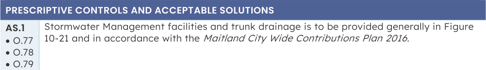

#### 10.4.2.20. Stormwater and Water Quality

#### Objectives

O.77 To provide for an integrated and sustainable approach to the design and provision of open space

and urban water management.

O.78 To protect and enhance the water quality, water quantity and habitat value of downstream

waterways and environment.

O.79 To prevent erosion and run-off during site preparation, construction and the ongoing use of the land

to minimise cumulative impact on receiving waterways.

> [Picture on page 45: a picture, saved as a picture (images/ch-10-00-special-precincts-locality-plans-and-urban-release-page-45-46.gif, 150 dpi).]
> Words printed on the picture (title and legend, copied from the PDF):
> • O.77
> • O.78
> • O.79

#### PRESCRIPTIVE CONTROLS AND ACCEPTABLE SOLUTIONS

Stormwater Management facilities and trunk drainage is to be provided generally in Figure 10-21 and in accordance with the Maitland City Wide Contributions Plan 2016.

#### AS.1

#### Objectives

O.80 Amelioration of natural and environmental hazards, including bushfire, flooding and site

contamination and, in relation to natural hazards, the safe occupation of, and the evacuation from, any land so affected is achieved.

| PRESCRIPTIVE CONTROLS AND ACCEPTABLE SOLUTIONS |  |
|---|---|
| PC.1 | Filling of drainage lines is to be limited to that necessary to render flood free all residential land. |
| • O.80 |  |
| AS.1 | Retained drainage lines/water courses should be rehabilitated through comprehensive replanting with indigenous plant species. |
| • O.80 |  |
| PC.2 • O.80 | Subdivision design and lot layout must identify and ensure that any future residential housing will not be adversely affected by noise or vibration from traffic, railways nor any other adjoining land uses including the extractive industry adjacent to the Hunter River. |
| PC.3 • O.80 | Noise and vibration assessments are required to be submitted with relevant Development Applications for subdivisions that adjoin incompatible land uses, including classified roads and rail corridors, and extractive industries within the Hunter River. |
| PC.4 | Development must comply with the relevant provisions of Planning for Bush Fire Protection 2019. |
| • O.80 |  |
| PC.5 | Land within the flood planning area is to address Clause 5.21 of the Maitland Local Environmental Plan 2011. |
| • O.80 |  |
| PC.6 | All development applications must demonstrate compliance with the requirements of the State Environmental Planning Policy (Resilience and Hazards) 2021. |
| • O.80 |  |
