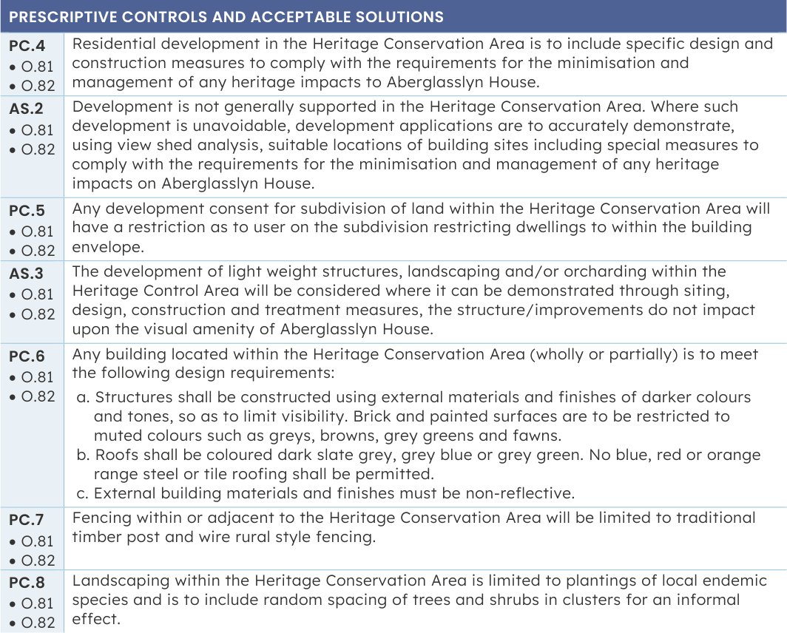

#### 10.4.2.22. Key Development Sites

#### Aberglasslyn Heritage Control Area Objectives

O.81 To ensure that development does not adversely impact upon the setting and context of Aberglasslyn

House.

O.82 To provide a visual screen and scenic backdrop for new development.

| PRESCRIPTIVE CONTROLS AND ACCEPTABLE SOLUTIONS |  |
|---|---|
| PC.1 | A Statement of Heritage Impact (SoHI) is required for subdivision that relates to land containing any part of the Heritage Conservation Area and adjacent to Aberglasslyn House. |
| • O.81 |  |
| • O.82 |  |
| PC.2 | Existing vegetation within the Heritage Conservation Area is to be retained. |
| • O.81 |  |
| • O.82 |  |
| AS.1 | Where practicable, new dwellings should be located adjacent to, or behind established trees. |
| • O.81 |  |
| • O.82 |  |
| PC.3 • O.81 • O.82 | All dwelling houses and outbuildings on land containing the Heritage Conservation Area are: a. to be limited to single storey, and b. must be no greater than 5m in height when measured from the existing ground level to the highest point of the ridgeline. |

> [Picture on page 47: a map, saved as a picture (images/ch-10-00-special-precincts-locality-plans-and-urban-release-page-47-1.gif, 150 dpi); the street names and other small labels are on the picture.]
> Words printed on the picture (title and legend, copied from the PDF):
> the following design requirements:

#### PRESCRIPTIVE CONTROLS AND ACCEPTABLE SOLUTIONS

Residential development in the Heritage Conservation Area is to include specific design and construction measures to comply with the requirements for the minimisation and management of any heritage impacts to Aberglasslyn House.

#### PC.4

#### AS.2

Development is not generally supported in the Heritage Conservation Area. Where such development is unavoidable, development applications are to accurately demonstrate, using view shed analysis, suitable locations of building sites including special measures to comply with the requirements for the minimisation and management of any heritage impacts on Aberglasslyn House. Any development consent for subdivision of land within the Heritage Conservation Area will have a restriction as to user on the subdivision restricting dwellings to within the building envelope.

#### PC.5

#### AS.3

The development of light weight structures, landscaping and/or orcharding within the Heritage Control Area will be considered where it can be demonstrated through siting, design, construction and treatment measures, the structure/improvements do not impact upon the visual amenity of Aberglasslyn House. Any building located within the Heritage Conservation Area (wholly or partially) is to meet

#### PC.6

• O.82 a. Structures shall be constructed using external materials and finishes of darker colours

and tones, so as to limit visibility. Brick and painted surfaces are to be restricted to muted colours such as greys, browns, grey greens and fawns.

b. Roofs shall be coloured dark slate grey, grey blue or grey green. No blue, red or orange

range steel or tile roofing shall be permitted.

c. External building materials and finishes must be non-reflective. Fencing within or adjacent to the Heritage Conservation Area will be limited to traditional timber post and wire rural style fencing.

#### PC.7

Landscaping within the Heritage Conservation Area is limited to plantings of local endemic species and is to include random spacing of trees and shrubs in clusters for an informal

#### PC.8
