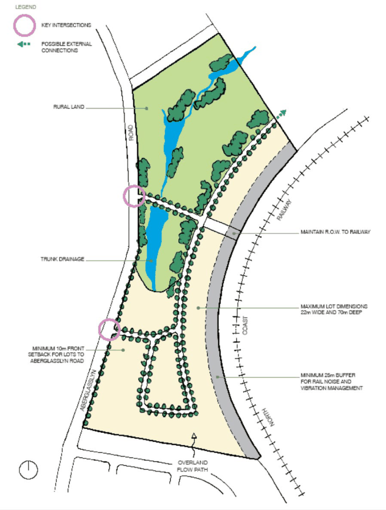
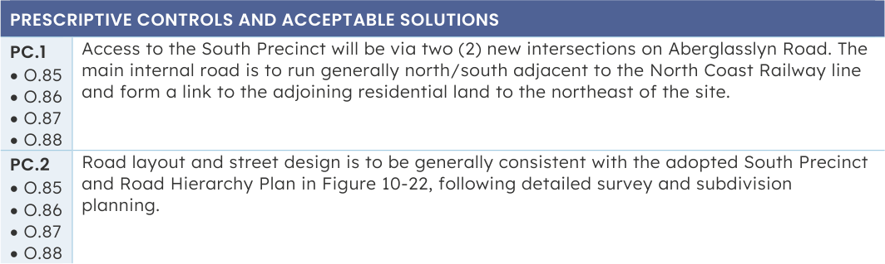

#### 10.4.2.23. Residential Densities

#### Objectives

O.83 To encourage higher density living around transport, open space and service nodes.

O.84 To ensure cost-effective and resource efficient development to promote affordable housing.

#### PRESCRIPTIVE CONTROLS AND ACCEPTABLE SOLUTIONS

Higher residential densities are encouraged in high amenity areas nominated in Figure 10- 21.

#### AS.1

• O.83

• O.84

### Development Requirements – Aberglasslyn South Precinct

The following is the Precinct Plan provisions referred to in the general provisions above that applies to the South Precinct.

> [Picture on page 48: a picture, saved as a picture (images/ch-10-00-special-precincts-locality-plans-and-urban-release-page-48-4.gif, 150 dpi).]

#### Figure 10-22: Aberglasslyn - South Precinct and Road Hierarchy

No specific requirements have been made for the following matters within the Central Precinct as they are already adequately addressed by other relevant provisions within the Maitland Local Environmental Plan 2011 and the Maitland Development Control Plan 2026:

• Residential Densities

• Neighbourhood Commercial and Retail Uses

• Provision of Public Facilities and Services

• Key Development Sites

#### Objectives

O.85 To achieve a simple and safe movement system for private vehicles, public transport, pedestrians

and cyclists.

O.86 To provide walkable neighbourhoods with convenient access to neighbourhood shops, community

facilities and other services, with less dependence on cars for travel.

O.87 To provide for access generally by way of an interconnected network of streets and paths which

facilitate safe, efficient and pleasant walking, cycling and driving.

O.88 To facilitate new development which supports the efficiency of public transport systems, and

provides safe, direct access to the system for residents.

> [Picture on page 49: a picture, saved as a picture (images/ch-10-00-special-precincts-locality-plans-and-urban-release-page-49-10.gif, 150 dpi).]
> Words printed on the picture (title and legend, copied from the PDF):
> • O.85
> • O.86
> • O.87
> • O.88
> planning.
> • O.85
> • O.86
> • O.87
> • O.88

#### PRESCRIPTIVE CONTROLS AND ACCEPTABLE SOLUTIONS

Access to the South Precinct will be via two (2) new intersections on Aberglasslyn Road. The main internal road is to run generally north/south adjacent to the North Coast Railway line and form a link to the adjoining residential land to the northeast of the site.

#### PC.1

Road layout and street design is to be generally consistent with the adopted South Precinct and Road Hierarchy Plan in Figure 10-22, following detailed survey and subdivision

#### PC.2
