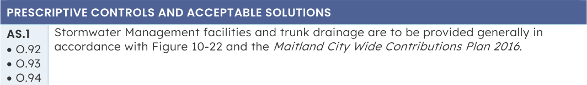

#### 10.4.2.27. Stormwater and Water Quality

#### Objectives

O.92 To provide for an integrated and sustainable approach to the design and provision of open space

and urban water management.

O.93 To protect and enhance the water quality, water quantity and habitat value of downstream

waterways and environment.

O.94 To prevent erosion and run-off during site preparation, construction and the ongoing use of the land

to minimise cumulative impact on receiving waterways.

> [Picture on page 50: a picture, saved as a picture (images/ch-10-00-special-precincts-locality-plans-and-urban-release-page-50-22.gif, 150 dpi).]
> Words printed on the picture (title and legend, copied from the PDF):
> • O.92
> • O.93
> • O.94

#### PRESCRIPTIVE CONTROLS AND ACCEPTABLE SOLUTIONS

Stormwater Management facilities and trunk drainage are to be provided generally in accordance with Figure 10-22 and the Maitland City Wide Contributions Plan 2016.

#### AS.1
