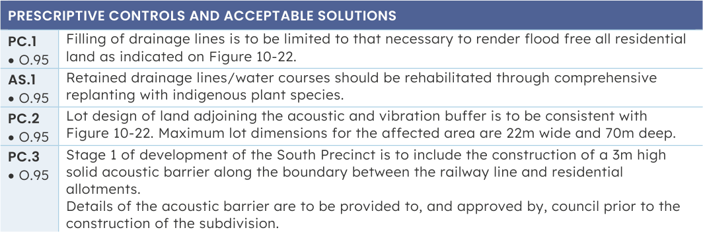

#### 10.4.2.28. Amelioration of Natural and Environmental Hazards

#### Objectives

O.95 Amelioration of natural and environmental hazards, including bushfire, flooding and site

contamination and, in relation to natural hazards, the safe occupation of, and the evacuation from, any land so affected is achieved.

> [Picture on page 50: a picture, saved as a picture (images/ch-10-00-special-precincts-locality-plans-and-urban-release-page-50-32.gif, 150 dpi).]
> Words printed on the picture (title and legend, copied from the PDF):
> • O.95
> • O.95
> • O.95
> • O.95
> allotments.
> construction of the subdivision.

Figure 10-22. Maximum lot dimensions for the affected area are 22m wide and 70m deep.

#### PRESCRIPTIVE CONTROLS AND ACCEPTABLE SOLUTIONS

Filling of drainage lines is to be limited to that necessary to render flood free all residential land as indicated on Figure 10-22.

#### PC.1

Retained drainage lines/water courses should be rehabilitated through comprehensive replanting with indigenous plant species.

#### AS.1

Lot design of land adjoining the acoustic and vibration buffer is to be consistent with

#### PC.2 PC.3

Stage 1 of development of the South Precinct is to include the construction of a 3m high solid acoustic barrier along the boundary between the railway line and residential

Details of the acoustic barrier are to be provided to, and approved by, council prior to the

| PRESCRIPTIVE CONTROLS AND ACCEPTABLE SOLUTIONS Residential development of allotments adjacent to the railway line and containing the noise vibration management area must include specific design and construction measures to to satisfy AS 3671-1989 Category 3 construction. A separate acoustic engineer’s required to certify that each dwelling, at the design stage, can meet the of State Environmental Planning Policy (Transport & Infrastructure) 2021. front setback of 10m applies to any residential building constructed on land Road. Design and construction measures are to be to a level to satisfy Category 3 construction. A separate acoustic engineer’s report is required to at the design stage, can attenuate 27dB(A) at the façade of the must identify and ensure that any future residential housing will noise or vibration from traffic, railways or any other adjoining industries along the Hunter River. are to be submitted with Development Applications for land uses, including classified roads and rail within the Hunter River. be assessed and designed in accordance with the 2019. Clause 5.21 of the Maitland Local compliance with the requirements of the Hazards) 2021. |  |
|---|---|
| PC.4 • O.95 and a level report is requirements |  |
| PC.5 A minimum • O.95 facing Aberglasslyn AS 3671-1989 certify each dwelling, dwelling. |  |
| PC.6 Subdivision and lot layout • O.95 not be adversely affected by land uses including extractive |  |
| PC.7 Noise and vibration assessments • O.95 subdivision that adjoins incompatible corridors, and extractive industries |  |
| PC.8 | Development on bushfire prone land will NSW RFS Planning for Bushfire Protection |
| • O.95 |  |
| PC.9 | Land within the flood planning area must address Environmental Plan 2011. |
| • O.95 |  |
| PC.10 | All development applications are to demonstrate State Environmental Planning Policy (Resilience and |
| • O.95 |  |
