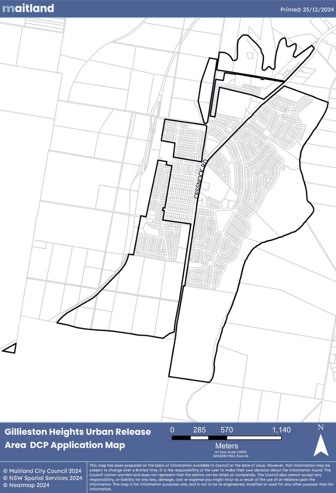
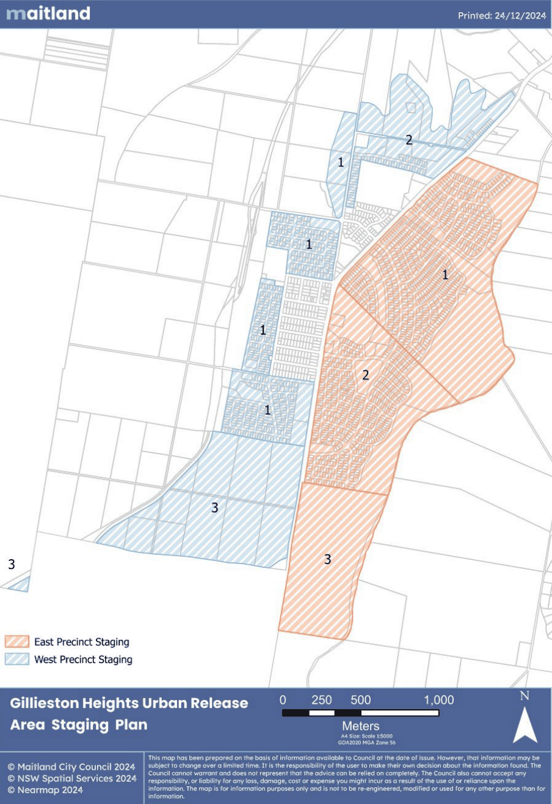
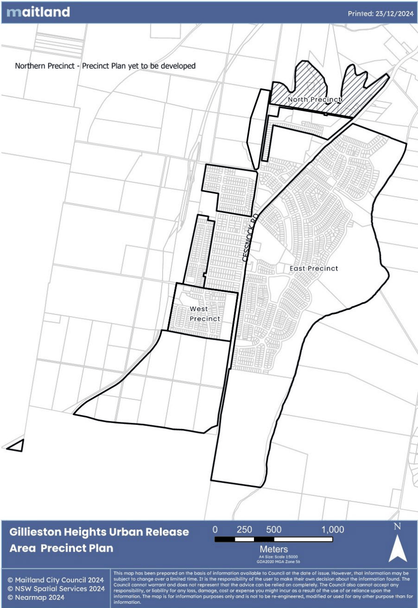

#### 10.4.3. Gillieston Heights Urban Release Area

> [Picture on page 52: a picture, saved as a picture (images/ch-10-00-special-precincts-locality-plans-and-urban-release-page-52-2.gif, 150 dpi).]

#### Figure 10-23: Gillieston Heights Urban Release Area

The desired future character for the Gillieston Heights Urban Release Area comprises a mix of residential housing styles and types, supported by a central neighbourhood centre, a potential school site, open space and areas of existing vegetation, which provide a backdrop to the future development.

On the western side of the release area, a roadside buffer for landscaping and acoustic separation will run adjacent to the Cessnock Road frontage, effectively denying direct vehicular access to the new development, except via new traffic-controlled intersections. The eastern side of the release area is generally defined by an escarpment lined in parts with existing bushland, which must be retained to provide a visual backdrop to new development. Any roads and development along this eastern edge must respond to the topographic constraints of the land, so as to minimise cut and fill.

The residential areas are to be developed into a series of neighbourhoods defined by the natural landform, shared pathways and roads. Streets will be designed for safety, connectivity and to provide opportunities for establishing new plantings and attractive streetscapes. Any school, neighbourhood shops and parks will be located adjacent to bus routes and provide a focal point for community activity.

Riparian areas adjacent to existing water courses will be retained and enhanced as part of the water cycle management of the release area and existing dams on site will be used wherever practicable as water quality devices treating water prior to discharge into receiving waterways.

Development within this Urban Release Area is well progressed. The overall Area Plan prepared for this Urban Release Area comprises precinct plans for the East and West precinct. These precincts are bisected by Cessnock Road.

> [Picture on page 54: a picture, saved as a picture (images/ch-10-00-special-precincts-locality-plans-and-urban-release-page-54-1.gif, 150 dpi).]

#### Figure 10-24: Gillieston Heights URA Staging Plan

> [Picture on page 55: a picture, saved as a picture (images/ch-10-00-special-precincts-locality-plans-and-urban-release-page-55-1.gif, 150 dpi).]

#### Figure 10-25: Gillieston Heights URA Precinct Plan

No specific requirements have been made for the following matters within the General Provisions for the Gillieston Heights Urban Release Area as they are already adequately addressed by other relevant provisions within the Precinct Plans provided for this URA, the Maitland Local Environmental Plan 2011 and the Maitland Development Control Plan 2026:

• Transport Movement Hierarchy

• Overall Landscaping Strategy

• Passive and Active Recreation Areas

• Stormwater and Water Quality

• Amelioration of Natural and Environmental Hazards

• Key Development Sites

• Residential Densities

• Neighbourhood Commercial and Retail Uses

• Provision of Public Facilities and Services
