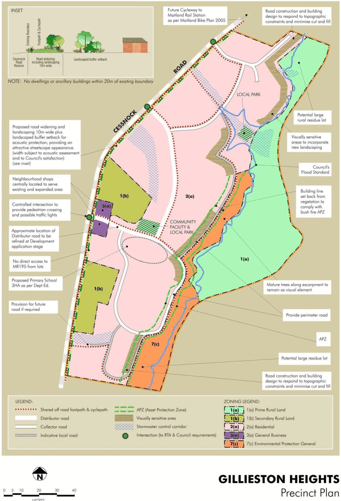
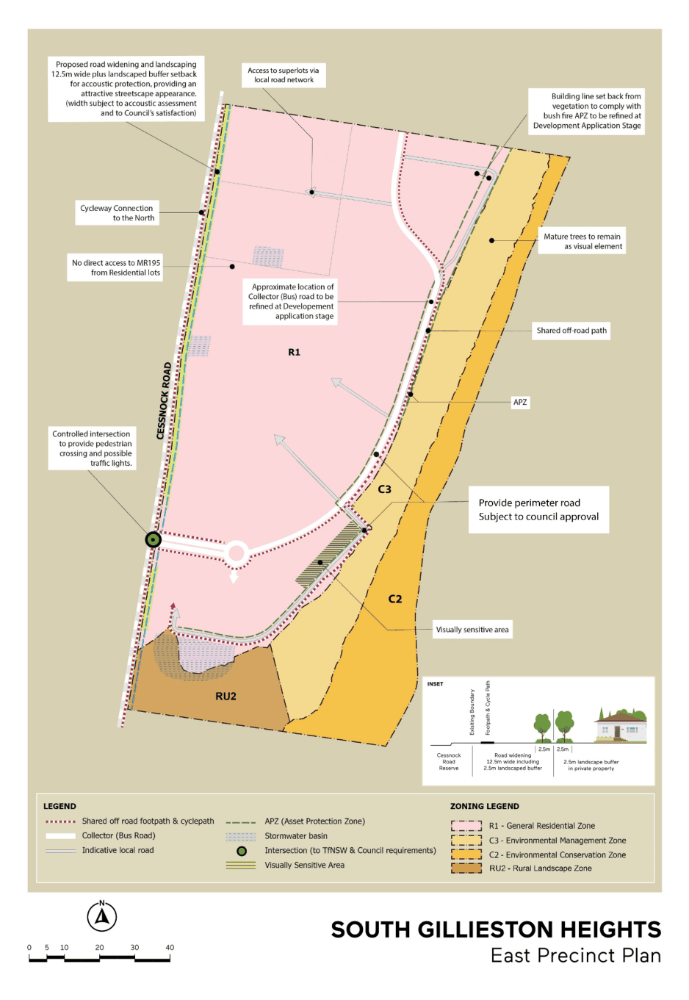

#### 10.4.3.1. Staging Plan

#### Objectives

O.96 To provide for the timely and efficient release of urban land, making provision for necessary

infrastructure and sequencing.

#### PRESCRIPTIVE CONTROLS AND ACCEPTABLE SOLUTIONS

Staging of the urban release area should be generally in accordance with Figure 10-24.

#### AS.1

• O.96

### Development Requirements – Gillieston Heights East Precinct

The following are the Precinct Plan provisions referred to in Figure 10-25 that applies to the East

> [Picture on page 57: a picture, saved as a picture (images/ch-10-00-special-precincts-locality-plans-and-urban-release-page-57-3.gif, 150 dpi).]

Precinct.

#### Figure 10-26: Gillieston Heights East Precinct Plan

> [Picture on page 58: a picture, saved as a picture (images/ch-10-00-special-precincts-locality-plans-and-urban-release-page-58-1.gif, 150 dpi).]

#### Figure 10-27: South Gillieston Heights East Precinct Plan

No specific requirements have been made for the following matters within the East Precinct as they are already adequately addressed by other relevant provisions within the Maitland Local Environmental Plan 2011 and the Maitland Development Control Plan 2026:

• Passive and Active Recreation Areas

• Stormwater and Water Quality

• Residential Densities

• Provision of Public Facilities and Services
