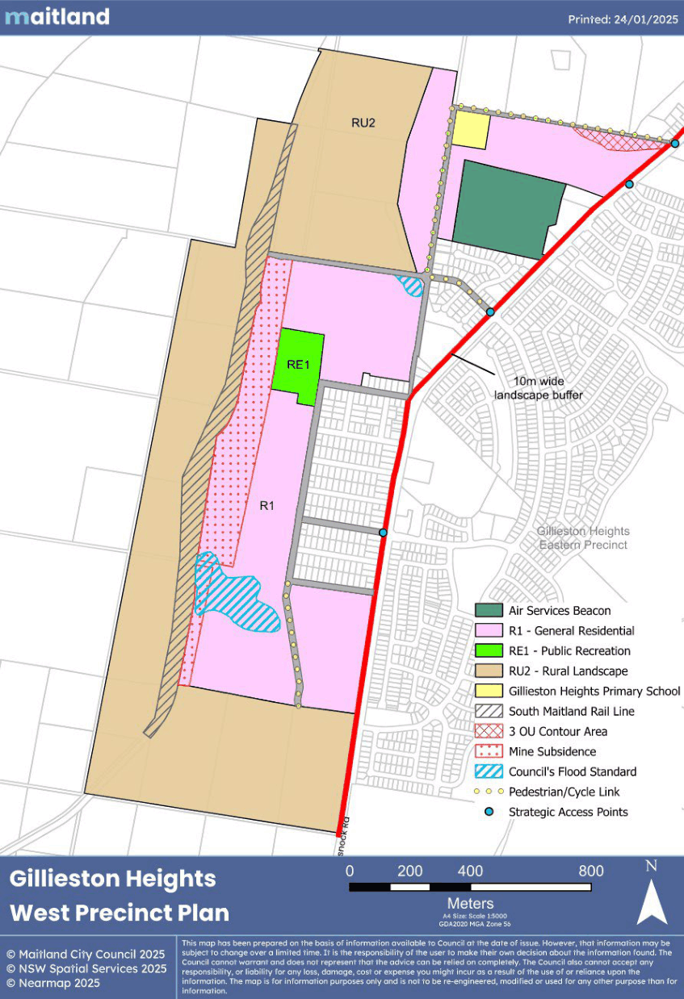

#### 10.4.3.7. Neighbourhood Commercial and Retail Uses

#### Objectives

O.110 To ensure that local commercial and retail uses are provided for relevant development sites.

| PRESCRIPTIVE CONTROLS AND ACCEPTABLE SOLUTIONS The commercial centre is to be located in generally in accordance with Figure 10-27 and easy and direct pedestrian, cyclist and vehicle access to the surrounding residential area and good visibility from the main access route. structure adjoining the commercial centre is to be designed to accommodate buses and bus stops. development within land zoned for business purposes is not subject to the requirements adjacent to Cessnock Road (MR 195) as shown on the for the 10m road widening. Notwithstanding this, such include appropriate landscaping as part of the overall design. located adjacent to Cessnock Road (MR 195), including land should be appropriately designed so as to provide a high- with visual interest, particularly by discouraging bulky collector road close to the commercial centre to to have direct access to Cessnock Road. |  |
|---|---|
| PC.1 • O.110 have |  |
| PC.2 | The street or facilitate |
| • O.110 |  |
| AS.1 Commercial • O.110 landscape buffer Precinct Plan, except development must |  |
| AS.2 Development, which is • O.110 zoned for business purposes, quality architectural appearance buildings and blank walls. |  |
| PC.3 | The school is to be located on a encourage use of the centre, but is not |
| • O.110 |  |

### Development Requirements – Gillieston Heights West Precinct

The following is the Precinct Plan provisions referred to in Figure 10-25 that applies to the West

> [Picture on page 63: a picture, saved as a picture (images/ch-10-00-special-precincts-locality-plans-and-urban-release-page-63-3.gif, 150 dpi).]

Precinct.

#### Figure 10-28: Gillieston Heights West Precinct Plan

No specific requirements have been made for the following matters within the West Precinct as they are already adequately addressed by other relevant provisions within the Maitland Local Environmental Plan 2011 and the Maitland Development Control Plan 2026:

• Passive and Active Recreation Areas

• Stormwater and Water Quality

• Residential Densities

• Neighbourhood Commercial and Retail Uses

• Provision of Public Facilities and Services
