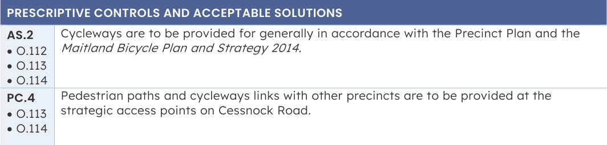

#### 10.4.3.9. Transport Movement Hierarchy

#### Objectives

O.112 To achieve a simple and safe movement system for private vehicles, public transport, pedestrians

and cyclists.

O.113 To provide walkable neighbourhoods with convenient access to neighbourhood shops, community

facilities and other services, with less dependence on cars for travel.

O.114 To provide for access generally by way of an interconnected network of streets and paths which

facilitate safe, efficient and pleasant walking, cycling and driving.

O.115 To facilitate new development which supports the efficiency of public transport systems, and

provides safe, direct access to the system for residents.

| PRESCRIPTIVE CONTROLS AND ACCEPTABLE SOLUTIONS |  |
|---|---|
| AS.1 | Road layout should be consistent with the Precinct Plan. Development applications for subdivisions must ensure that road networks connect to other development areas in a logical hierarchy of street function. |
| • O.112 |  |
| • O.113 |  |
| • O.114 |  |
| PC.1 | Each development area is required to have access to a minimum of one of the strategic access intersections as identified on the Precinct Plan. The northern development area fronting Gillieston Road is required to have access to Vintage Drive as well as the upgraded intersection at Gillieston Road. |
| • O.112 |  |
| • O.114 |  |
| • O.115 |  |
| PC.2 | No new future lot is to have direct vehicular access to Cessnock Road (MR 195). |
| • O.112 |  |
| • O.114 |  |
| PC.3 • O.112 • O.114 | Road widening to 11m carriageway width must be provided for lots fronting Gillieston Road, Kiah Road and Cartwright Street. Reconstruction of these roads for their full length providing continuous access to the intersection points must be undertaken in accordance with Council’s MoES. All other roads including Ryans Road, are to be constructed in accordance with Council’s MoES. |

> [Picture on page 65: a picture, saved as a picture (images/ch-10-00-special-precincts-locality-plans-and-urban-release-page-65-1.gif, 150 dpi).]
> Words printed on the picture (title and legend, copied from the PDF):
> • O.112
> • O.113
> • O.114
> • O.113
> • O.114

#### PRESCRIPTIVE CONTROLS AND ACCEPTABLE SOLUTIONS

Cycleways are to be provided for generally in accordance with the Precinct Plan and the Maitland Bicycle Plan and Strategy 2014.

#### AS.2

Pedestrian paths and cycleways links with other precincts are to be provided at the strategic access points on Cessnock Road.

#### PC.4
