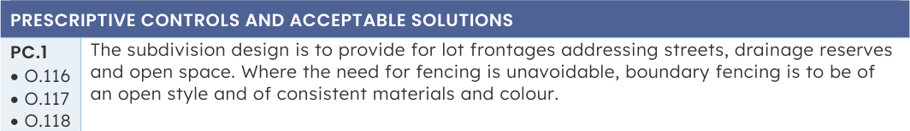

#### 10.4.3.10. Overall Landscaping Strategy

#### Objectives

O.116 To soften the visual impact of all built elements, creating attractive and consistent streetscapes

when viewed by passing traffic and pedestrians.

O.117 To ensure key environmental areas such as waterways, vegetation, land resources, and areas of

cultural significance and scenic value are protected.

O.118 To provide landscaping appropriate to the nature and scale of development that enhances the local

character and streetscape, supports retention and regeneration of ecological corridors and provides visual interest and a suitable backdrop to the built form.

> [Picture on page 65: a picture, saved as a picture (images/ch-10-00-special-precincts-locality-plans-and-urban-release-page-65-18.gif, 150 dpi).]
> Words printed on the picture (title and legend, copied from the PDF):
> • O.116
> • O.117
> • O.118

#### PRESCRIPTIVE CONTROLS AND ACCEPTABLE SOLUTIONS

The subdivision design is to provide for lot frontages addressing streets, drainage reserves and open space. Where the need for fencing is unavoidable, boundary fencing is to be of an open style and of consistent materials and colour.

#### PC.1
