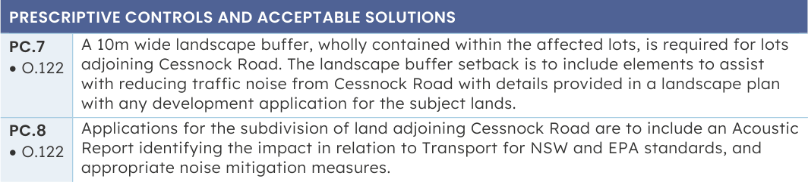
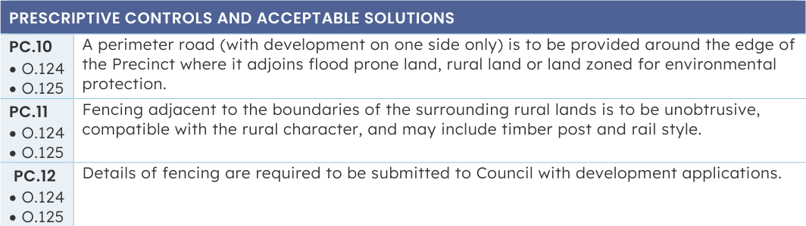
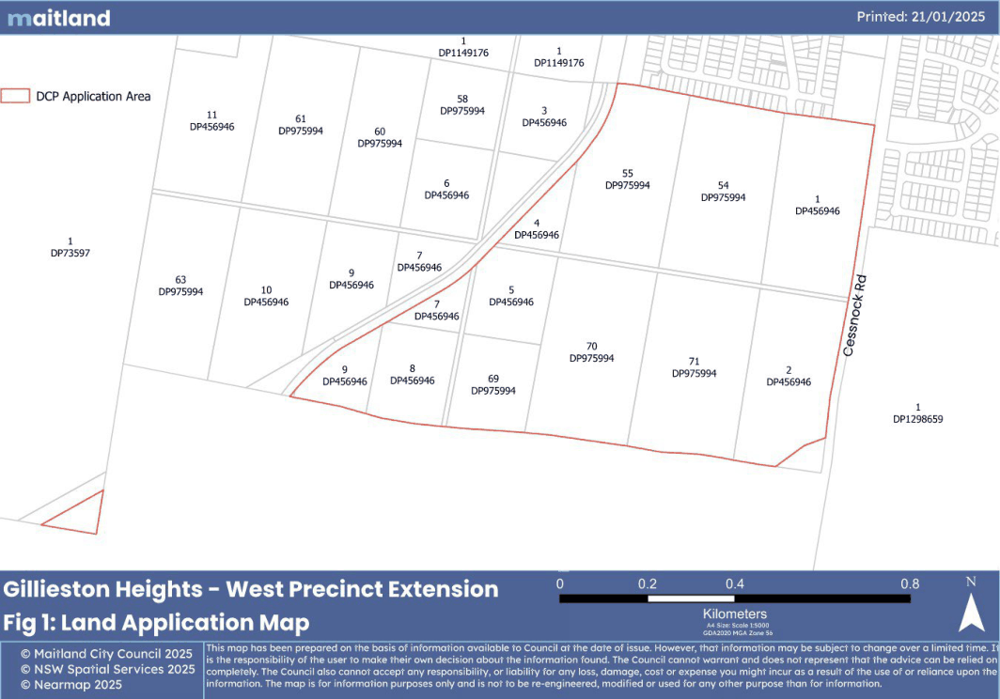

#### 10.4.3.11. Amelioration of Natural and Environmental Hazards

#### Objectives

O.119 Amelioration of natural and environmental hazards, including bushfire, flooding and site

contamination and, in relation to natural hazards, the safe occupation of, and the evacuation from, any land so affected is achieved.

| PRESCRIPTIVE CONTROLS AND ACCEPTABLE SOLUTIONS |  |
|---|---|
| PC.1 | Flood free access is to be available to all proposed allotments. |
| • O.119 |  |
| PC.2 • O.119 | Development must comply with the relevant provisions of Planning for Bush Fire Protection 2019. |
| PC.3 • O.119 | Land within the flood planning area is to address Clause 5.21 of the Maitland Local Environmental Plan 2011. |
| PC.4 • O.119 | All development applications must demonstrate compliance with the requirements of the State Environmental Planning Policy (Resilience and Hazards) 2021. |

#### Land adjoining South Maitland Railway Objectives

O.120 To ensure that future residential development is not adversely affected by any noise and vibration

from the South Maitland rail corridor.

| PRESCRIPTIVE CONTROLS AND ACCEPTABLE SOLUTIONS |  |
|---|---|
| PC.1 | No residential development is to occur within 60m of the western boundary of Lot 1 DP 986923 as shown on the Precinct Plan. |
| • O.120 |  |
| PC.2 • O.120 | A noise and vibration assessment, prepared by a suitably qualified acoustic engineer, is to accompany development applications for land adjoining the South Maitland Railway. Appropriate noise mitigation measures are to be provided, in accordance with recommendations of the acoustic report, for any land adjoining the South Maitland Railway. |
| PC.3 • O.120 | Residential subdivision and development is to be designed so as to comply with the relevant standards and criteria for noise and vibration contained within the State Environmental Planning Policy (Transport and Infrastructure) 2021 and DCCEEW standards at the time. |
| AS.1 • O.120 | Appropriate noise and vibration controls are to be provided by means of separating the source and the receiver, including utilising landscaping and buffers which do not detract from the streetscape and visual appearance of the area. Applying noise attenuation building design techniques to new housing is strongly encouraged. |

#### Land surrounding Air Services Australia Beacon Objectives

O.121 To ensure that the Air Services Australia Beacon is not adversely affected by future residential

development.

| PRESCRIPTIVE CONTROLS AND ACCEPTABLE SOLUTIONS |  |
|---|---|
| PC.4 • O.121 | No part of any building within 150m of the Doppler VHF Omni Directional Range (DVOR) vector, located on Lot 1 DP 817693 (No. 258 Cessnock Road, Gillieston Heights) is to protrude above a height of RL 42m AHD. |
| PC.5 | Any landscaping of lots within 150m of the DVOR vector is to be maintained below a height of RL 42m AHD. |
| • O.121 |  |

#### Land fronting Cessnock Road Objectives

O.122 To ensure that future residential development is not adversely affected by any noise and vibration

from Cessnock Road.

#### PRESCRIPTIVE CONTROLS AND ACCEPTABLE SOLUTIONS PC.6

• O.122

Any development application for subdivision of Lot 1 DP 197680 is to make provision for road connection from Cartwright Street through the site to enable future access to the south of the Precinct.

> [Picture on page 67: a picture, saved as a picture (images/ch-10-00-special-precincts-locality-plans-and-urban-release-page-67-1.gif, 150 dpi).]
> Words printed on the picture (title and legend, copied from the PDF):
> • O.122
> • O.122
> appropriate noise mitigation measures.

#### PRESCRIPTIVE CONTROLS AND ACCEPTABLE SOLUTIONS PC.7

A 10m wide landscape buffer, wholly contained within the affected lots, is required for lots adjoining Cessnock Road. The landscape buffer setback is to include elements to assist with reducing traffic noise from Cessnock Road with details provided in a landscape plan with any development application for the subject lands.

#### PC.8

Applications for the subdivision of land adjoining Cessnock Road are to include an Acoustic Report identifying the impact in relation to Transport for NSW and EPA standards, and

#### Land adjoining Poultry Farm Objectives

O.123 To ensure that future residential development is not adversely affected by the operation of the

poultry farm.

#### PRESCRIPTIVE CONTROLS AND ACCEPTABLE SOLUTIONS PC.9

• O.123

No development is to occur in areas subject to odour levels greater than 3 odour units (OU) as identified in the Precinct Plan, unless evidence is provided that the poultry operations have ceased.

#### Rural Land/Flood Fringe Interface Objectives

O.124 Development adjacent to rural zones and flood prone lands are to be suitably designed so as to be

compatible with the existing rural landscape and setting.

O.125 Fencing is to make a positive contribution to the visual appearance of development and will be

consistent with the overall landscaping strategy.

> [Picture on page 67: a picture, saved as a picture (images/ch-10-00-special-precincts-locality-plans-and-urban-release-page-67-27.gif, 150 dpi).]
> Words printed on the picture (title and legend, copied from the PDF):
> • O.124
> • O.125
> • O.124
> • O.125
> • O.124
> • O.125

#### PRESCRIPTIVE CONTROLS AND ACCEPTABLE SOLUTIONS

A perimeter road (with development on one side only) is to be provided around the edge of the Precinct where it adjoins flood prone land, rural land or land zoned for environmental protection.

#### PC.10

Fencing adjacent to the boundaries of the surrounding rural lands is to be unobtrusive, compatible with the rural character, and may include timber post and rail style.

#### PC.11

Details of fencing are required to be submitted to Council with development applications.

#### PC.12

### Development Requirements – Gillieston Heights West Precinct

### Extension

The following provisions apply to the residential zoned land that make up Regrowth-Kurri Kurri and that are located within the Maitland Local Government Area as identified by Figure 10-29.

> [Picture on page 68: a picture, saved as a picture (images/ch-10-00-special-precincts-locality-plans-and-urban-release-page-68-5.gif, 150 dpi).]

#### Figure 10-29: Gillieston Heights West Extension Precinct Plan

The desired future character for Regrowth-Kurri Kurri Urban Release Area comprises a mix of residential housing, supported by a central neighbourhood centre, open space, and areas of existing vegetation, which will provide a backdrop to future development. It is the logical southern extension of existing residential development located at Gillieston Heights to the north.

On the eastern side of the Urban Release Area, landscaping will run adjacent to the Cessnock Road frontage to provide separation for future dwellings, effectively denying vehicular access to individual lots, except via new traffic-controlled intersections. The western side of the release area is defined by the South Maitland Railway Line.

The residential areas are to be developed into a series of neighbourhoods defined by the natural landform, shared pathways, and roads. Streets will be defined for safety, connectivity and will provide opportunities for establishing new plantings and attractive streetscapes.

No specific requirements have been made for the following matters within the West Extension Precinct as they are already adequately addressed by other relevant provisions within the Maitland Local Environmental Plan 2011 and the Maitland Development Control Plan 2026:

• Passive and Active Recreation Areas

• Stormwater and Water Quality

• Residential Densities

• Neighbourhood Commercial and Retail Uses

• Provision of Public Facilities and Services
