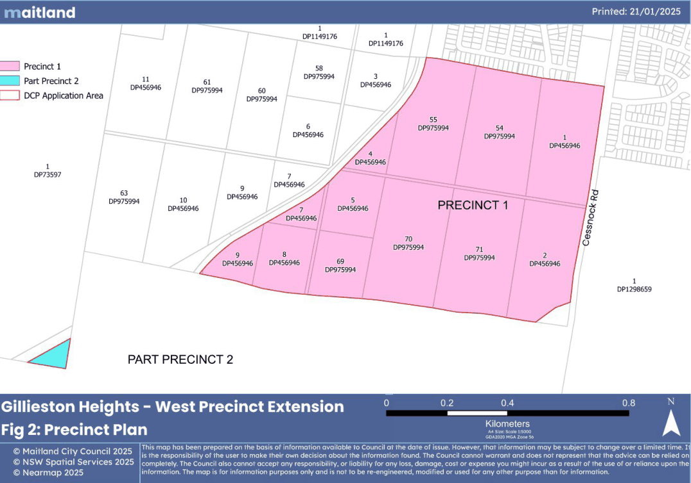
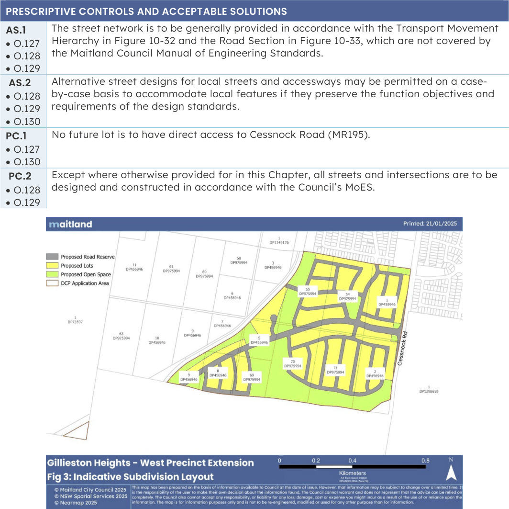
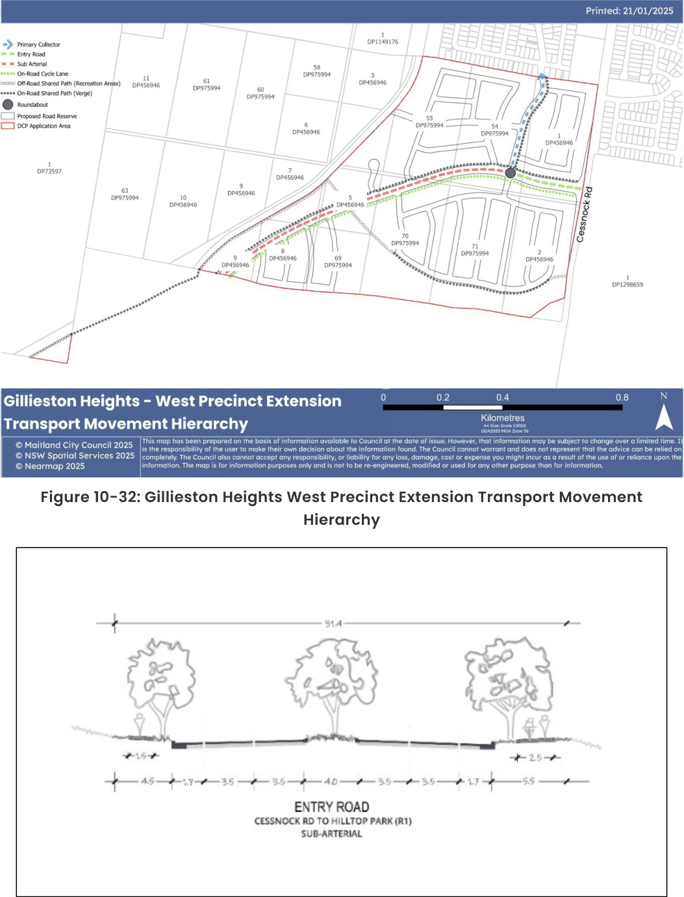
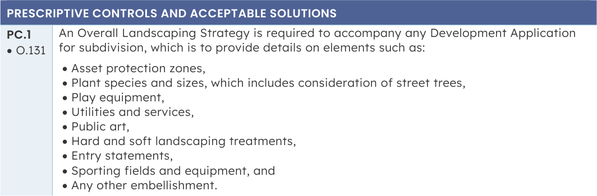

#### 10.4.3.13. Staging Plan

#### Objectives

O.126 To provide for the timely and efficient release of urban land making provision for necessary

infrastructure and sequencing.

#### PRESCRIPTIVE CONTROLS AND ACCEPTABLE SOLUTIONS PC.1

• O.126

Any Development Application prepared for subdivision will provide consideration (e.g. interconnecting roads) to the development of the overall precinct in which the subdivision is located as shown in Figure 10-30.

> [Picture on page 69: a picture, saved as a picture (images/ch-10-00-special-precincts-locality-plans-and-urban-release-page-69-16.gif, 150 dpi).]

#### Figure 10-30: Gillieston Heights Western Precinct Extension Staging Plan

#### Objectives

O.127 To provide a hierarchy of interconnected streets that gives safe, convenient, and clear access.

O.128 To ensure that the hierarchy of street is clearly discernible through variations in the carriageway

width, on-street parking, street tree planting, and pedestrian amenities.

O.129 To ensure sufficient carriageway and verge widths are provided to allow streets to perform their

designated functions within the street network and to accommodate public utilizes, drainage systems and the majority of Asset Protection Zones.

O.130 To encourage the use of streets by pedestrians and cyclists and to allow cars, buses, and other users

to proceed safely without unacceptable inconvenience or delay.

> [Picture on page 70: a picture, saved as a picture (images/ch-10-00-special-precincts-locality-plans-and-urban-release-page-70-10.gif, 150 dpi).]
> Words printed on the picture (title and legend, copied from the PDF):
> • O.127
> • O.128
> • O.129
> • O.128
> • O.129
> • O.130
> • O.127
> • O.130
> • O.128
> • O.129

#### PRESCRIPTIVE CONTROLS AND ACCEPTABLE SOLUTIONS

The street network is to be generally provided in accordance with the Transport Movement Hierarchy in Figure 10-32 and the Road Section in Figure 10-33, which are not covered by the Maitland Council Manual of Engineering Standards.

#### AS.1

Alternative street designs for local streets and accessways may be permitted on a case-by-case basis to accommodate local features if they preserve the function objectives and requirements of the design standards.

#### AS.2

No future lot is to have direct access to Cessnock Road (MR195).

#### PC.1

Except where otherwise provided for in this Chapter, all streets and intersections are to be designed and constructed in accordance with the Council’s MoES.

#### PC.2

Figure 10-31: Gillieston Heights West Precinct Extension Indicative Subdivision Layout

> [Picture on page 71: a picture, saved as a picture (images/ch-10-00-special-precincts-locality-plans-and-urban-release-page-71-1.gif, 150 dpi).]

#### Figure 10-32: Gillieston Heights West Precinct Extension Transport Movement

#### Hierarchy

#### Figure 10-33: Road Section for Cessnock Road to Hilltop Park

#### Objectives

O.131 To provide landscaping appropriate to the nature and scale of development that enhances the local

character and streetscape, supports retention and regeneration of ecological corridors, and provides visual interest and a suitable backdrop to the built form.

> [Picture on page 72: a picture, saved as a picture (images/ch-10-00-special-precincts-locality-plans-and-urban-release-page-72-5.gif, 150 dpi).]
> Words printed on the picture (title and legend, copied from the PDF):
> • O.131
> • Play equipment,
> • Utilities and services,
> • Public art,
> • Entry statements,
> • Any other embellishment.

#### PRESCRIPTIVE CONTROLS AND ACCEPTABLE SOLUTIONS

An Overall Landscaping Strategy is required to accompany any Development Application for subdivision, which is to provide details on elements such as:

#### PC.1

• Asset protection zones,

• Plant species and sizes, which includes consideration of street trees,

• Hard and soft landscaping treatments,

• Sporting fields and equipment, and
