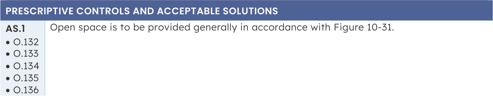

#### 10.4.3.16. Passive and Active Recreation Areas

#### Objectives

O.132 To provide public open space that meets the recreational needs of residents.

O.133 To provide an equitable distribution of public open space and recreation opportunities.

O.134 To ensure good quality of design and embellishment of the public domain.

O.135 To ensure environmentally and visually sensitive land contributes to the landscape character of the

precinct.

O.136 To ensure that public domain elements contribute to a consistent street character.

> [Picture on page 72: a picture, saved as a picture (images/ch-10-00-special-precincts-locality-plans-and-urban-release-page-72-22.gif, 150 dpi).]
> Words printed on the picture (title and legend, copied from the PDF):
> • O.132
> • O.133
> • O.134
> • O.135
> • O.136

#### PRESCRIPTIVE CONTROLS AND ACCEPTABLE SOLUTIONS

Open space is to be provided generally in accordance with Figure 10-31.

#### AS.1
