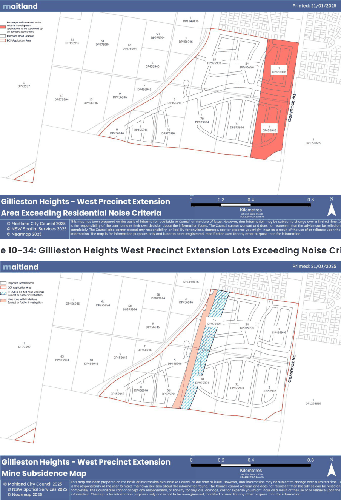

#### 10.4.3.18. Key Development Sites

#### Land fronting Cessnock Road and South Maitland Railway Objectives

O.141 To minimise risk to human health from noise at the time of subdivision.

| PRESCRIPTIVE CONTROLS AND ACCEPTABLE SOLUTIONS |  |
|---|---|
| PC.1 • O.141 | An acoustic assessment is required to accompany development applications for subdivision to demonstrate if any mitigation measures will be required for those lots in proximity to the South Maitland Railway Line and Cessnock Road as identified by Figure 10-34. The assessment is to be undertaken by a suitability qualified acoustic consultant to ensure that the properties are designed and constructed in accordance with Development near Rail Corridors and Busy Roads – Interim Guideline (NSW Department of Planning, 2008) to achieve acceptable internal noise amenity, regarding the external noise exposure levels. |
| PC.2 | Any proposed fencing is to be located on private land and not on public land. |
| • O.141 |  |
| AS.1 | Subdivision in proximity to the South Maitland Railway Line may result in the need for the construction of security fencing to restrict access and improve safety. |
| • O.141 |  |

#### Mine Subsidence – Old Mine Workings Objectives

O.142 To minimise risk to property arising from development on land with potential mine subsidence

issues.

O.143 To ensure that potential mine subsidence issues are adequately addressed at the subdivision stages.

O.144 To provide consideration to the relevant NSW Government Subsidence Advisory Development

Guidelines.

| PRESCRIPTIVE CONTROLS AND ACCEPTABLE SOLUTIONS |  |
|---|---|
| PC.1 • O.142 • O.143 • O.144 | Areas of potential mine subsidence are shown on Figure 10-35. From this, it is understood that the following lots are affected: • Lot 3, DP 456946 • Lot 55, DP 975994 • Lot, 4, DP 456946 • Lot 69, DP 975994 • Lot 5, DP 456946 • Lot 70, DP 975994 • Lot 1, DP 1206034 Prior to any Development Application for Subdivision within the mine workings or mine zone with limitations as identified by Figure 10-35, an applicant will undertake further geotechnical assessment to assess the suitability of this land for the development. |

> [Picture on page 74: a picture, saved as a picture (images/ch-10-00-special-precincts-locality-plans-and-urban-release-page-74-1.gif, 150 dpi).]

Figure 10-34: Gillieston Heights West Precinct Extension Lots Exceeding Noise Criteria

#### Figure 10-35: Gillieston Heights West Precinct Extension Mine Subsidence Map
