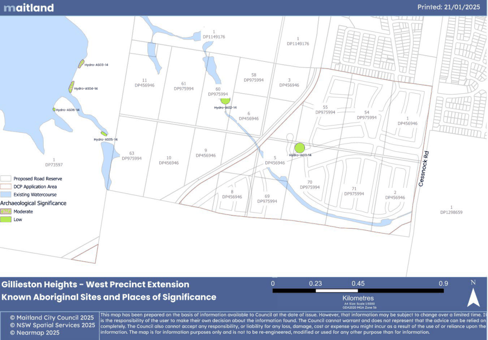

#### 10.4.3.19. Archaeological Significance

#### Objectives

O.145 To require further investigation of Aboriginal archaeological identified as significant on lands to be

developed for urban purposes.

O.146 To ensure that any Aboriginal significance is appropriately incorporated into the development of the

precinct.

| PRESCRIPTIVE CONTROLS AND ACCEPTABLE SOLUTIONS |  |
|---|---|
| PC.1 | Known Aboriginal Archaeological Sites are shown on Figure 10-36. An Aboriginal Heritage Impact Permit (AHIP) issued under Part 6 of the National Parks and Wildlife Act 1974 (NPW Act 1974) is required for any works which affect these sites. |
| • O.145 |  |
| • O.146 |  |
| PC.2 • O.145 • O.146 | Areas of high archaeological sensitivity warrant a full Aboriginal Cultural Heritage Assessment (ACHA) prior to any development works. If impacts to any Aboriginal objects identified through these assessments cannot be avoided, an AHIP issued under Part 6 of the National Parks and Wildlife Act 1974 (NPW Act 1974) will be required. Consultation with relevant Aboriginal persons and organisations’ is required under Biodiversity Conservation Division (BCD) policy when an application for an AHIP is considered and should be conducted in accordance with BCD Aboriginal Cultural Heritage Consultation Requirements for Proponents. |
| PC.3 • O.145 • O.146 | Areas of low archaeological sensitivity warrant an Aboriginal archaeological due diligence assessment prior to any development works. This assessment is to be conducted in accordance with BCD Due Diligence Code of Practice for the protection of Aboriginal Objects in New South Wales. Visual inspections undertaken for the purposes of a due diligence assessment should include an Aboriginal community representative. Depending on the results of the due diligence assessment undertaken, a full Aboriginal cultural heritage assessment may be required. Note: Areas of nil archaeological sensitivity do not contain any known Aboriginal heritage constraints. However, Aboriginal objects may still occur in these areas. If any Aboriginal objects are encountered during development, and impacts cannot be avoided, an AHIP issued under Park 6 of the NPW Act 1974 will be required. |

> [Picture on page 76: a picture, saved as a picture (images/ch-10-00-special-precincts-locality-plans-and-urban-release-page-76-1.gif, 150 dpi).]

#### Figure 10-36: Gillieston Heights West Precinct Extension Known Aboriginal

#### Archaeological Sites
