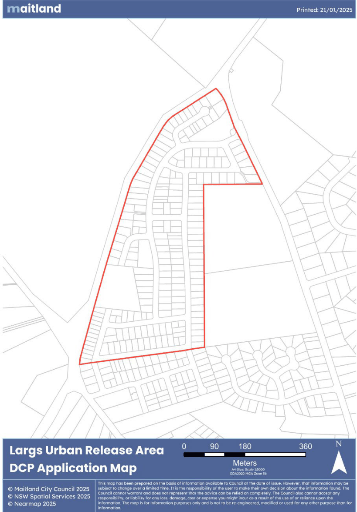
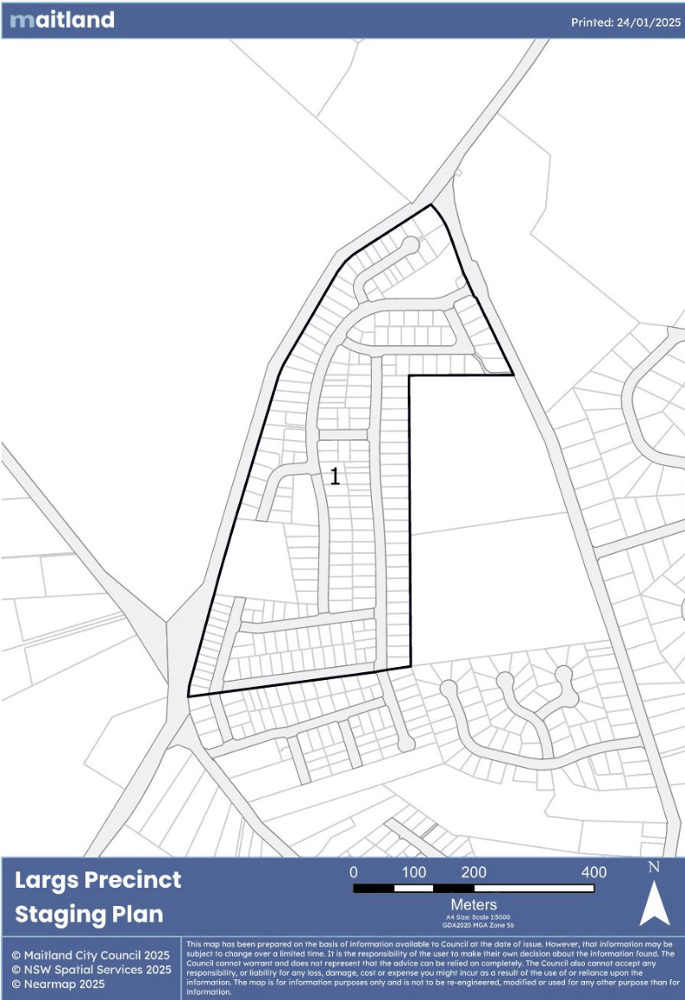
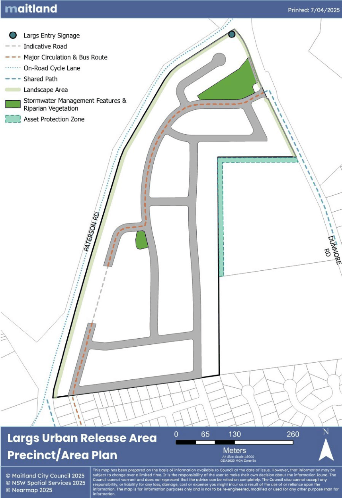

#### 10.4.4. Largs Urban Release Area

> [Picture on page 77: a picture, saved as a picture (images/ch-10-00-special-precincts-locality-plans-and-urban-release-page-77-2.gif, 150 dpi).]

#### Figure 10-37 Largs Urban Release Area

The Largs Urban Release Area will be developed as a residential area with a range of lot sizes that reflect the constraints of the site. Individual lots will generally accommodate one and two storey dwellings. Multi dwelling housing or dual occupancy proposals should ensure that potential impacts to privacy, solar access, visual amenity, traffic management and its suitability in relation to the form of adjoining development have been considered.

A high value will be placed on retaining existing vegetation, where public safety is not at risk, and the establishment of additional landscaping will enhance the visual appearance of the area from surrounding urban and rural vantage points. An overall Area/Precinct Plan has been prepared for this Urban Release Area, as the area is relatively compact in relation to other sites.

> [Picture on page 78: a picture, saved as a picture (images/ch-10-00-special-precincts-locality-plans-and-urban-release-page-78-6.gif, 150 dpi).]

#### Staging Plan

#### Figure 10-38: Largs Urban Release Area Staging Plan

#### Area/Precinct Plan

The Largs Urban Release Area is made up of one precinct, which utilises the general provisions of this

> [Picture on page 79: a picture, saved as a picture (images/ch-10-00-special-precincts-locality-plans-and-urban-release-page-79-3.gif, 150 dpi).]

section.

#### Figure 10-39: Largs Urban Release Area Precinct/Area Plan

### Development Controls – General Provisions

No specific requirements have been made for the following matters within the General Provisions for the Largs Urban Release Area as they are already adequately addressed by other relevant provisions within the Maitland Local Environmental Plan 2011 and the Maitland Development Control Plan 2026:

• Passive and Active Recreation Areas

• Residential Densities

• Neighbourhood Commercial and Retail Uses

• Provision of Public Facilities and Services
