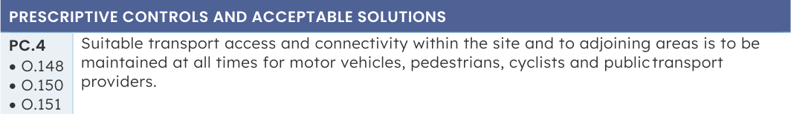

#### 10.4.4.2. Transport Movement Hierarchy

#### Objectives

O.148 To achieve a simple and safe movement system for private vehicles, public transport, pedestrians

and cyclists.

O.149 To provide walkable neighbourhoods with convenient access to neighbourhood shops, community

facilities and other services, with less dependence on cars for travel.

O.150 To provide for access generally by way of an interconnected network of streets and paths which

facilitate safe, efficient and pleasant walking, cycling and driving.

O.151 To facilitate new development which supports the efficiency of public transport systems, and

provides safe, direct access to the system for residents.

| PRESCRIPTIVE CONTROLS AND ACCEPTABLE SOLUTIONS |  |
|---|---|
| PC.1 | Road layout and street design is to be consistent with Figure 10-39and following detailed survey and subdivision planning. |
| • O.148 |  |
| • O.149 |  |
| • O.150 |  |
| • O.151 |  |
| PC.2 | No lot or development is to have direct access to Paterson Road either via an intersection or driveway access from new residential allotments. |
| • O.148 |  |
| • O.150 |  |
| AS.1 | Road design is to take into account the stormwater management strategy and ensure that there will be satisfactory driveway access to new allotments, at a grade less than the maximum provided for in Council’s MoES. |
| • O.148 |  |
| • O.150 |  |
| AS.2 | The transport movement hierarchy should generally be in accordance with the major circulation route, cycleways and shared paths shown on the Precinct Plan. |
| • O.148 |  |
| • O.149 |  |
| • O.150 |  |
| PC.3 | Provision must be made for a continuous bus route through the area. The bus route shall have a minimum road reserve of 18m and carriageway of 9m. |
| • O.148 |  |
| • O.151 |  |

> [Picture on page 81: a picture, saved as a picture (images/ch-10-00-special-precincts-locality-plans-and-urban-release-page-81-1.gif, 150 dpi).]
> Words printed on the picture (title and legend, copied from the PDF):
> providers.
> • O.148
> • O.150
> • O.151

#### PRESCRIPTIVE CONTROLS AND ACCEPTABLE SOLUTIONS

Suitable transport access and connectivity within the site and to adjoining areas is to be maintained at all times for motor vehicles, pedestrians, cyclists and public transport

#### PC.4
