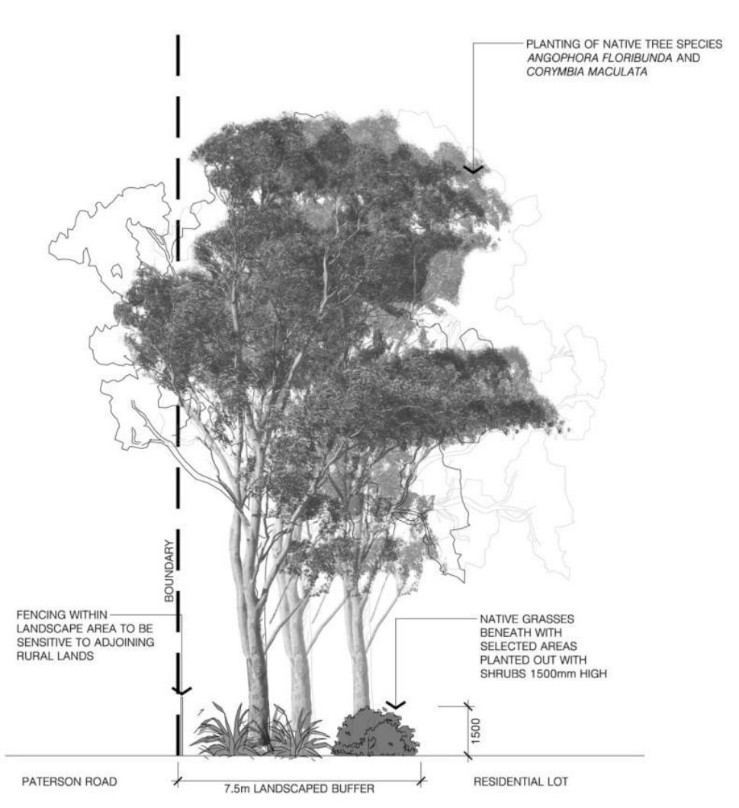

#### 10.4.4.3. Overall Landscaping Strategy

#### Objectives

O.152 To soften the visual impact of all built elements, creating attractive and consistent streetscapes

when viewed by passing traffic and pedestrians.

O.153 To ensure key environmental areas such as waterways, vegetation, land resources, and areas of

cultural significance and scenic value are protected.

O.154 To provide landscaping appropriate to the nature and scale of development that enhances the local

character and streetscape, supports retention and regeneration of ecological corridors and provides visual interest and a suitable backdrop to the built form.

| PRESCRIPTIVE CONTROLS AND ACCEPTABLE SOLUTIONS |  |
|---|---|
| PC.1 | Detailed landscaping plans are to be submitted with all development applications for subdivision. |
| • O.152 |  |
| • O.154 |  |
| PC.2 | Plantings to achieve visual amenity and landscaping objectives are to be protected via mechanisms such as protective covenants, urban design (building setbacks, road reserves) or other options to the satisfaction of Council. |
| • O.153 |  |
| • O.154 |  |
| AS.1 | Landscaping and visual amenity provisions should complement acoustic and bushfire hazard treatments. |
| • O.152 |  |
| • O.154 |  |
| AS.2 | Lots fronting Paterson and Dunmore Roads immediately adjacent to, and up to 100m from, the Paterson and Dunmore Road intersection should be of sufficient size to provide for substantial setbacks to improve visual quality. |
| • O.152 |  |
| • O.153 |  |
| • O.154 |  |
| PC.3 | Existing vegetation is to be maintained and enhanced where possible, particularly within riparian areas and public spaces. |
| • O.153 |  |
| • O.154 |  |
| AS.3 | Gateway signage or gateway elements should be understated and refer to “Largs” rather than “Maitland” and be located at the intersection of Dunmore Road and Paterson Road. |
| • O.152 |  |
| • O.153 |  |
| • O.154 |  |
| AS.4 | Subdivision entry features should be separate from the Largs gateway element to avoid ambiguity. |
| • O.152 |  |
| • O.153 |  |
| • O.154 |  |
| PC.4 • O.152 • O.153 • O.154 | The landscaping area to Paterson Road is to be 7.5m wide and maintained within allotments via a protective covenant. This landscaping area shall include native ground covers and shrubs to a maximum height of 1.5m so as to not hide the development but improve visual amenity. The Planting Cross-Section diagram (Figure 10-40) shows a typical cross section of vegetation plantings for the site. |

| PRESCRIPTIVE CONTROLS AND ACCEPTABLE SOLUTIONS |  |
|---|---|
| PC.5 | The landscaping area to Dunmore Road is to include the retention of existing native trees as well as additional tree planting. Building setbacks must take into account tree plantings. |
| • O.152 |  |
| • O.153 |  |
| • O.154 |  |
| AS.5 | Fencing within the landscaping areas is to make a positive contribution to the visual appearance of development and not detract from the provision of landscaping. Fencing should also be sensitive to the adjoining rural lands. |
| • O.152 |  |
| • O.153 |  |
| • O.154 |  |

> [Picture on page 82: a picture, saved as a picture (images/ch-10-00-special-precincts-locality-plans-and-urban-release-page-82-2.gif, 150 dpi).]

#### Figure 10-40: Largs - Planting Cross Section

#### Objectives

O.155 To provide for an integrated and sustainable approach to the design and provision of open space

and urban water management.

O.156 To protect and enhance the water quality, water quantity and habitat value of downstream

waterways and environment.

O.157 To prevent erosion and run-off during site preparation, construction and the ongoing use of the land

to minimise cumulative impact on receiving waterways.

O.158 To ensure Stormwater Management facilities are located in accordance with the details provided on

the Precinct Plan, or an alternative co-ordinated stormwater strategy as approved by Council.

| PRESCRIPTIVE CONTROLS AND ACCEPTABLE SOLUTIONS |  |
|---|---|
| AS.1 | Stormwater and water quality management measures are to be provided generally in accordance with Figure 10-39. |
| • O.155 |  |
| • O.156 |  |
| • O.158 |  |
| PC.1 | Rainwater tanks are not to be considered in the calculations for stormwater detention purposes. |
| • O.155 |  |
| • O.156 |  |
| PC.2 | Adequate stormwater management measures are to be provided at all times during the sequenced release of land. |
| • O.156 |  |
| • O.157 |  |
| PC.3 | All development applications are required to demonstrate that there will be no detrimental impact on downstream waterways, wetland environments or agricultural productivity as a result of new development. |
| • O.155 |  |
| • O.156 |  |
| • O.157 |  |
| • O.158 |  |
