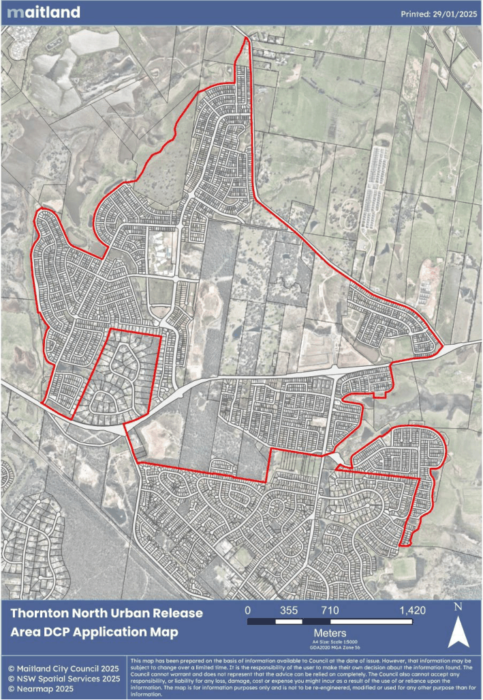
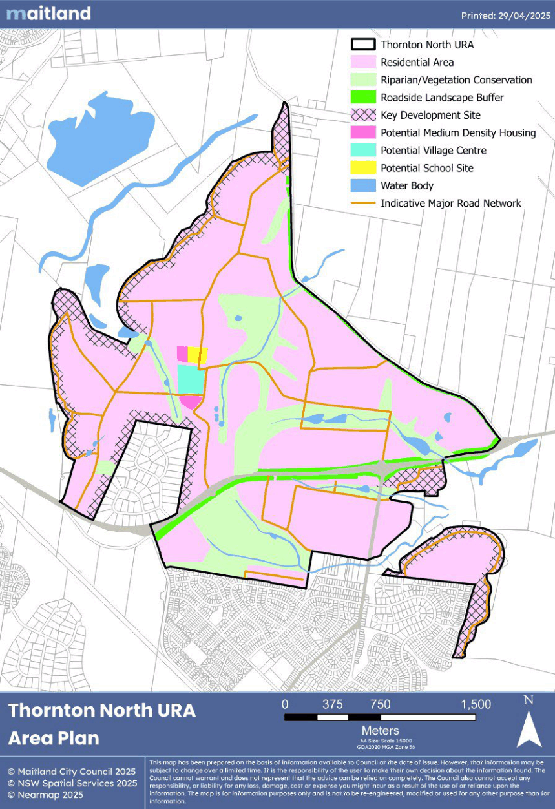
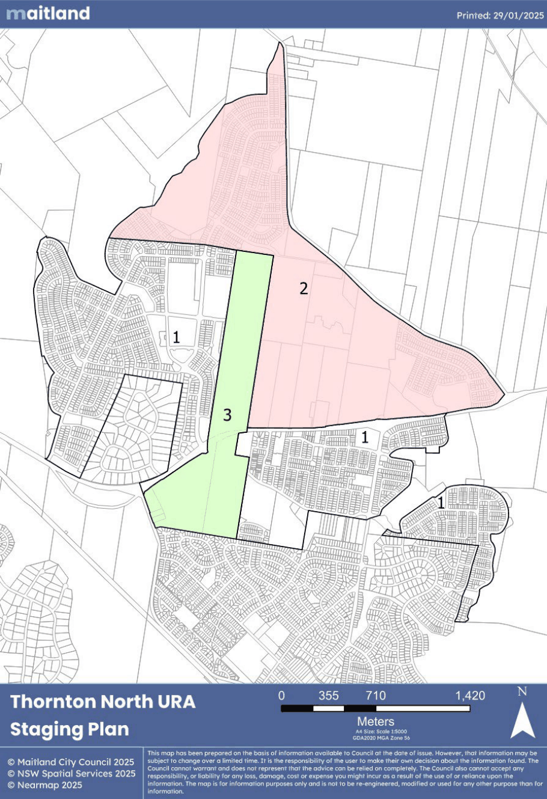
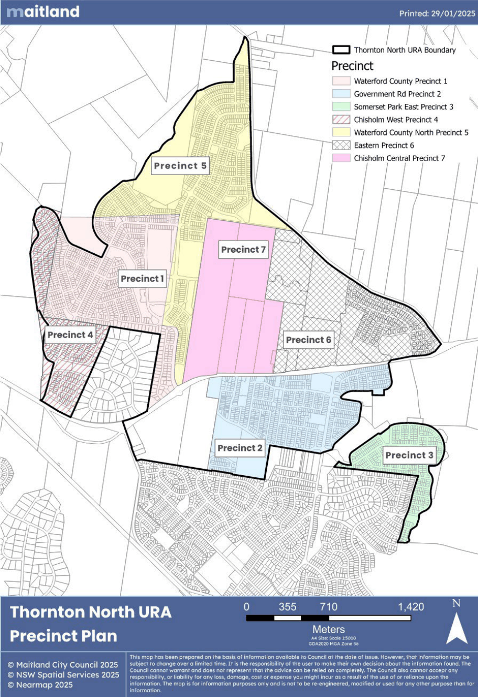

#### 10.4.5. Thornton North Urban Release Area

> [Picture on page 85: a picture, saved as a picture (images/ch-10-00-special-precincts-locality-plans-and-urban-release-page-85-2.gif, 150 dpi).]

#### Figure 10-41: Thornton North Urban Release Area

The Thornton North Urban Release Area comprises a total of 900 hectares of land, with an approximate residential yield of 5,000 lots. The Hunter Regional Plan 2041 (NSW Department of Planning, 2022) identifies the Thornton North URA as part of the Hunter Urban Development Program and is a key site to achieve the dwelling targets for population growth in the Lower Hunter. The proximity of the Thornton North URA to regional transport systems, including the rail corridor, the

M1 Motorway and the New England Highway is fundamental to the identification of this area for urban development. A significant balance of the residential zoned land has now been developed into the suburb of Chisholm and also as a prominent urban extension to the well-established area of Thornton. A Structure Plan and associated Infrastructure Plans (including a specific Section 7.11 Contributions Plan, Thornton North Infrastructure Contributions Plan 2008) have been prepared for this URA.

#### Thornton North Area Plan

The Thornton North Area Plan is comprised of precinct plans as shown in Figure 10-44. The provisions of this section apply to the preparation of precincts plans for and staging of the Thornton North URA.

> [Picture on page 86: a picture, saved as a picture (images/ch-10-00-special-precincts-locality-plans-and-urban-release-page-86-4.gif, 150 dpi).]

#### Figure 10-42: Thornton North Area Plan

> [Picture on page 87: a picture, saved as a picture (images/ch-10-00-special-precincts-locality-plans-and-urban-release-page-87-1.gif, 150 dpi).]

#### Figure 10-43: Thornton North URA Staging Plan

> [Picture on page 88: a picture, saved as a picture (images/ch-10-00-special-precincts-locality-plans-and-urban-release-page-88-1.gif, 150 dpi).]

#### Figure 10-44: Thornton North URA Precinct Plan

No specific requirements have been made for the following matters within the General Provisions for the Thornton North Urban Release Area as they are already adequately addressed by other relevant provisions within the Maitland Local Environmental Plan 2011 and the Maitland Development Control Plan 2026:

• Residential Densities

• Provision of Public Facilities and Services

• Neighbourhood Commercial and Retail Uses
