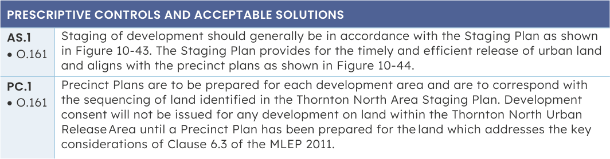

#### 10.4.5.1. Staging Plan

#### Objectives

O.161 To provide for the timely and efficient release of urban land making provision for necessary

infrastructure and sequencing.

> [Picture on page 89: a picture, saved as a picture (images/ch-10-00-special-precincts-locality-plans-and-urban-release-page-89-12.gif, 150 dpi).]
> Words printed on the picture (title and legend, copied from the PDF):
> • O.161
> • O.161

#### PRESCRIPTIVE CONTROLS AND ACCEPTABLE SOLUTIONS AS.1

Staging of development should generally be in accordance with the Staging Plan as shown in Figure 10-43. The Staging Plan provides for the timely and efficient release of urban land and aligns with the precinct plans as shown in Figure 10-44.

#### PC.1

Precinct Plans are to be prepared for each development area and are to correspond with the sequencing of land identified in the Thornton North Area Staging Plan. Development consent will not be issued for any development on land within the Thornton North Urban Release Area until a Precinct Plan has been prepared for the land which addresses the key considerations of Clause 6.3 of the MLEP 2011.
