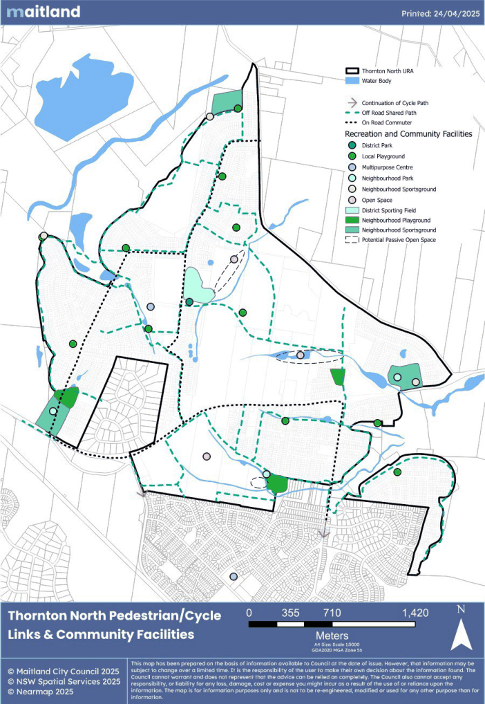
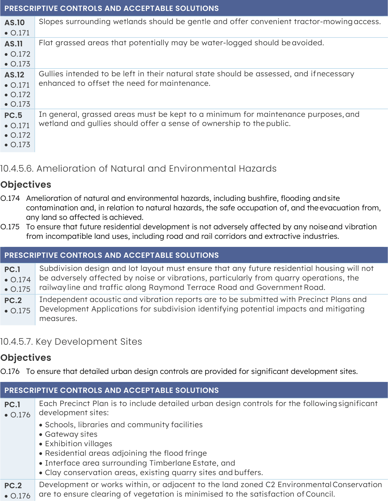

#### 10.4.5.3. Overall Landscaping Strategy

#### Objectives

O.166 To soften the visual impact of all built elements, creating attractive and consistent streetscapes

when viewed by passing traffic and pedestrians.

O.167 To ensure key environmental areas such as waterways, vegetation, land resources, and areas of

cultural significance and scenic value are protected.

O.168 To provide landscaping appropriate to the nature and scale of development that enhances the local

character and streetscape, supports retention and regeneration of ecological corridors and provides visual interest and a suitable backdrop to the built form.

| PRESCRIPTIVE CONTROLS AND ACCEPTABLE SOLUTIONS |  |
|---|---|
| PC.1 | Landscaping will be required on land adjacent to major intersections, all collector roads, the main north/south Boulevard, Raymond Terrace Road and Government Road. |
| • O.166 |  |
| • O.168 |  |
| PC.2 | The overall landscaping strategy is to provide for a minimum of 10m deep landscape buffering to Raymond Terrace Road, Government Road and Mcfarlanes Road (Figure 10- 42). |
| • O.166 |  |
| • O.168 |  |
| PC.3 | The overall landscaping strategy is to provide a minimum 5m deep landscape buffer adjoining Timberlane Estate, within the 15m ‘no development’ buffer. |
| • O.166 |  |
| • O.167 |  |
| • O.168 |  |
| PC.4 | The overall landscaping strategy is to provide extensive tree planting to the wetland edge, with visual breaks where streets terminate in views to the wetlands. |
| • O.166 |  |
| • O.167 |  |
| • O.168 |  |
| PC.5 | Subdivision and housing design is to take advantage of significant and attractive views overlooking the surrounding rural lands by orienting streets and locating public space to capture views. |
| • O.167 |  |
| • O.168 |  |

#### Objectives

O.169 Neighbourhoods are conveniently located open space areas that offer a range of recreational

opportunities for residents, accessible within walking distance from each residence.

O.170 To provide a safe and appropriate level of pedestrian and cycleway access linking new development

with established urban areas, parks and public transport, including a mix of on-road and off-road cycle routes.

#### PRESCRIPTIVE CONTROLS AND ACCEPTABLE SOLUTIONS

The network of passive and active recreational areas should be provided generally in accordance with Figure 10-45 and the associated Thornton North Infrastructure Contributions Plan 2008.

> [Picture on page 91: a picture, saved as a picture (images/ch-10-00-special-precincts-locality-plans-and-urban-release-page-91-11.gif, 150 dpi).]

#### AS.1

• O.169

• O.170

Figure 10-45: Thornton North URA Active Links, Recreation and Community Facilities

#### Objectives

O.171 To provide for an integrated and sustainable approach to the design and provision of open space

and urban water management.

O.172 To protect and enhance the water quality, water quantity and habitat value of downstream

waterways and environment.

O.173 To prevent erosion and run-off during site preparation, construction and the ongoing use of the land

to minimise cumulative impact on receiving waterways.

| PRESCRIPTIVE CONTROLS AND ACCEPTABLE SOLUTIONS |  |
|---|---|
| PC.1 | The stormwater and water quality management controls are to be consistent with the Thornton North Structure Plan in the use of Water Sensitive Urban Design (WSUD). |
| • O.171 |  |
| • O.172 |  |
| • O.173 |  |
| AS.1 | The number and location of WSUD elements should be determined by modelling to develop the WSUD strategy for the site and be integrated with the overall design. |
| • O.171 |  |
| • O.172 |  |
| AS.2 • O.171 | Parking areas can be located adjacent to WSUD elements where they are designed to prevent damage by vehicles. Bollards or castellated kerbs are required to allow distributed flow to WSUD elements. |
| PC.2 • O.171 | Long-term maintenance costs are to be identified in the design of the WSUD elements and are to be submitted to Council for consideration prior to acceptance of the WSUD strategy. |
| AS.3 | Swales may be acceptable where it can be demonstrated that they will meet Council’s performance and maintenance objectives and facilitate safe and effective movement of pedestrians and vehicles. |
| • O.171 |  |
| • O.172 |  |
| • O.173 |  |
| PC.3 | No change to the minimum width of roads on account of WSUD will be supported. |
| • O.171 |  |
| PC.4 | Flow control measures are to be used where grades in swales exceed 4%. |
| • O.171 |  |
| • O.172 |  |
| • O.173 |  |
| AS.4 • O.171 | Where practical, WSUD elements may be incorporated in a centre depressed median of dual carriage roads. |
| AS.5 • O.171 • O.172 | Wherever possible, existing natural drainage gullies should form part of a stormwater and runoff drainage management system incorporating detention basins and/ or wetlands to alleviate stormwater peaks and retain pollutants. |
| AS.6 | Wetlands should be well-designed creating an attractive and safe amenity and be highly visible for both adjoining residents and passers-by. |
| • O.171 |  |
| • O.172 |  |
| AS.7 | Walking paths should have frequent contact adjacent to the wetland edge. |
| • O.171 |  |
| AS.8 | Vegetation should be designed such that generous unobstructed view of the wetland is available. |
| • O.171 |  |
| • O.172 |  |
| AS.9 | Emergent macrophytes should be minimal and manageable. |
| • O.172 |  |
| • O.173 |  |

> [Picture on page 93: a picture, saved as a picture (images/ch-10-00-special-precincts-locality-plans-and-urban-release-page-93-1.gif, 150 dpi).]
> Words printed on the picture (title and legend, copied from the PDF):
> • O.171
> • O.172
> • O.173
> • O.171
> • O.172
> • O.173
> • O.171
> • O.172
> • O.173

#### PRESCRIPTIVE CONTROLS AND ACCEPTABLE SOLUTIONS

Slopes surrounding wetlands should be gentle and offer convenient tractor-mowing access.

#### AS.10

Flat grassed areas that potentially may be water-logged should be avoided.

#### AS.11

Gullies intended to be left in their natural state should be assessed, and if necessary enhanced to offset the need for maintenance.

#### AS.12

In general, grassed areas must be kept to a minimum for maintenance purposes, and wetland and gullies should offer a sense of ownership to the public.

#### PC.5
